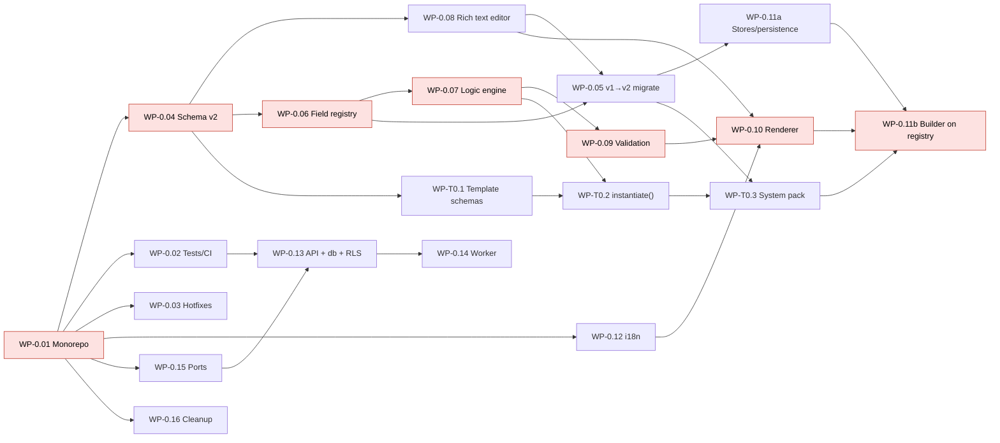
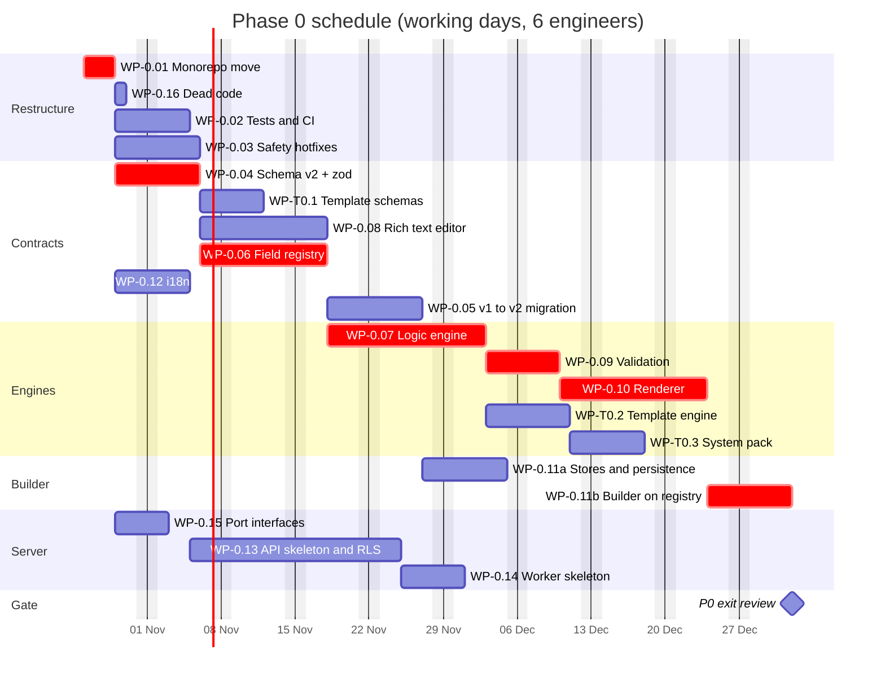
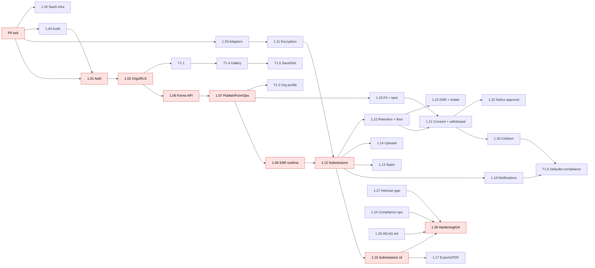
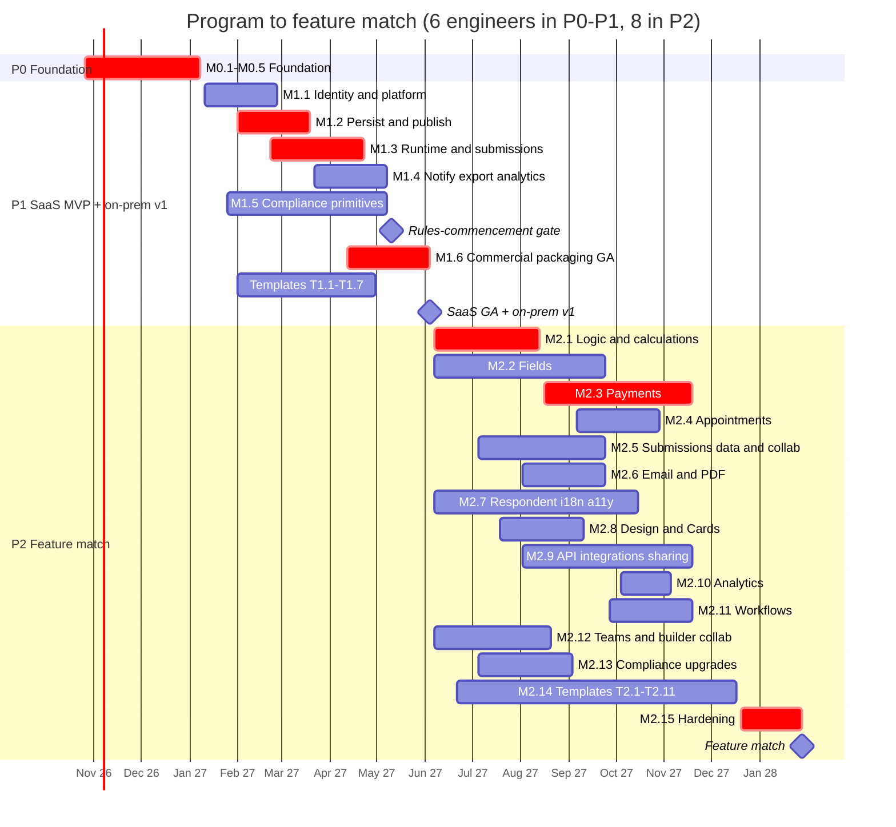

# fORM- delivery plan: from the current builder to JotForm feature match

**Status:** v1.1, revised after the compliance and feasibility reviews (`05-review-log.md`).
**Baseline:** commit `e1be409`. A single Vite 8 + React 19 app in `src/`, using npm (`package-lock.json`) and oxlint. No tests, no backend. `tsconfig.app.json` does not turn on `strict`.
**Target:** "Feature match" = all P0, P1 and P2 rows of the feature matrix shipped: **306 rows** (P0 46, P1 88, P2 172), including the template rows. Pointer rows (BLD-13, DSN-03, DSN-09) are not counted. The fixed decisions are not reopened.
**Inputs:** the codebase map (bug ids B*, S*), the feature matrix (`01`), the schema (`02`), the architecture (`03`) and the templates spec (`06`). Names, packages, tables and roles follow the architecture (ADR-0001): `@form/*` scope, `packages/registry`, `packages/ports` + `adapters`, `memberships`, `audit_log`, `fr_migrator`, Postgres 18.

---

## 0. Assumptions, units and team

### 0.1 Units and conventions
- **ed** = engineer-day. Planning capacity is **4 ed per engineer per week**.
- Each WP has a **Size** (ed, before buffer) and a **Parallel?** note.
- **WP ids:** `WP-0.xx`, `WP-1.xx`, `WP-2.xx` for platform and product work; `WP-T0.x`, `WP-T1.x`, `WP-T2.x` for templates (ids from the templates spec).
- **Size floor rule.** A WP's size must be at least the sum of the lower Cx bounds of the matrix rows it delivers (S = 1, M = 3, L = 11, XL = 31 ed). A CI script (`docs/tools/check-wp-sizes`) checks the §8 traceability against the matrix. Re-sizing in v1.1 brought payments, appointments, logic, audit, the logic engine, the renderer, connectors and encryption above their floors.
- **Definition of Done** for every WP, in addition to its acceptance criteria:
  - tests in CI; user-facing strings through `@form/i18n`; respondent UI passes axe;
  - every new table has RLS, appears in the isolation suite for **every actor kind**, and declares its erase/retain rule in the PII coverage manifest;
  - every operator-relevant state change, and every denied attempt, emits an audit event;
  - the edition check passes (saas / onprem / airgapped), with no outbound call unless allowed;
  - behind a flag until its milestone ships; a docs page exists.

### 0.2 Team

| Role | P0 | P1 | P2 | Focus |
|---|---|---|---|---|
| FE-1 (builder lead) | 1 | 1 | 1 | Builder, stores, registry views, rule builder |
| FE-2 (renderer and a11y) | 1 | 1 | 1 | Renderer, SSR runtime, embed SDK, WCAG |
| BE-1 (platform lead) | 1 | 1 | 1 | API, RLS, publish, submissions |
| BE-2 (data and compliance) | 1 | 1 | 1 | Logic, validation, encryption, DSR, retention |
| FS-1 (full-stack) | 1 | 1 | 1 | Templates, i18n, notifications |
| SRE/Sec-1 | 0.5–1 | 1 | 1 | CI, Helm, air-gapped bundle, SaaS infrastructure, SOC 2 evidence |
| FE/BE-3, BE-4 (payments, integrations) | – | – | 2 | Join at the start of P2 |
| Product designer | 0.5 | 1 | 1 | |
| QA / accessibility tester | 0.5 | 0.5 | 1 | |
| PM | 1 | 1 | 1 | |
| Legal counsel (DPDP, IT Act, CERT-In) | ad hoc | 0.3 | 0.2 | Consent, DSR, KYC, children's data, breach texts |
| Template author / content writer | – | 0.5 | 1 | Also manages the translation vendor |

**Engineers:** 6 in P0–P1, 8 in P2 (recommended). §6 gives 4- and 6-engineer variants.

### 0.3 Effort and calendar summary

| Phase | Raw ed | Buffer | Planned ed | 4 engineers | 6 engineers | 6 → 8 engineers (recommended) |
|---|---|---|---|---|---|---|
| P0 Foundation | 162 | +16 (10%) | 178 | ~12 wk | **~10 wk** (critical path) | 10 wk |
| P1 SaaS MVP + on-prem v1 | 464 | +46 (10%) | 510 | ~32 wk | **~21 wk** | 21 wk |
| P2 Feature match | 920 | +138 (15%) | 1,058 | ~66 wk | ~44 wk | **~33 wk** |
| **Total** | **1,546** | +200 | **1,746** | ~110 wk | ~75 wk | **~64 wk** |

**Calendar (recommended staffing):**
- P0: Mon 2026-10-26 → Fri 2027-01-08 (includes the year-end week).
- P1: 2027-01-11 → 2027-06-04: **SaaS GA and on-prem v1**. The DPDP Rules apply from about **13 May 2027**; the M1.5 gate on 2027-05-10 makes every commencement duty live before then for any tenant processing real data (design partners included).
- P2: 2027-06-07 → 2028-01-28 (includes the year-end week): **feature match**.

v1.0 planned 1,289 raw ed (P2 at 30 weeks). The increase comes from re-sizing to the Cx floors (+~170 ed in P2), moving DPDP commencement duties into P1, the SSR runtime, SaaS infrastructure, the audit redesign and the template-customisation additions.

---

## 1. Milestones

| Milestone | Window | Exit criterion |
|---|---|---|
| **M0.1 Monorepo green** | P0 W1 | `apps/builder` runs unchanged from the pnpm/Turborepo workspace; CI required on `main`; ADR-0001 merged |
| **M0.2 Safe builder** | P0 W2 | Interim fixes for S1–S4, B1/B2, B4, B12, B17–B19 merged with regression tests |
| **M0.3 Contracts frozen** | P0 W4 | `@form/schema` v2 + zod twins + `@form/registry` contract + rich-text AST + template schemas |
| **M0.4 Engines** | P0 W9 | `logic@2` compile/evaluate passing the cross-browser determinism corpus, page-scoped validation, `FormRenderer`, `instantiate()` |
| **M0.5 Builder on v2 + server skeletons** | P0 W10 | Builder edits v2 documents, persists to IndexedDB, previews through `@form/renderer`; API and worker skeletons pass RLS meta-tests including partitions and every actor kind |
| **M1.1 Identity and platform** | P1 W1–7 | Auth, orgs, roles incl. `data.route`, adapters, audit chain with denied events, SaaS infrastructure baseline |
| **M1.2 Persist and publish** | P1 W4–10 | Server drafts with CAS, immutable versions, FormOps, access control, org profile, notice approval |
| **M1.3 Runtime and submissions (design-partner alpha)** | P1 W7–15 | SSR runtime on the user-content domain, embeds, submissions stored, encrypted, purpose-filtered; inbox |
| **M1.4 Notify, export, analytics** | P1 W11–17 | Emails, exports, Chromium PDFs, webhooks with purpose gating, analytics |
| **M1.5 Compliance primitives + Rules-commencement gate** | P1 W3–18; **gate 2027-05-10** | PII tagging and taint, Consent block with full notice and language picker (en, hi), withdrawal, retention + statutory floor, DSR v1 + intake, children's data, breach and CERT-In tooling, platform-as-fiduciary, WCAG AA — all live for every tenant processing real data |
| **M1.6 Commercial, packaging, GA** | P1 W14–21 | Billing, Helm (external-DB profile), multi-hop air-gapped bundle, pen test → **SaaS GA + on-prem v1 (2027-06-04)** |
| **M2.1–M2.15** | P2 W1–34 | Domain tracks (§5), flagged, GA in the monthly release train |
| **FM (feature match)** | 2028-01-28 | All 306 P0–P2 rows shipped and traced (§8) |

---

## 2. Phase 0: Foundation (implementation-ready)

**Goal:** the builder works at every step and, at the end, edits **schema v2** documents through the **field registry**, previews through a **store-independent renderer** with **page-scoped, visibility-aware validation** and **safe rich text**. Packages are pure and isomorphic. The API and worker skeletons enforce RLS from the first table.

**Rules for the P0 sequence:**
1. WP-0.01 is a one-day code freeze; nothing else touches `src/` until it merges.
2. Later WPs change `apps/builder` in small PRs; the Playwright smoke test from WP-0.02 stays green on every PR.
3. **v1 code and v2 packages never change in the same PR.** The builder switches to v2 in WP-0.11a/b behind the `migrate()` adapter.

**P0 WP order (dependency order):** WP-0.01 → WP-0.16 → WP-0.02 → WP-0.03 → WP-0.04 → WP-0.12 → WP-0.15 → WP-T0.1 → WP-0.08 → WP-0.06 → WP-0.05 → WP-0.07 → WP-0.13 → WP-0.09 → WP-0.11a → WP-T0.2 → WP-0.14 → WP-0.10 → WP-T0.3 → WP-0.11b.

### WP-0.01: Monorepo restructure (pnpm + Turborepo); move `src/` to `apps/builder`
- **Goal:** the ADR-0001 layout with zero behaviour change and git history kept. **Rows:** FND-01.
- **Scope:** repo root, `apps/builder/**`, `pnpm-workspace.yaml`, `turbo.json`, `packages/tsconfig/**`, `.gitignore`, `README.md`, `docs/adr/0001-monorepo.md`.
- **Depends on:** none. **Size:** 3 ed. **Parallel?** No (critical-path start, one engineer + reviewer, `src/` frozen).

**Exact steps:**
1. **Preconditions.** Node 24 LTS (Vite 8 needs ≥ 20.19 / 22.12), `.nvmrc` = `24`, `corepack enable`, on Windows `git config core.longpaths true`. Branch `chore/monorepo`.
2. **Commit A — pure move, no content edits** (rename detection keeps history):
   ```sh
   rm -rf dist
   mkdir -p apps/builder
   git mv src index.html public vite.config.ts tsconfig.json tsconfig.app.json tsconfig.node.json apps/builder/
   git mv package.json apps/builder/package.json
   git rm package-lock.json
   git commit -m "chore: move builder app into apps/builder (no content changes)"
   ```
   `.oxlintrc.json` and `README.md` stay at the root.
3. **Commit B — workspace wiring:**
   - `pnpm-workspace.yaml`: `packages: ["apps/*", "packages/*"]` plus a `catalog:` for react, zod and typescript.
   - Root `package.json`:
     ```json
     {
       "name": "form-monorepo", "private": true, "type": "module",
       "packageManager": "pnpm@10.<x>.<y>",
       "engines": { "node": ">=24" },
       "scripts": {
         "dev": "turbo run dev --filter=@form/builder",
         "build": "turbo run build", "typecheck": "turbo run typecheck",
         "test": "turbo run test", "e2e": "turbo run e2e", "lint": "oxlint"
       },
       "devDependencies": { "turbo": "^2", "oxlint": "^1.81.0", "typescript": "~6.0.2" }
     }
     ```
   - `apps/builder/package.json`: `"name": "@form/builder"`, dependencies unchanged; scripts `dev: vite`, `build: tsc -b && vite build`, `typecheck: tsc -b`, `preview: vite preview`; remove its `lint` script.
   - `turbo.json`:
     ```json
     { "$schema": "https://turbo.build/schema.json",
       "tasks": {
         "build":     { "dependsOn": ["^build"], "outputs": ["dist/**"] },
         "typecheck": { "dependsOn": ["^typecheck"] },
         "test":      { "dependsOn": ["^typecheck"], "outputs": ["coverage/**"] },
         "e2e":       { "dependsOn": ["build"] },
         "dev":       { "cache": false, "persistent": true } } }
     ```
   - `packages/tsconfig` (`@form/tsconfig`): `base.json` (current compiler options without `paths`/`include`) and `strict.json` (adds `strict`, `exactOptionalPropertyTypes`, `noUncheckedIndexedAccess`, `noImplicitOverride`, `isolatedModules`). Packages extend `strict.json`; `apps/builder` keeps its config until WP-0.11b.
   - **Internal packages are source-only:** `"exports": { ".": "./src/index.ts" }`, `"type": "module"`, no build step. Vite, Vitest and `tsx` consume the TypeScript; production Node apps are bundled with **tsup** (WP-1.27).
   - `.turbo` in `.gitignore`. No path changes are needed.
4. **Install and verify:** `pnpm install` (allow build scripts only via `onlyBuiltDependencies`). Checks: `pnpm dev` serves `/builder/demo` (add a block via slash menu, preview, submit); `pnpm build` output within ±1% gzip of a pre-move build; `pnpm lint` and `pnpm typecheck` green; `git log --follow apps/builder/src/store/useFormStore.ts` reaches `e1be409`.
5. **README:** workspace map, prerequisites, commands. **ADR-0001:** the layout from architecture §1.1.

**Acceptance:** all step-4 checks pass; commit A contains only renames.

### WP-0.16: Dead code and copy cleanup
- **Rows:** FND-14. **Scope:** delete `App.css`, `assets/*`, `ui/sheet.tsx`, `DialogTrigger`/`DialogClose`, `Select` in `ui/input.tsx`, the `FieldIcon` export, `isInputBlock`, `canPairBeside`, `.success-burst`; remove competitor copy (`ThemeSettings.tsx:19`).
- **Depends on:** WP-0.01. **Acceptance:** no unused exports in touched files; build size does not grow. **Size:** 1 ed. **Parallel?** Yes.

### WP-0.02: Test harness, characterisation tests and CI
- **Goal:** a safety net before refactors. **Rows:** FND-11 (tests and CI).
- **Scope:** root `vitest.config.ts` (`test.projects`), per-package configs (`node` for packages, `jsdom` for renderer and builder); `apps/builder/e2e/**` (Playwright); `.github/workflows/ci.yml`; `CODEOWNERS` (two reviewers on `packages/logic`, `packages/db`, `packages/crypto`, `apps/api/src/authz`); PR template; `renovate.json`; `.dependency-cruiser.cjs`.
- **Dev dependencies:** `vitest`, `@vitest/coverage-v8`, `jsdom`, Testing Library (react, user-event, jest-dom), `fast-check`, `@playwright/test`, `@axe-core/playwright`, `dependency-cruiser`.
- **Steps:**
  1. Characterisation tests for `lib/{logic,zodFromBlocks,layout}.ts`; each confirmed bug (B1, B2, B4, B7, B8, B9, B13, B14, B15, B16, B17, B18, B19, B21) as `it.fails(...)`, flipped by its fixing WP.
  2. Playwright `smoke.spec.ts` (insert Short text → Preview → fill → Submit → thank-you) and `xss.spec.ts` (fails on any `dialog`; red until WP-0.03).
  3. CI jobs (Node 24, frozen lockfile, Turbo cache): `check` (lint, typecheck, test, build); `e2e` (Chromium); `deps` (dependency-cruiser layer rules from architecture §1.3); `security` (osv-scanner, gitleaks); `db` (added by WP-0.13); `determinism` (added by WP-0.07).
  4. Required checks on `main`; Renovate with `minimumReleaseAge: "14 days"`.
- **Depends on:** WP-0.01. **Acceptance:** CI < 10 min clean; failing tests block merge; importing `react` from `packages/schema` fails `deps`; coverage uploaded. **Size:** 5 ed. **Parallel?** Yes.

### WP-0.03: Interim safety and correctness hotfixes in the v1 builder
- **Goal:** remove critical exposures now; each fix is replaced by its v2 counterpart later. **Rows:** FND-09 (part), BLD-06, FND-11 (error boundary).

| Fix | Change | Replaced by |
|---|---|---|
| S1/S2 | DOMPurify (allowlist `b i u s a span br p`; `style` only `color`/`background-color`) at `RichText.tsx:40` and every `dangerouslySetInnerHTML` in `FormPreview.tsx:233-246` | WP-0.08 |
| S3 | `FormCanvas.tsx:134-135` escapes plain text before saving | WP-0.08 |
| S4 | `RichText.tsx:158-162` allows only `https:`, `http:`, `mailto:`, `tel:`; `rel="noopener noreferrer nofollow"` | WP-0.08 |
| S6 | Redirect only for `https?:`, same tab | WP-1.07 |
| B1/B2 | Next triggers only `idsOnCurrentPage ∩ visible`; schema from visible blocks only | WP-0.09 |
| B4/B5/B6 | Signature sent only with strokes; DPR scaling with ResizeObserver; Clear button; stable `onChange` | WP-0.10 |
| B12 | try/catch around `new RegExp`; `ErrorBoundary` around preview and canvas | WP-0.09 |
| B17 | zundo `partialize` + `equality: (a, b) => a.form === b.form` | WP-0.11a |
| B18 | Remove global `pauseForTyping`; throttle per call site | WP-0.11a |
| B19 | Immutable updates in `reorderBlocks` / `placeBeside` | WP-0.11a |
| B22 | Guard redo while typing | WP-0.11a |
| B28 | Clamp `ratingMax` 1–10, scale 2–10 | registry |

- **Depends on:** WP-0.01, WP-0.02. **Acceptance:** `xss.spec.ts` green in builder and preview; related `it.fails` flipped; a 3-page form with a required field on page 3 advances from page 1; a required empty signature blocks submit; 10 block-select clicks add no history entries; invalid pattern `[` shows an inline error. **Size:** 6 ed. **Parallel?** Yes.

### WP-0.04: `packages/schema`: v2 types, zod twins, V1 namespace, structural validation
- **Goal:** freeze the contract. **Rows:** FND-02, FND-07 (types).
- **Scope:** `packages/schema/` (`@form/schema`; deps `zod@^4`, `canonicalize` (RFC 8785), `@noble/hashes`).
- **Steps:**
  1. Copy the verified `v2.ts` (schema doc §2) and split it by section into `src/v2/*.ts`; re-export from `src/index.ts`. Move the negative checks to `test/types.negative.test-d.ts`.
  2. Zod twins in `src/v2/zod/*.ts`: ids via `z.custom<BlockId>(isOpaqueId)`; recursive `RichDoc`/`InlineDoc` via `z.lazy` with node-count and depth limits; `z.discriminatedUnion` everywhere; **every object twin is strict** (`z.strictObject`: unknown keys are rejected, never stripped; ADR-0002 §1). **The `RichDoc`/`InlineDoc` types and validators ship here**, so the registry does not wait for the TipTap editor.
  3. Equality tests `expectTypeOf<z.infer<typeof X>>().toEqualTypeOf<X>()` for every export; a script fails on any export without a twin.
  4. `src/v1.ts`: V1 types + lenient `parseV1`.
  5. `src/validate/structure.ts`: `validateStructure(def)` for I1, I3, I4, I5/I6 (rich-text validator), I7, I12, I14.
  6. `src/hash.ts`: `contentHash(x) = sha256(JCS(x))`, isomorphic, synchronous.
  7. **Decision gate (end of W2):** D1 money = `MinorUnits` string; freeze the twins.
- **Depends on:** WP-0.01. **Acceptance:** `tsc` strict + `exactOptionalPropertyTypes` + `noUnusedLocals` clean; the 5 negative checks still fail; 0 twin gaps; fast-check `parse(JSON.parse(JSON.stringify(x))) ≡ x` for `Block`, `FormDefinition`, `TemplateVersionPayload`; no React/DOM imports. **Size:** 10 ed. **Parallel?** Two engineers by section.

### WP-0.12: `packages/i18n`: ICU framework, `en-IN`, formatting
- **Rows:** FND-12. **Scope:** `createI18n(locale, catalogs)` on `intl-messageformat`; number (lakh/crore), `DatePattern` and currency formatters; catalogues `locales/en-IN/{renderer,builder,system}.json`; pseudo-locale `en-XA`; `pnpm i18n:extract`; **a pinned grapheme segmenter** (`unicode-segmenter`, pinned exactly) exported for `logic` and `validation`. **Latin digits in every locale** (native digits are a later per-locale option; ADR-0002 §6).
- **Depends on:** WP-0.01. **Acceptance:** every `SYSTEM_MESSAGE_KEYS` entry exists in `en-IN` (the test imports the constant from `@form/schema`, a devDependency; no hand copy); `format(1234567.89)` → `12,34,567.89`; dates `DD-MM-YYYY`; no unwrapped renderer text under `en-XA`; segmenter results identical in Node, Chromium, Firefox and WebKit on an Indic corpus. **Size:** 5 ed. **Parallel?** Yes.

### WP-0.15: Port interfaces, job contracts and edition config
- **Rows:** FND-17 (interfaces), FND-19 (shape).
- **Scope:** `packages/ports/src/{storage,mailer,kms,search,captcha,scan,geoip,guardian,audit-sink,egress,queue}.ts` (interfaces + the `JobData` map); contract suites in `packages/testkit` (`runStorageContract(impl)` …); dev implementations in `packages/adapters` (filesystem storage, SMTP to Mailpit, local-keyfile KMS, no-op scanner, manual guardian verifier); `@form/config` edition schema (`DEPLOYMENT_MODE`, `EGRESS_POLICY`, internet features off when `none`).
- **Depends on:** WP-0.01. **Acceptance:** dev implementations pass their contracts; air-gapped config rejects `integration:*` and third-party captcha. **Size:** 3 ed. **Parallel?** Yes.

### WP-T0.1: Template payload schemas (TPL-01)
- **Scope:** `packages/schema/src/v2/templates.ts` + twins: the 7 kinds, `TemplateVariable`, `LockSpec`, `TemplateRef`, `TemplateForkBinding`, `var` node, `Origin`, `FormpackManifest`, `migrate()` hooks.
- **Depends on:** WP-0.04. **Acceptance:** `_kindsOk` holds; round-trips pass; a literal email recipient fails type-check and parse; the 5 current templates (after WP-0.05) validate. **Size:** 4 ed. **Parallel?** Yes.

### WP-0.08: Rich text as a constrained AST (TipTap) with safe rendering
- **Goal:** remove every HTML sink. **Rows:** FND-08, BLD-03, PROP-01 (label), S1–S4.
- **Scope:**
  - `packages/schema/src/richtext/`: `fromHtml.ts` (v1 HTML → AST via `htmlparser2` allowlist, never executes; `<font>`/`<span style=color>` → `textColor`), `toPlain.ts`, `normalize.ts`.
  - `packages/renderer/src/richtext/RichTextView.tsx`: node switch to React elements; link `rel`/`target` added at render; `pipe` and `var` through a resolver prop.
  - `apps/builder/src/components/editor/{InlineEditor,RichEditor}.tsx`: TipTap 3 with Link (`isAllowedUri`), TextStyle/Color/Highlight limited to tokens + palette; reserved `pipe` and `var` extensions; paste keeps only allowlisted marks.
  - Delete `RichText.tsx` and the DOMPurify shim.
- **Depends on:** WP-0.04. **Acceptance:** ≥ 150-payload XSS corpus → zero `on*` attributes, zero `javascript:` hrefs, no `dialog`; CI grep for `innerHTML|dangerouslySetInnerHTML|execCommand` finds 0; editor ↔ AST round-trips stable on 50 fixtures; paste from Docs/Word keeps only bold, italic, underline, links, lists; copy and paste between builder editors keeps every allowed mark and node through the builder's own AST clipboard payload (`application/x-form-rich-text+json`), normalized and limit-checked again on paste (ADR-0002 §7). **Size:** 10 ed. **Parallel?** Yes (FE-2), alongside WP-0.06.

### WP-0.06: Field registry (FND-03) in `packages/registry`
- **Rows:** FND-03; FLD-01/02/07/09/10/11/20/21/22/23 and PROP-03/06/14/15 (registry port).
- **Scope:** `packages/registry/src/{define.ts, index.ts (REGISTRY: FieldRegistry), availability.ts, fields/<type>.ts}`.
  - **P0-available types**, fully implemented: `short_text`, `long_text`, `email`, `phone` (basic), `number`, `url`, `single_choice`, `multi_choice`, `date`, `time`, `rating`, `linear_scale`, `nps`, `ranking`, `file_upload`, `signature`, `hidden`, `heading`, `paragraph`, `divider`.
  - **Other types** via `defineStub(type, capability, defaultConfig)` for value types and `defineStubBlock(type, kind, capability, defaultConfig)` for plain blocks (real `configSchema` where specified, `palette: []`, availability P1/P2; `compile()` returns `missing_capability`). Capabilities without a named `Capability` use `x-field:<type>`; `DRAFT_DEFAULT_CONFIG_TYPES` lists the types whose default config is a draft the schema rejects (`repeating_group`). See schema §2.2 and ADR-0002 §2.
  - **Scalars:** `answerScalar(block, value, path)` is the one scalar contract; the per-type `toScalar` gets no block parameter.
  - Fixes: one answer shape per choice type (B25); unanswered NPS/scale absent (B7); ranking absent until interaction (B8); rating max 1–10 (B28); `disabled` + `required` lint (B27).
  - Default compliance: `email` personal/contact with `principalIdentifier: 'email'`; `phone` personal/contact; `signature` personal/identity; free text personal/free_text; `hidden` none (flagged for review).
- **Depends on:** WP-0.04 (types incl. `InlineDoc`). **Does not wait for WP-0.08.** **Acceptance:** the `FieldRegistry` mapped type compiles; table test per available type (default config parses, samples accepted, 5 invalid samples rejected each, `isEmpty` agrees with I9); operator matrix and export header snapshots; no React import. **Size:** 12 ed. **Parallel?** Two engineers by type family.

### WP-0.05: v1 → v2 migration and fixture corpus
- **Rows:** FND-02 (migration); data-level parts of B10, B15, B16, B21, B25–B28, S5–S7.
- **Scope:** `packages/schema/src/migrate/{index.ts, v1-to-v2.ts, notes.ts}` per schema §4.2 (`MigrationContext` injected); `test/fixtures/v1/`: the 5 templates + 30 hand-made v1 forms each exercising one of B1–B28 / S1–S7.
- **Depends on:** WP-0.04, WP-0.06, WP-0.08. **Acceptance:** golden output per fixture (seeded `idFactory`); idempotent; every output passes `validateDefinition(…,'save')`; expected `MigrationNote` codes; password only in `plaintextPasswordToHash`; show/hide parity with WP-0.07. **Size:** 8 ed. **Parallel?** Yes (FS-1).

### WP-0.07: `packages/logic`: `logic@2` compile and evaluate (v1-parity subset)
- **Rows:** FND-06; semantics of LOG-03/04; B21.
- **Scope:** `packages/logic/src/`: `cells.ts`; `compile.ts` (steps, reads, writes, **same-cell writer edges in authored order**, **`on_path` steps**); `plan.ts` (Kahn, ties by rule index then `documentOrder`); `cycles.ts` (paths, "conflicting writers" hint); `pageOrder.ts` (I8, **transitive**, incl. validation bounds); `taint.ts` (I13); `evaluate.ts`; `operators.ts`; `text.ts` (NFC + generated case-fold table, pinned grapheme length from `@form/i18n`); `decimal.ts` (**decimal.js full**, precision 34); `validateDefinition.ts`; `projectForRuntime.ts` (keeps `reads`, drops server rule steps); `trace.ts`.
- **P0 subset:** `ConditionGroup` and every comparison operator incl. dates; actions show, hide, require, unrequire, enable, disable; `Expr` limited to `lit`, `ref`, comparisons. Others compile to `missing_capability` until WP-2.01–2.03.
- **Contracts (ADR-0002 §2):** `compile()` treats every `missing_capability` issue as fatal (`{ ok: false }`), whether it comes from a registry stub's lint or from logic outside the P0 subset; answers are read only through `answerScalar(block, value, path)`.
- **Determinism harness:** the fixture corpus runs in Node and, via Playwright, in Chromium, Firefox and WebKit; CI job `determinism` diffs `EvalState` JSON byte-for-byte.
- **Depends on:** WP-0.06. **Acceptance:** v1 parity on 35 fixtures × 200 answer sets (except documented fixes); cross-engine determinism green; fuzzing shows `evaluate` never throws; cycles, conflicting writers and page-order violations reported with paths (golden test for the A/B/C writer case); 300-block/200-rule form evaluates < 5 ms p95 in Node, incremental < 1 ms; B21 flipped. **Size:** 20 ed. **Parallel?** BE-2 leads, BE-1 helps (pageOrder, taint, validateDefinition).

### WP-0.13: `apps/api` skeleton and `packages/db` with RLS from the first table
- **Rows:** FND-15, CMP-01 (foundation).
- **Scope:**
  - **`packages/db`:** Drizzle tables `orgs`, `users`, `memberships`, `forms`, `form_drafts`, `audit_pending`/`audit_log` (placeholders); roles `fr_migrator`, `fr_app` (`NOBYPASSRLS`), `fr_template_seeder`, `fr_system_agg`; null-safe helpers (`app_org()` …, `app_subject_ids()`); `withTenant()` with read-only/read-write modes; schema `parts` with no grants to `fr_app`; definer functions `list_user_orgs`, `membership_for`, `orgs_due_for`, `resolve_job_org`, `create_partitions`; RLS meta-tests (forced RLS on every `org_id` table, no grants on partitions, no raw `current_setting(` in policies).
  - **`apps/api`:** Fastify 5 `buildApp(config)`, fastify-type-provider-zod, helmet, cors, under-pressure, swagger; request context (dev header stub until WP-1.01); problem+json errors; pino with redaction **and query-string scrubbing**; OTel (OTLP only when configured); `/livez`, `/readyz` (incl. NTP offset check); `GET /v1/forms` as the RLS demo.
  - **Dev infrastructure:** `deploy/docker/compose.dev.yaml` (Postgres 18, SeaweedFS for the S3 API, dev and CI only (ADR-0002 §5), Mailpit, optional ClamAV, otel-lgtm).
  - **Testcontainers harness** and the CI `db` job.
- **Depends on:** WP-0.02, WP-0.15. **Acceptance:** `pnpm --filter @form/api dev` runs under `tsx watch`; isolation for user, API-key, system and respondent actors (no policy raises without a user id); direct `SELECT` on a partition as `fr_app` is denied; meta-test fails on a table without policy (negative test); OpenAPI JSON produced; `db` job < 3 min. **Size:** 14 ed. **Parallel?** Yes (BE-1), off the builder critical path.

### WP-0.09: `packages/validation`: per-page, visibility-aware, isomorphic
- **Rows:** FND-05, VAL-01, VAL-05, VAL-07, VAL-10, RSP-02.
- **Scope:** `normalize.ts` (I9); `validateAnswers(version, evalState, answers, { scope: page|submit, locale, today, messages })` validating only `required_eff`/`visible_eff` blocks in scope plus `submitBlocks`; `errors.ts` (zod issues → codes, `required` first; fixes B14); **regex through `re2js` on client and server** with a 256-char cap; no `FileList`, no DOM.
- **Depends on:** WP-0.07. **Acceptance:** table tests per type; property: no error outside `visible_eff` or the current page; B1, B2, B7, B8, B9, B13, B14 flipped; runs with `document` undefined; regex corpus (`\s` with NBSP, `\w` with Devanagari, `i` with non-ASCII) gives identical verdicts in all engines; every code has an `en-IN` message. **Size:** 7 ed. **Parallel?** On the critical path.

### WP-0.11a: Builder state: document and UI stores, command layer, local persistence, routing
- **Rows:** FND-10, BLD-05, BLD-06, BLD-11 (URL sync); B17–B23.
- **Scope:** `apps/builder/src/state/`: `documentStore.ts` (zustand + immer + zundo over `{ doc }`, `equality: (a,b) => a.doc === b.doc`), `uiStore.ts`, `commands/*.ts` (`dispatch(op)`, validated; typing coalesced per `(blockId, path)` within 600 ms by merging commands), `history.ts`. `persistence/`: `DocumentRepository { list, load, save }`, `IndexedDbRepository` (`idb-keyval`), BroadcastChannel tab-conflict warning. Routes `/forms`, `/builder/:id`, `/builder/:id/preview` (URL ↔ mode both ways). Load runs `migrate()` and shows notes (until WP-0.11b the store edits the v1 document the UI views read and drafts stay `format: 'v1'`; load runs `migrateV1ToV2` over it and shows the notes without storing the result, BL-143). Duplicate deep-clones with fresh ids, **strips `origin`**, does not copy rules; paste strips `origin` too. Delete lists referencing rules and offers remove/disable.
- **Depends on:** WP-0.05. **Acceptance:** B17–B23 flipped; random op sequences: undo^n then redo^n returns the same document, history never holds UI-only changes; reload restores from IndexedDB; v1 import shows notes; duplicated blocks carry no `origin`. **Size:** 8 ed. **Parallel?** Yes (FS-1).

### WP-T0.2: `packages/templates-core` engine (TPL-03)
- **Scope:** `instantiate(version, ctx)` (`uuidv5(idSeed, sourceId)` ids, option ids kept, references remapped, key collisions suffixed, origin stamps, bake variables, optional parts); `insertSnippet(...)` → `DocumentOp[]`, `keyMap`, binding; `resolveVariables(bake)`; `lockFingerprint` (not enforced); pure parts of `sanitizeForTemplate` (PII regex scan, strip access/ops/analytics IDs, literal recipients → placeholders).
- **Depends on:** WP-T0.1, WP-0.07. **Acceptance:** instances pass `validateDefinition(…,'save')`; same seed → byte-identical output in Node and the three browsers; different seeds → disjoint ids; clashing snippet keys → `pan_2` + correct `keyMap`; sanitiser catches all planted PII in a 40-case corpus. **Size:** 8 ed. **Parallel?** Yes.

### WP-0.14: `apps/worker` skeleton
- **Rows:** FND-16. **Scope:** pg-boss; handler registry; **signed job envelope** (`{ v, orgId, resource, data, sig }`, HMAC verified, org re-derived with `resolve_job_org`); per-job tenant context with a minimal permission set; retry/backoff/DLQ policies; cron; graceful `SIGTERM`; sample jobs `system.heartbeat`, `partitions.maintain` (calls `create_partitions`) and `templates.seed` (stub).
- **Depends on:** WP-0.13. **Acceptance:** API-enqueued job processed under RLS for its org; a forged job (wrong org for the resource, or bad signature) is rejected and audited; `SIGTERM` mid-job retries; `partitions.maintain` creates partitions in `parts` with forced RLS. **Size:** 4 ed. **Parallel?** Yes.

### WP-0.10: `packages/renderer`: store-independent `FormRenderer`
- **Rows:** FND-04, BLD-11, DSN-11, FLD-10 (accessible dropdown); starts RSP-06.
- **Scope:** `FormRenderer.tsx` props `{ version: RuntimeFormVersion; mode: 'live'|'preview'; status; initialAnswers?; onSubmit; onPartialSave?; uploader; locale; theme?; onEvent? }`; `eval/EvalProvider.tsx` (`useWatch`-driven incremental evaluation from `reads`; **`meta.now` frozen at session start**); `rhfResolver.ts`; `controls/<type>.tsx` (`Record<AvailableType, Control>`); `layout/rows.ts`; `screens/{Ending,Status}.tsx`; `theme/cssVars.ts`; `signature/SignaturePad.tsx` (DPR, Clear, typed alternative); `Confetti.tsx` (reduced motion); `styles.css` scoped under `.fr-root`. **SSR-ready from the start:** no `window`/`document` at module scope, deterministic ids (`useId`), hydration test.
- **Order of work:** move `PreviewField`, `Control`, `wrapAffix`, `ScreenShell`, `pagesOf` unchanged → v1 `FormPreview` becomes a store-reading wrapper → evaluator context → callbacks → v2 types and registry controls → contract tests → builder `PreviewPane` wrapping `<FormRenderer>` in `DeviceFrame` (preview compiles locally with `compile` + `projectForRuntime`).
- **Accessibility baseline:** `label htmlFor`/`id`, `aria-invalid`, `aria-describedby`, `fieldset`/`legend`, `role="radiogroup"` + `aria-checked` for rating/scale/NPS, focus to first error, `aria-live` status, required marker in theme colour + sr-only text.
- **Depends on:** WP-0.08, WP-0.09, WP-0.12. **Acceptance:** contract test per type (render → answer → validate → clear → payload shape); e2e: 3 pages, logic hides a required field, submit works, hidden answer absent from `onSubmit`; `renderToString` + hydrate without mismatch on all fixtures; axe 0 serious/critical; no `zustand` or `apps/*` imports; ≤ 90 KB gz excluding React and catalogue; signature `uploader` receives a PNG `Blob`. **Size:** 18 ed. **Parallel?** FE-2 leads, FE-1 helps.

### WP-T0.3: `packages/templates`: system templates as data, signed pack build (TPL-02)
- **Scope:** `packages/templates/src/system/core/*.json` (contact, feedback, NPS, job application, event registration as v2 payloads from `migrate()` output, hand-edited); `pnpm templates:build` (validate against registry and logic, write `dist/system-core-<ver>.formpack`, sign with Ed25519 dev key; per-key algorithm field); builder imports the built pack.
- **Depends on:** WP-T0.2, WP-0.05. **Acceptance:** build fails on a registry/logic issue (negative fixture); one changed byte fails verification; New-form gallery lists the 5 and instantiates offline; `src/data/templates.ts` deleted. **Size:** 6 ed. **Parallel?** Yes.

### WP-0.11b: Builder UI on registry and v2; New-form flow through templates
- **Rows:** BLD-01, BLD-04, BLD-05, FND-13, PROP-01/03/06/14/15.
- **Scope:** `apps/builder/src/fields/{canvas,inspector,icons,tiles}.ts` as registry views; inspector sections General / Options / Validation / Logic / Privacy (purpose picker in P1); options editor keeps ids, editable `code`, never derives values from labels (B15, B16); per-block Logic tab writes a form-level `Rule` with typed operands and sets/clears `initiallyHidden` (D2); slash menu and palette from registry `palette`; New-form dialog (*Blank* / *From template* via `instantiate()` over the pack); per-block selectors; builder `strict: true`; the document store, commands and drafts move to `FormDefinition` (`format: 'v2'`; a `v1` draft is migrated once on load and saved back, BL-143) with `DocumentOp` dispatch (BL-085); block copy and paste, where paste strips `origin` and copies no rules (BL-144); delete `lib/{fields,logic,zodFromBlocks}.ts`, `types/form.ts`, `FormPreview.tsx`, `TemplateModal.tsx`.
- **Depends on:** WP-0.10, WP-0.11a, WP-T0.3. **Acceptance:** every available type has canvas preview, inspector, icon and control; in a 200-block form, typing commits < 16 ms p95 and only that block re-renders; e2e: create from template → 3-page form with show/hide → preview → submit; no `V1.` symbol outside `packages/schema/src/migrate`. **Size:** 10 ed. **Parallel?** Three engineers.

### Phase 0 exit gate
- All 46 P0 rows traced to merged WPs (§8).
- The builder only edits v2; preview runs `@form/renderer`; B1–B29 and S1–S4 fixed or carried with a named P1 WP (S5–S11).
- `schema`, `registry`, `logic`, `validation` ≥ 90% line coverage; determinism green in Node + Chromium + Firefox + WebKit.
- API and worker run locally with RLS; meta-tests (incl. partitions and actor kinds) in CI.
- ADRs merged: 0001 monorepo, rich text, logic engine, registry, RLS model (0001, 0015, 0016).

---

## 3. Phase 0 critical path



There is no edge WP-0.08 → WP-0.06: the `RichDoc`/`InlineDoc` types ship in WP-0.04.



**Critical path:** 0.01 (3) → 0.04 (6) → 0.06 (8) → 0.07 (11) → 0.09 (5) → 0.10 (10) → 0.11b (6) = **49 working days (~10 weeks)**.
**Slack:** WP-T0.3 ≈ 4 days (it ends day 39; 0.11b starts day 44); WP-0.11a ≈ 2.5 weeks; WP-0.05 ≈ 1 week; server track (0.13/0.14) ≈ 4.5 weeks.
**To shorten it:** start WP-0.07 on a 6-type registry subset at day 3 of WP-0.06; pair a second engineer on WP-0.10 controls.

---

## 4. Phase 1: SaaS MVP and on-prem v1 (21 weeks, 6 engineers)

### M1.1 Identity and platform

**WP-1.01: Authentication and sessions** (WSP-01, WSP-08)
- **Scope:** `apps/api/src/modules/auth/**`, `packages/db/schema/auth.ts`, `apps/builder/src/pages/auth/*`. **In-house auth (ADR-0017)** on the architecture tables: argon2id (`@node-rs/argon2`), magic link, Google and Microsoft OIDC via `openid-client` (SaaS only), server-side sessions (`__Host-fr_sess`), rotation on privilege change, password reset, TOTP 2FA with 10 hashed recovery codes, per-IP and per-account throttling, **Fetch-Metadata + `X-FR-Client` CSRF guard (ADR-0008, no tokens)**, every auth event audited (including failures and denials).
- **Depends on:** WP-0.13, WP-0.15 (dev Mailpit adapter; **not** WP-1.03), WP-1.04 (audit). **Acceptance:** e2e sign-up → verify → 2FA enrol → sign out → TOTP sign-in → recovery-code sign-in; session-fixation test; cross-site POST without the header is rejected; OIDC hidden air-gapped. **Size:** 15 ed. **Parallel?** Two engineers; 1.02 starts when sessions exist.

**WP-1.02: Organisations, members, invites, roles, RLS everywhere** (WSP-02, WSP-03, WSP-09, CMP-01)
- **Scope:** `orgs`, `memberships`, `invites`, `org_settings`; roles Owner/Admin/Editor/Viewer mapped to permission sets incl. **`data.route`** and `compliance.approve_notice`; org defaults `en-IN`, `Asia/Kolkata`, `DD-MM-YYYY`; org switcher via `list_user_orgs()`; `X-FR-Org` via `membership_for()`; isolation-suite generator per table and actor kind.
- **Depends on:** WP-0.13, WP-1.01. **Acceptance:** cross-org CRUD affects 0 rows for every actor kind; Viewer gets 403 (audited) on draft writes; expired invite rejected. **Size:** 12 ed.

**WP-1.03: Adapter implementations** (FND-17)
- **Scope:** S3 API (aws-sdk v3) with `capabilities()`; SMTP (nodemailer); KMS: AWS, GCP, Azure Key Vault, Vault transit, keyfile; signing keys app-held and KMS-wrapped (Ed25519) with an ES256 KMS-native option; Postgres FTS; captcha (PoW default; hCaptcha/Turnstile/reCAPTCHA opt-in); ClamAV; GeoIP; GuardianVerifier (existing account, manual review); AuditSink (WORM bucket, syslog/OTLP). SeaweedFS (S3 API) only in dev/CI containers (ADR-0002 §5). **Contract suites deferred from WP-0.15** land here, one per port with its first production implementation: captcha, GeoIP, egress, queue (run against the WP-0.14 pg-boss adapter), audit-sink and search (ADR-0002 §4).
- **Depends on:** WP-0.15. **Acceptance:** each implementation passes its contract suite (SeaweedFS, Vault, Mailpit, ClamAV containers; cloud KMS mocked + nightly real-account job); egress-blocked run passes with on-prem implementations; Object Lock absent → checkpoints go to the syslog sink. **Size:** 15 ed. **Parallel?** Split by adapter.

**WP-1.04: Audit log: pending queue, chain worker, denied events** (CMP-02)
- **Scope:** `audit_pending` (in-transaction append), separate-connection writer for denied/error events, `audit.chain` per-org worker, `audit_log` partitioned in `parts`, head/trigger checks, `audit.checkpoint` (signed, WORM or syslog), `audit.verify`, `audit.archive`, `audit.append()` helper with answer-value lint and scrubber, read-audit helpers (detail, grid page, API, export, download).
- **Depends on:** WP-0.13, WP-0.14. **Acceptance:** tampering detected; a 403 produces an audit row; chain lag < 5 s under load; no head lock held by business transactions; event-catalogue test lists every emitted code. **Size:** 12 ed.

**WP-1.05: Edition flags and builder security headers** (FND-19, FND-20 builder)
- **Scope:** edition config surfaced to the UI; builder CSP `script-src 'self'`, `frame-ancestors 'none'`, Trusted Types; `Referrer-Policy`.
- **Depends on:** WP-0.15. **Acceptance:** CSP violation-report test; edition matrix test. **Size:** 4 ed.

**WP-1.29: SaaS platform infrastructure** (CMP-16, CMP-18 infra part)
- **Scope:** IaC for Mumbai (primary) and Hyderabad (DR): Kubernetes clusters, managed Postgres 18 with PITR and cross-region replica, S3 buckets (staging unversioned, others versioned, audit with Object Lock), CDN with India TLS termination and query-less cache keys, India-hosted SMTP provider and sending domain (SPF, DKIM, DMARC), the user-content registrable domain (D13), staging and prod environments, NTP to NIC/NPL, log and trace storage in India with 365-day retention, on-call rota and paging, secrets management.
- **Depends on:** P0 exit. **Acceptance:** staging deploy from CI; DR failover drill; restore drill evidence; log retention and region verified; NTP offset alerting live. **Size:** 20 ed. **Parallel?** SRE, alongside everything.

### M1.2 Persist and publish

**WP-1.06: Forms API and builder persistence swap** (BLD-07, WSP-06, FND-10 completion)
- **Scope:** forms CRUD; `PUT /v1/forms/:id/draft` with `If-Match` (409 + merge prompt); autosave every 2 s idle; forms list (search, sort, favourite, clone, archive, trash/restore); v1 JSON import (server `migrate`, password hashed in the same request); `ApiRepository` replaces `IndexedDbRepository` (IndexedDB stays as offline cache).
- **Depends on:** WP-1.02, WP-0.11a, **WP-T0.3**. **Acceptance:** concurrent edits → 409 + merge UI; reload shows latest draft; v1 password never in a draft; every endpoint in the RLS suite. **Size:** 14 ed.

**WP-1.07: Publish pipeline, FormOps and access control** (PUB-01, PUB-03, BLD-08, VAL-04, END-02, ACC-01–05, ACC-08)
- **Scope:** immutable `form_versions` (trigger) and `form_version_state` (retirement after `acceptPreviousVersionsHours`); publish = `resolveForPublish` → `validateDefinition('publish')` → server `compile` + compare → `contentHash`; re2js regex checks; URL schemes; consent `noticeVersion` bump on rendered-notice hash change; FormOps tables with `rev` and audit diffs; access UI (enable, time-zone-aware open/close, limit, embed and redirect allowlists); argon2id password + `POST /f/:slug/unlock`; slugs with redirects. `resolveForPublish` takes the org profile through an interface; the profile itself lands in WP-T1.3 (no mutual dependency).
- **Depends on:** WP-1.06, WP-0.07. **Acceptance:** `UPDATE form_versions` fails; unsafe regex, `javascript:` redirect, logic cycle → 422 with codes; tampered client plan rejected; password hash never in a response; limit N under 50 concurrent submits accepts exactly N; a submission to the previous version within 72 h is accepted, after retirement → `version_superseded`. **Size:** 16 ed.

**WP-1.08: Asset store and theme** (DSN-01, DSN-07, CMP-12)
- **Scope:** content-addressed asset store (`assets` + `asset_refs`); logo/cover/image upload (`AssetRef` only); v1 `logoUrl`/`coverUrl` import job; theme tokens → CSS variables; progress bar from the evaluator path (B10); plan-gated branding (off on-prem); bundled base fonts.
- **Depends on:** WP-1.03, WP-0.10. **Acceptance:** runtime page makes zero third-party requests; external image URL rejected at save; identical uploads stored once. **Size:** 7 ed.

**WP-1.32: Notice approval gate** (CMP-24)
- **Scope:** `compliance.approve_notice` permission; `POST /v1/forms/:id/notice/approve` storing the hash of notice + purposes + lawful bases; publish error `consent_not_reviewed` when the hash differs; approval UI with rendered notice preview per locale; audit.
- **Depends on:** WP-1.07, WP-1.21 (notice rendering). **Acceptance:** editing a purpose after approval blocks publish until re-approved; approvals audited. **Size:** 4 ed.

### M1.3 Runtime and submissions (design-partner alpha at the end)

**WP-1.09: `apps/runtime`: React SSR renderer and iframe embed** (PUB-02, PUB-04, RSP-01, FLD-16, END-01, FND-20 runtime)
- **Scope:** React 19 `renderToPipeableStream` server entry + hydrated client; `GET /f/:slug` from cached `RuntimeFormVersion` (`projectForRuntime`); `ETag = contentHash`; cache by path only (query excluded); `POST /session`; status screens; unlock flow; **hash-based CSP** computed at publish (`'strict-dynamic'`, Trusted Types report-only with payment/captcha scripts); per-form `frame-ancestors`; `Referrer-Policy: no-referrer`; prefill read on the client then removed with `history.replaceState`; date picker (en-IN); endings from the AST; served on the user-content domain (ADR-0013). Budget: LCP < 1.5 s on a Moto G-class device over 4G, JS < 120 KB gz.
- **Depends on:** WP-1.07, WP-0.10, WP-1.08. **Acceptance:** leak snapshot (no `note`, `origin`, server actions or steps, password, recipients, webhook URLs); identical CSP for two visitors of a cached page; framing from a non-allowlisted origin blocked; prefill params absent from the address bar, logs and CDN cache key; Lighthouse CI budget passes; hydration has no mismatch. **Size:** 23 ed. **Parallel?** FE-2 + FE-1.

**WP-1.10: Embed SDK, URL prefill, hidden capture** (PUB-05, PRE-01, FLD-30)
- **Scope:** `@form/embed` (iframe, auto-resize over origin-checked `postMessage`, params passed via fragment/postMessage); prefill by `key` / `key[part]` honouring `allowPrefill` (sensitive refused by default, audited); prefill URL builder; hidden fields from `url_param`/`utm`.
- **Depends on:** WP-1.09. **Acceptance:** prefill e2e; sensitive prefill ignored and audited; foreign-origin message ignored. **Size:** 8 ed.

**WP-1.11: Field-level encryption** (CMP-07)
- **Scope:** three-level hierarchy (KMS root → org KEK → purpose DEKs incl. `statutory`); AES-256-GCM `EncryptedAnswer` with AAD; `EncryptedScalar` for tainted computed values; sensitive-by-default; DEK rotation; blind-index columns for `principalIdentifier` fields; KMS unwrap metrics.
- **Depends on:** WP-1.03. **Acceptance:** round trips; changed AAD fails; rotation without downtime; **a backup taken after an erasure contains no recoverable copy of the erased data, and the restore drill shows earlier backups expire within 35 days** (no crypto-shred claim). **Size:** 12 ed. **Parallel?** Yes.

**WP-1.12: Submission pipeline** (SUB-01, VAL-09, LOG-25, CMP-19, ACC-04)
- **Scope:** `POST /f/:slug/submissions` per architecture §2.5: evaluation, validation, encryption and blind indexes outside the transaction; idempotency insert first; inserts; one `submission.fanout` job; counters last; gap-free per-block unique-ID counters (`form_id_counters`); limit counted for `complete` only; held statuses; respondent `app.subject_ids` scoping; server meta from `SubmissionRequest.client` (`pageUrl`, `referrer`, `device`); version acceptance policy; partitions in `parts`, no default partition.
- **Depends on:** WP-1.07, WP-1.09, WP-1.11. **Acceptance:** injected hidden-field answer not stored; replay returns the same result without counting twice; client/server `EvalState` parity on the corpus; p95 < 150 ms for a 50-field form at 50 RPS on one node; a single form sustains ≥ 500 submits/s in the load test without errors; respondent context cannot read another submission. **Size:** 16 ed.

**WP-1.13: Spam and abuse controls** (SPM-01, SPM-02, FLD-29, CMP-11)
- **Scope:** honeypot and minimum fill time; Postgres rate limiter keyed by visit token with IP as a spam signal (CGNAT-friendly, architecture §3.5); **proof-of-work captcha default everywhere**, third-party providers per-form opt-in with recipient declaration; daily salt for rate keys, per-form salt for uniqueness; `signals.ttl` job nulls stored IP/UA hashes after the TTL.
- **Depends on:** WP-1.12. **Acceptance:** bot script blocked; 200 respondents behind one IP submit successfully (with at most an on-suspicion PoW); no raw IP stored anywhere (DB scan); hashes nulled after TTL; air-gapped uses PoW with no outbound call. **Size:** 8 ed.

**WP-1.14: Uploads and signatures** (FLD-26, FLD-28, EXP-02)
- **Scope:** **presigned POST** into the unversioned staging bucket → complete → `file.inspect` (MIME sniff, dual allowlist, EXIF strip, ClamAV, encrypt sensitive, copy to uploads, delete staging); size, count, quota; uploads bound to draft or submission when one exists; signature PNG through `uploader` with WFL-07 evidence hash; downloads via short-lived URLs or streaming.
- **Depends on:** WP-1.03, WP-1.12. **Acceptance:** `.png` executable rejected; EICAR quarantined and absent from every versioned bucket; size overrun rejected by the store; signed URL expires; no data URLs. **Size:** 12 ed.

**WP-1.15: Submissions UI v1** (SUB-02, SUB-03, SUB-04, SUB-05, SUB-08, SUB-12)
- **Scope:** virtualised grid (TanStack Table) with version-union columns; inbox detail; FTS on non-sensitive, non-tainted answers (`btree_gin (form_id, doc)`); date/status filters; bulk actions; archive and trash with 30-day purge; **every read audited** (coalesced per grid page).
- **Depends on:** WP-1.12, WP-1.04. **Acceptance:** 100k submissions page < 200 ms server time; search never matches ciphertext and never scans other forms; purge removes rows and files; audit rows exist for grid pages and detail views. **Size:** 16 ed.

### M1.4 Notify, export, analytics

**WP-1.16: Notifications** (NOT-01–05)
- **Scope:** per-org SMTP senders (KMS-encrypted credentials, test send); owner notifications and autoresponders with required `purposeIds`; merge tags; `EmailDoc` → HTML with masking (`inNotifications`, taint); reply-to from a field; delivery log (365 days) recording org-profile and brand state; live variables resolved at send time; at-least-once delivery with stable `Message-ID`; `disclosures` rows; withdrawal link forced into autoresponders when a dpdp consent block exists.
- **Depends on:** WP-1.12, WP-1.03. **Acceptance:** sensitive and tainted fields masked; fields outside the notification's purposes absent; SMTP failure retried and logged; merge tags HTML-escaped. **Size:** 14 ed.

**WP-1.17: Exports and default PDF** (EXP-01, EXP-03)
- **Scope:** CSV/XLSX export jobs (all, selected, filtered) with formula-injection escaping, audit and `disclosures`; default PDF and print view via headless Chromium in `fr-worker-pdf` (no network, bundled Noto). No pdf-lib text path.
- **Depends on:** WP-1.15, WP-0.14. **Acceptance:** `=cmd|…` escaped; Devanagari and Tamil render correctly (visual snapshots); 100k rows < 2 min. **Size:** 12 ed.

**WP-1.18: Webhooks** (INT-01)
- **Scope:** HMAC-SHA256 signing, retries, delivery log (metadata 365 days, snippet 30 days), replay, SSRF guard; **required `purposeIds`** declared in purposes' `recipients` (publish error otherwise); `data.route` permission; `disclosures`; `consent.withdrawn` event.
- **Depends on:** WP-1.12, WP-1.02. **Acceptance:** signature verifies with the published recipe; `169.254.169.254` blocked; replay works; a webhook without declared purposes cannot be saved; Creator-like roles without `data.route` get 403 (P2 roles). **Size:** 9 ed.

**WP-1.19: Form analytics v1** (ANA-01)
- **Scope:** renderer `onEvent` beacons → batched ingest (COPY every 5 s) → hourly per-org rollups; no cookies; dashboard (views, starts, submissions, conversion, median completion time); field-level events disabled for forms with a children policy.
- **Depends on:** WP-1.09. **Acceptance:** numbers reconcile with submissions; no cookies set; children-policy forms send page-level counts only. **Size:** 8 ed.

### M1.5 Compliance primitives (Rules-commencement gate 2027-05-10)

**WP-1.20: PII tagging, privacy config, data inventory, taint** (CMP-03)
- **Scope:** Privacy inspector tab (classification, category, purposes with s.7 clauses, encrypt and prefill flags); form purposes, lawful bases, retention; fiduciary defaults from the org profile interface (rights URL, Board info, privacy contact); compiled `dataInventory`; **taint propagation and `declassify`** with audited reasons; masking hooks; publish errors `missing_purpose`, `sensitive_pipe_in_unsafe_context`, `recipient_not_declared`.
- **Depends on:** WP-0.11b, WP-1.07. **Acceptance:** `age(dob)` variable over a sensitive DOB is stored encrypted and excluded from search; piping PAN into a subject line fails publish; lowering `sensitive` needs confirmation and is audited. **Size:** 12 ed.

**WP-1.21: DPDP Consent block, notice and withdrawal** (CMP-04, CMP-05, FLD-36)
- **Scope:**
  - `consent` control in `dpdp` and `terms` modes; standalone notice with itemised data (from the inventory), purposes, **withdrawal, rights and Board-complaint text** (publish error `notice_incomplete`); one unbundled item per consent purpose, never pre-ticked;
  - **notice hash over the fully rendered notice per locale**; `noticeVersion` bump; `ConsentRecord` per item;
  - **language picker**: `en-IN` and `hi-IN` notices in P1 (system snippets with attestations), uploaded translations with `reviewedConsentLocales`, and a "request in another language" action creating a CMP-10 intake item;
  - **I14**: consent before consent-based fields (`consent_after_consent_fields`); drafts, `validate-page`, OTP and analytics carry only legitimate-use or already-granted fields;
  - `dropAnswersWithoutConsent` unconditional;
  - **withdrawal (CMP-05):** `/s/:token` one-click link on the ending and in autoresponders, `granted=false` record, `consent.withdrawn` job (erase consent-only data subject to the statutory floor, cancel scheduled emails/reminders/workflows, webhook event, confirmation email). Integration delete calls attach when INT-10 lands (WP-2.24/2.25).
- **Depends on:** WP-1.20, WP-1.12, WP-1.16, WP-1.22. **Acceptance:** unticked optional purpose → its answers not stored; notice text, inventory or variable changes bump `noticeVersion`; a notice missing withdrawal/rights/Board text fails publish; a Hindi notice can be selected and is recorded in the consent record; withdrawal takes one click, records, erases and confirms; bundled consent warns. **Size:** 22 ed. **Parallel?** Two engineers.

**WP-1.22: Retention, statutory floor and legal hold** (CMP-06, CMP-23, SUB-12 purge)
- **Scope:** `deleteAfter` from purposes and `RetentionOps` (shorten only); `statutory` and `inactivity` retention kinds (48 h notice job); **statutory hold store** with its own DEK, `statutory_hold_move()` / `statutory_hold_purge()`, audited access with `compliance.statutory_access`; per-field deletion; purge per `pii_coverage`; legal hold; drafts ≤ 60 days; DSR erasure responses state what is restricted and until when.
- **Depends on:** WP-1.12, WP-1.11. **Acceptance:** frozen-clock tests purge on the exact day; data erased within the floor lands in the hold store and is unreadable to normal roles; floor purge happens at the right date; legal hold blocks purges; purges audited. **Size:** 13 ed.

**WP-1.23: DSR v1, disclosures ledger, grievance and DSR intake** (CMP-09, CMP-10)
- **Scope:** principal lookup across forms (blind index); export (JSON + PDF) **including the `disclosures` ledger**; correction via revisions; erasure job over every `pii_coverage` table; **`pii_coverage` manifest + test** (every PII-bearing table declares erase/retain); intake: DSR and grievance requests (form template, email, manual, API), due dates ≤ 90 days, assignee, overdue alerts, response templates (`dsr_response`) with the privacy contact; identity confirmation by signed email link; per-principal objection recording (s7a).
- **Depends on:** WP-1.11, WP-1.15, WP-1.22. **Acceptance:** after erasure the principal is not found anywhere (incl. FTS, partials, prefill links, delivery snippets, export objects); disclosures listed in the export; a new PII table without a manifest entry fails CI; overdue alert fires on day N−7 and N. **Size:** 18 ed.

**WP-1.30: Children's and guardian data** (CMP-13)
- **Scope:** `ChildrenDataPolicy` modes (`age_gate` with `subject`, `lawful_guardian`, `exempt` with declaration); `pending_guardian_consent` hold (no notifications, webhooks, integrations, drafts, analytics); `guardian_verifications` table and manual review queue; existing-verified-adult-account method; guardian consent request email; `guardian.expire` job; evidence on `ConsentRecord.vpc`; tracking off for the whole form; publish error `children_policy_incomplete`; email OTP documented as a contact step only.
- **Depends on:** WP-1.21, WP-1.12, WP-1.16. **Acceptance:** an under-18 subject's submission is held and invisible to side effects until verified; expiry deletes it; manual review approval releases it and records evidence; exempt mode requires a Fourth Schedule item and justification; air-gapped offers only the two local methods. **Size:** 10 ed.

**WP-1.24: Compliance operations, breach and SOC 2 controls** (CMP-14, CMP-15, CMP-16, CMP-18)
- **Scope:**
  - incident and breach runbooks; `incidents` table; **CERT-In 6-hour reporting** procedure and drafts; Processor→Fiduciary notice (preliminary within 24 h of awareness, updates every 24 h); **fiduciary tooling**: affected-principal list by form, time window and fields, principal notices with Rule 7(1) contents via SMTP (works air-gapped), Board intimation and 72-hour report drafts;
  - DPA, sub-processor list with regions and prior-notice process; RoPA export per form and org (incl. disclosures); DR region pinned in India;
  - access reviews; break-glass (audited, time-boxed, customer notified); encrypted backups with PITR and restore drills incl. keyfile escrow; SBOM, cosign signatures, dependency scanning; annual incident tabletop;
  - **on-prem shared-responsibility (CUEC) matrix and hardening guide**; support-bundle DPA.
- **Depends on:** WP-1.04, WP-1.27, WP-1.29. **Acceptance:** tabletop and restore-drill evidence produced; break-glass creates an audit event, a customer email and an alert; an unsigned image is refused by admission policy; a mock breach produces principal notices and the Board draft in < 1 h. **Size:** 21 ed.

**WP-1.25: WCAG 2.1 AA renderer** (RSP-06)
- **Scope:** audit of all controls, endings and status screens; keyboard paths; NVDA + Firefox and VoiceOver + Safari passes; contrast against theme tokens; axe on every fixture.
- **Depends on:** WP-1.09. **Acceptance:** external audit reports zero AA failures; GIGW checklist evidence. **Size:** 15 ed.

**WP-1.31: Platform as Data Fiduciary** (CMP-21)
- **Scope:** builder-user notice at sign-up and in settings; account export and deletion (`/v1/me/export`, `/v1/me/delete`) with org-ownership checks; privacy contact and grievance route for builder users; DPA clause for anonymised cross-tenant statistics (≥ 5 distinct orgs); support-access DPA text for on-prem bundles.
- **Depends on:** WP-1.01. **Acceptance:** a user can export and delete their account; deletion keeps org data owned by the org and reassigns or blocks per policy; notice version recorded at sign-up. **Size:** 5 ed.

### M1.6 Commercial, packaging, GA

**WP-1.26: Plans, quotas, metering, billing** (WSP-10, WSP-11)
- **Scope:** metering (forms, submissions, views, storage, fields per form); usage page; plan limits from `plans.limits` merged with overrides (no deploy for limit changes); Stripe Billing (USD) and Razorpay subscriptions (INR); GST invoices; disabled on-prem.
- **Depends on:** WP-1.02, WP-1.12. **Acceptance:** over-quota submission gets the correct status; a limit override takes effect without a deploy; on-prem has no billing UI or calls. **Size:** 15 ed.

**WP-1.27: Packaging: OCI images, Helm, air-gapped bundle** (FND-18; Helm parts of TPL-05)
- **Scope:** `fr-server`, `fr-worker-pdf`, `fr-builder` images (distroless, non-root), tsup bundles; Helm chart with migrate Job, worker seeding, **external Postgres and S3 as the default profile** (CNPG and a bundled object store optional, per D14), `queueDatabase`, NTP, audit sink, `templates.*` values, NetworkPolicies; air-gapped bundle with signatures, SBOMs, **third-party notices and source offers**, ClamAV and GeoIP data, **multi-hop upgrade images** and `form-admin upgrade plan`; upgrade and rollback runbook.
- **Depends on:** WP-0.14, WP-1.03. **Acceptance:** kind cluster with **deny-all egress** installs and passes e2e (create → publish → submit → export PDF); upgrade from N−1 **and from the oldest supported release** passes. **Size:** 15 ed.

**WP-1.28: Hardening and GA**
- **Scope:** threat-model review; external pen test; k6 load (200 submit/s per node, 1M submissions, single-form spike); SLOs and alerts; operator and user docs; design-partner beta exit; GA checklist including the Rules-commencement gate evidence.
- **Depends on:** all M1.1–M1.5 WPs. **Acceptance:** zero open critical/high findings; SLO dashboards live; GA checklist signed. **Size:** 10 ed.

### Templates in P1

| WP | Scope | Depends on | Acceptance | Size |
|---|---|---|---|---|
| **WP-T1.1** Storage and RLS (TPL-04) | Templates spec §5.1 migrations, §5.2 null-safe policies incl. localizations and category links, immutability trigger, `template_for_binding()`, isolation suite per actor kind | WP-1.02 | Org A cannot list, read, search, use, diff, fork or export org B's templates (404); drafts invisible to non-reviewers; no policy raises for API-key or job actors; `fr_app` cannot write system rows | 8 |
| **WP-T1.2** Seeding (TPL-05) | `templates.seed` as `fr_template_seeder`; trust store with release key (per-key algorithm); Helm values; `form-admin templates import` | WP-T1.1, WP-0.14, WP-1.27 | Seeds offline under deny-all egress; tampered pack fails; re-seed idempotent | 6 |
| **WP-T1.3** Org profile and variables (TPL-06) | `org_profiles` API and settings UI (privacy contact, rights URL, Board info, industry); live `var` resolution in builder and preview; `resolveForPublish` writes `variables_snapshot`; `TEMPLATE_VARIABLE_UNRESOLVED`; brand refs fall back to theme defaults with a warning | WP-1.02, WP-1.07 | DPDP template without a privacy contact → 422 with `fixUrl`; published version has no `var` nodes; profile change affects drafts now and published forms only on republish | 8 |
| **WP-T1.4** API and gallery v1 (TPL-07) | List (FTS, categories), get, preview, idempotent `use` with lawful-basis confirmation; bindings; "From template" chip; New-form gallery; preview modal (Form, Endings, Data inventory); Use dialog; **single-block snippet insertion** (palette "Compliance": Consent, guardian consent, terms) client-side via `insertSnippet()` with server validation and a binding row; placeholder thumbnails for org templates | WP-T1.1, WP-T1.2, WP-1.06, WP-0.10 | Two `use` calls with one key → one form; client and server instantiate identical ids; preview runs the real renderer; Consent snippet insertable once (`oncePerForm`) | 13 |
| **WP-T1.5** Save, fork and edit (TPL-08) | Server sanitiser (PII scan, strips access/webhooks/integrations/analytics IDs, synthetic-only sample answers); personal and org scope; **fork a system template** (fork binding recorded); basic template editor (open org template → edit → publish vN, no propagation); lifecycle actions (deprecate, archive, restore, delete); metadata, category and localisation editor | WP-T1.4 | Planted PAN/email blocks save until acknowledged; a fork keeps `forked_from_version_id`; publishing v2 of an org template works; lifecycle actions audited | 8 |
| **WP-T1.6** Defaults + compliance starter set (TPL-09, TPL-10) | The P1 set in templates spec §6.4 (25 items): default emails (incl. DSR response, guardian request) and endings; Consent, guardian and terms snippets with en + hi and attestations; DSR, grievance, withdrawal, nomination and breach-intake forms in P1 variants (signed-link identity, submission id); legal review | WP-1.16, WP-1.21, WP-1.30, WP-T1.3 | New forms get default notification, autoresponder and status screens; counsel signs off consent and notice text; all pass `templates:build` | 5 (+ content, counsel) |
| **WP-T1.7** Usage and audit (TPL-11) | `template_usages`, daily rollup, popularity (≥ 5 distinct orgs), audit events | WP-T1.4, WP-1.04 | Rollup equals raw count; popularity hides templates used by < 5 orgs | 3 |

### P1 dependency graph



**P1 critical chain:** 1.01 → 1.02 → 1.06 → 1.07 → 1.09 → 1.12 → 1.15 → 1.28 = **122 ed**, about 18 weeks with pairing on 1.01, 1.07, 1.09, 1.12 and 1.15. 1.03 is not on it (WP-1.01 uses the dev mail adapter). The compliance track (1.20 → 1.22 → 1.21 → 1.30 / 1.32 / 1.23) must finish by the 2027-05-10 gate (P1 W18).

---

## 5. Phase 2: Feature match (33 weeks, 8 engineers)

**How P2 runs:** capacity-bound. Long poles: WP-2.09 (≤ 2 engineers), the payments chain WP-2.01 → 2.02 → 2.11 → 2.12 → T2.1, and the template chain WP-2.30 → T2.6 → T2.7. Each track ships behind flags and goes GA in the monthly train. Every new field type flips its registry stub and must pass completeness tests. Sizes are at or above the Cx floors of their rows.

### M2.1 Logic and calculations

**WP-2.01: Rule builder and logic semantics** (LOG-01–11, LOG-21, LOG-22, BLD-12) — 35 ed
- Form-level rules list (search, filter, enable, duplicate, names, groups, drag reorder); nested group editor; typed operands; multi-target actions incl. sections and pages; per-type operator matrix; publish-issue UX for cycles, conflicting writers and page-order violations; preview rule trace; canvas badges.
- **Depends on:** WP-0.07. **Acceptance:** 25 LOG scenarios as e2e; cycles show paths; conflicting-writer hint; trace lists fired rules; client/server agreement across browsers.

**WP-2.02: Expressions, calculations and variables** (LOG-14–20, LOG-23, FLD-33, PROP-13, VAL-13) — 45 ed
- `packages/logic/src/expr/{parser (Pratt), printer, typecheck, functions, decimal (decimal.js full, incl. trig), dates, money (gst_split)}`; `set_value`/`set_variable`/`block_submit`; calculation block; holiday calendars (`holiday_calendars`); formula editor with autocomplete; taint through expressions.
- **Depends on:** WP-2.01. **Acceptance:** parse→print→parse stable; golden tests for every function in Node and three browsers; `0.1 + 0.2 == 0.3`; `gst_split` sums exactly; fuzzed totality; server recompute rejects mismatches.

**WP-2.03: Navigation, endings and quizzes** (LOG-13, LOG-24, END-03, END-04, PRE-04, RSP-10) — 20 ed
- `skip_to_page`/`skip_to_end` with `onPath` cells and consistent Back; multiple endings; action buttons via `signed_links`; quiz scoring.
- **Depends on:** WP-2.02. **Acceptance:** skipped-page answers dropped server-side; Back retraces; a calculation reading a skipped page is null on both sides; quiz template scores correctly.

**WP-2.04: Answer piping** (PRE-02) — 8 ed
- `pipe` insertion in labels, options (`LabelText`), paragraphs, endings; live runtime resolution; server resolution in emails and PDFs; XLIFF placeholders.
- **Depends on:** WP-0.08, WP-2.01. **Acceptance:** hidden source → fallback; URL-context pipes percent-encoded; tainted pipes rejected in unsafe contexts.

### M2.2 Fields

| WP | Rows | Scope | Size |
|---|---|---|---|
| **WP-2.05** Composite and contact fields | FLD-03, 04, 05, 06, 08, PROP-02 | Full name; email confirmation and blocklists; phone (libphonenumber-js, E.164, +91); address with state/UT + PIN and US presets; spinner; sublabels; per-part logic paths and export columns | 20 |
| **WP-2.06** Choice and property upgrades | FLD-12, 13, 14, 15, PROP-05, 07, 09, 10, 11, VAL-06 | Other with text; columns; accessible searchable combobox; image choice; typed and dynamic defaults; `concealed`; label alignment; predefined lists and bulk paste; seeded shuffle; selection limits | 15 |
| **WP-2.07** Validation upgrades | VAL-02, 03, 08, 12, PROP-12 | Word limits; presets PAN, GSTIN (+PAN cross-check), PIN, IFSC, vehicle reg, **Aadhaar last 4 only**; server-enforced masks; per-locale system messages; age check | 14 |
| **WP-2.08** Date and time | FLD-17, 18, 19, FLD-20 icons | Date limits (relative, field-based on earlier pages, weekdays, ranges, holidays); `datetime` with zone; `time` range; rating icons | 10 |
| **WP-2.09** Structural fields | FLD-48, 25, 24 | Section container; repeating group with row-scoped rules (flagged, extra fuzzing) and encrypted child values; matrix modes; export flattening | 35 |
| **WP-2.10** Content and misc fields | FLD-27, 31, 32, 44, 45, 46, 47, 49, 50, PROP-08 | Take photo; context capture (off by default, PII); unique ID (`form_id_counters`, reset periods); heading subheading; paragraph images; image block (alt required); divider styles; page-break labels; submit options; 1/2/3 columns | 12 |

Acceptance highlights: invalid PIN rejected; Aadhaar full number never leaves the browser (network test); hiding a section strips descendants server-side; row-scoped fixtures agree across engines; 200 rows < 16 ms per commit; unique IDs gap-free under 100 concurrent submits; image without alt fails publish.

### M2.3 Payments

**WP-2.11: Payment framework, Stripe and Razorpay** (PAY-01, 02, 03, 06, 07, FLD-34, SUB-20) — 55 ed
- Gateway adapter interface (hosted checkout / fields only, SAQ-A); webhook reconciliation and idempotency (`payment_events`); per-form currency, test mode; `pending_payment` hold (limit counted on confirmation); server-computed amount (`amount_changed`); Stripe (cards, Apple/Google Pay, ACH, Link), Razorpay (UPI, cards, netbanking, wallets); donations and calculated amounts; pending/failed view.
- **Depends on:** WP-2.02, WP-1.12. **Acceptance:** sandbox e2e for both; replayed webhooks idempotent; tampered total rejected; no card data on our servers. **Parallel?** Two engineers.

**WP-2.12: Commerce** (PAY-04, 05, 08, 09, 10, 11, 12) — 55 ed
- Product list; subscriptions (Stripe Billing, Razorpay Subscriptions; UPI Autopay limits documented); coupons; tax incl. GST split; shipping; receipts and GST invoice numbering; stock.
- **Depends on:** WP-2.11. **Acceptance:** GST fixtures (intra → CGST+SGST, inter → IGST); last unit sold exactly once; coupon limits respected.

### M2.4 Appointments

**WP-2.13: Appointments** (FLD-35, SUB-16 calendar view, INT-11) — 40 ed
- Slot engine (weekly rules, buffers, capacity, notice, rolling window, holidays, zones); `appointment_slots` capacity table + `appointment_holds` with expiry; reminders; ICS; calendar view; Google/Microsoft busy-blocking and event creation (SaaS).
- **Depends on:** WP-2.08, WP-1.16, WP-2.24. **Acceptance:** concurrent bookings for the last seat → one success, one `slot_unavailable`; capacity-3 slots never overbook under 50 concurrent requests; reminders correct across zones; expired holds free capacity within a minute.

### M2.5 Data and collaboration on submissions

| WP | Rows | Scope | Size |
|---|---|---|---|
| **WP-2.14** Data views | SUB-06, 07, 16 gallery, 17, 18, 19, 23 | `saved_views`; column management; uploads gallery; per-question charts; **CSV/XLSX import** (import-time ids, `originalSubmittedAt`, lawful-basis declaration, retrospective-notice campaign); incomplete submissions; SSE live updates over a dedicated LISTEN connection | 22 |
| **WP-2.15** Working with submissions | SUB-09, 10, 11, 13, 14, 15, 21, 22 | Owner edits (two modes); revisions; request update; tags, comments, @mentions; reply/forward (with `disclosures`); assignee and `status_label`; row actions; role-based sharing (no anonymous links) | 25 |

### M2.6 Messaging and documents

| WP | Rows | Scope | Size |
|---|---|---|---|
| **WP-2.16** Email upgrades | NOT-06–12 | Rich email editor; attachments with caps (sensitive as links; `data.route`); edit notices; delayed and scheduled sends; conditional routing and variants; bounces and suppressions; per-language templates | 20 |
| **WP-2.17** PDF upgrades | EXP-04, 05, 06 | Bulk PDF zip; custom PDF templates (`PdfLayout`); passwords | 15 |

### M2.7 Respondent experience, i18n and accessibility

| WP | Rows | Scope | Size |
|---|---|---|---|
| **WP-2.18** Continuity and identity | RSP-03, 04, 09, SPM-04, ACC-06, 07, 09 | Save and resume (encrypted drafts with only legitimate-use or granted fields, uploads bound to the draft); local autosave (off for sensitive, pre-consent and children-policy forms); respondent edit via signed link; email OTP (`otp_challenges`); availability windows; unique submission (`respondent_tokens`, per-form salt); one per verified email | 22 |
| **WP-2.19** Multilingual forms | RSP-05, DSN-06 | Translation UI with completeness and stale detection; XLIFF/CSV with placeholder checks; switcher, `?lang=`, detection; RTL; Noto fonts; `reviewedConsentLocales` gate; **22-language Consent notices with attestations by P2 W4** | 20 |
| **WP-2.20** Accessibility checker + builder a11y | RSP-08, BLD-18 | Checker (alt text, labels, contrast); Radix/Ark dialogs and menus | 15 |
| **WP-2.21** Spam quarantine | SPM-03 | Quarantine folder, silent to respondents; restore triggers deferred effects once | 6 |

### M2.8 Design

**WP-2.22: Design upgrades and Cards layout** (DSN-02, DSN-04, DSN-05) — 25 ed
- Width, density, base size; custom CSS sanitised with css-tree and hashed into the CSP; Cards layout as a second renderer mode (SSR-safe).
- **Acceptance:** `url(https://…)` rejected; Cards passes the Classic contract suite; axe passes.

### M2.9 Distribution, API and integrations

| WP | Rows | Scope | Size |
|---|---|---|---|
| **WP-2.23** Public API, keys, SDK | INT-02, 03, 13 | Public `/v1` with OpenAPI from zod; scoped keys with rotation and rate limits; key use audited; `@form/sdk` client | 20 |
| **WP-2.24** Integration framework + first integrations | INT-10, 05, 06, 07 | OAuth connection store; mapping UI; run log and retries; **required `purposeIds`**, `data.route`; Sheets, Drive, Dropbox, OneDrive, Slack, Teams; **withdrawal delete calls** where supported; SaaS-only. Starts Google OAuth verification (sensitive scopes; `drive.file`) in P1 W12 | 25 |
| **WP-2.25** CRM, marketing and automation connectors | INT-04, 08, 09 | Zapier and Make apps (marketplace review), n8n node, Mailchimp (marketing-consent rows only), HubSpot, Salesforce, Zoho CRM; delete-on-withdrawal where APIs allow | 40 |
| **WP-2.26** Share and embed upgrades | PUB-06, 07, 08, 09, PRE-03 | Lightbox, pop-up, feedback button; local QR; invite by email (route); platform guides; personalised prefill links (`prefill_links`, opaque tokens) | 12 |

### M2.10 Analytics

**WP-2.27: Analytics upgrades** (ANA-02, 03, 04, 05) — 18 ed
- Device, browser family, OS family and country (local GeoIP, IP discarded); funnel; summary reports (`reports`) with password sharing and PDF; GA4/GTM/Meta Pixel opt-in, consent-gated, off for minors and air-gapped, declared as recipients.

### M2.11 Workflows

**WP-2.28: Approvals** (WFL-01, WFL-02, WFL-07) — 25 ed
- `workflows`, `workflow_runs`, `workflow_actions`; linear steps; signed action links; outcome emails; `workflow_state`; branches through `packages/logic`; signature evidence hash; IT Act disclaimer on signature templates.

### M2.12 Teams and builder collaboration

| WP | Rows | Scope | Size |
|---|---|---|---|
| **WP-2.29** Full roles and team workspaces | WSP-04, 05, 07 | Team Admin, Creator (no data access, **no `data.route`**), Data Collaborator, Data Viewer; per-form sharing; team-owned assets; folders | 20 |
| **WP-2.30** Builder collaboration | BLD-02, 09, 10, 14, 15 | Revision history and revert; named versions and the **shared diff engine** (`packages/logic/diff`); presence; **`DocumentOp` draft saves with per-block rebase** (no whole-document CAS conflicts); importers for JotForm, Google Forms and CSV of questions (I8 policy D10); palette categories | 36 |

Acceptance highlights: a Creator cannot read submissions or create a webhook (API and RLS); two editors changing different blocks never see a 409; revert creates a new draft revision; JotForm import yields valid v2 + notes.

### M2.13 Compliance upgrades

**WP-2.31: Compliance upgrades** (CMP-08, CMP-17, CMP-22, VAL-11) — 25 ed
- Full blind index for search, uniqueness and DSR; unique-field validation on encrypted fields; org exit export and deletion certificate (method + backup-expiry date); **DigiLocker guardian-verification adapter** (SaaS; legal review); SDF evidence pack (DPIA export from RoPA, audit pack, DPO field).
- **Depends on:** WP-1.11, WP-1.23, WP-1.30. **Acceptance:** duplicate email rejected on an encrypted field; certificate lists method and backup-expiry date; DigiLocker sandbox flow verifies a guardian.

### M2.14 Templates in P2

| WP | Scope | Depends on | Acceptance | Size |
|---|---|---|---|---|
| **WP-T2.1** Catalogue (TPL-12) | ~150 templates (~60 India-specific) and ~30 snippets per spec §6.4; synthetic sample answers; thumbnails; legal review of consent, KYC (statutory retention) and school-admission (children policy) text | WP-2.05, 2.09, 2.11/2.12, 2.13, 2.02, 2.19, T2.4, 2.18 (OTP), 2.10 (unique ID) | All pass `templates:build`; DPDP/KYC/signature notes present; payment templates run in sandbox | 30 (+ content, counsel) |
| **WP-T2.2** Gallery at scale (TPL-13) | All facets; synonyms; recommended sort; zero-result log; worker thumbnails for org templates | WP-T1.4, WP-2.22 | "केवाईसी" finds KYC; facet counts correct; p95 < 150 ms over 10k templates | 10 |
| **WP-T2.3** Themes and brand kit v1 (TPL-14) | Theme kind, ~20 presets incl. AAA; save design as theme; one default kit; brand refs in renderer, email, PDF, runtime; contrast check | WP-2.22, WP-1.08 | Precedence per spec §3.3; no brand refs in published versions | 10 |
| **WP-T2.4** Section snippets (TPL-15) | Section root; save selection as snippet; slash menu and palette; key-collision UX; purpose merge by `sourceId` | WP-2.09, WP-T0.2 | Two inserts → suffixed keys, two bindings | 10 |
| **WP-T2.5** Authored email, ending, PDF and workflow templates (TPL-16, TPL-22) | Editors reuse WP-2.16, 2.03, 2.17, 2.28; applying creates a binding; placeholders only | WP-2.16, 2.17, 2.03, 2.28 | Literal recipient rejected; binding visible | 12 |
| **WP-T2.6** Team scope and review (TPL-17) | `members_with_review`; reviewer queue with rendered diff and data inventory; notifications; org category admin | WP-2.29, WP-2.30 | Transitions audited; non-reviewer cannot approve | 10 |
| **WP-T2.7** Versions, updates, forks, variable editor (TPL-18, TPL-32) | Template builder `mode="template"`; vN+1 with changelog; three-way diff; update modal; apply into draft; dismiss; digests; **fork bindings with upstream updates**; **custom-variable and optional-part editor** | WP-2.30, WP-T2.6 | Conflict golden tests; live form unchanged until publish; a fork receives a system update and keeps its edits | 36 |
| **WP-T2.8** Template i18n (TPL-19) | Bundles, localised metadata, completeness, XLIFF/CSV, hi-IN for the top 30 | WP-2.19 | Completeness per locale shown | 12 (+ vendor) |
| **WP-T2.9** Bundles (TPL-20) | `.formpack` export/import with guards; org signing keys (per-key alg); unsigned → drafts; BLD-15 output as template | WP-T1.2, WP-2.30 | Zip-slip rejected; same hash skipped; full report | 10 |
| **WP-T2.10** Template analytics UI (TPL-21) | Library and author views | WP-T1.7 | Numbers match the rollup; RLS limits bound forms | 4 |
| **WP-T2.11** System legal-text updates (TPL-33) | Legal-text update banner; bulk apply into drafts; `mandatory` with deadline for consent and compliance snippets; per-form report | WP-T2.7 | A consent text update reaches 100 forms' drafts in one action; publishing old text after the deadline → 422 | 6 |

### M2.15 Feature-match release

**WP-2.32: Feature-match hardening** — 15 ed. Starts only after WP-T2.1 completes. Regression sweep over all 306 rows (traceability test ids); second pen test; performance re-baseline; docs; JotForm migration guides. **Acceptance:** every row has a passing acceptance test linked in §8; zero open critical/high findings.

**P2 total:** 755 (product WPs) + 150 (templates) + 15 (WP-2.32) = **920 ed**; with 15% buffer ≈ **1,058 ed**, about **33 weeks with 8 engineers**.

---

## 6. Program schedule and critical path



**End-to-end critical chain:**
- **P0:** WP-0.01 → 0.04 → 0.06 → 0.07 → 0.09 → 0.10 → 0.11b (~10 weeks).
- **P1:** WP-1.01 → 1.02 → 1.06 → 1.07 → 1.09 → 1.12 → 1.15 → 1.28 (~18 of 21 weeks); compliance track must close by the 2027-05-10 gate.
- **P2:** WP-2.01 → 2.02 → 2.11 → 2.12 → T2.1 (payment and fee templates) → 2.32: about 4.4 + 5.6 + 6.9 + 6.9 + 2.5 + 3 ≈ 29 weeks of the 33 at two engineers per WP. Payments start only after 2.02 ends (2027-08-13).
- **Secondary chain:** WP-2.30 (diff engine) → T2.6 → T2.7 → T2.11.

**Staffing variants:**
- **4 engineers:** P0 ~12 wk, P1 ~32 wk, P2 ~66 wk → feature match around **Q1 2029**; P1 GA would fall after Rules commencement, so the compliance track must be staffed first and the gate kept at 2027-05-10 for any tenant with real data. P2 order: M2.1/M2.2 → M2.14 core (T2.2–T2.4) → M2.3 → M2.5/M2.6 → M2.7 → M2.9 → rest.
- **6 engineers throughout:** P2 ~44 wk → feature match around **April 2028**.

---

## 7. Risks and mitigations

| # | Risk | L / I | Mitigation | Owner |
|---|---|---|---|---|
| R1 | Client and server logic diverge | M / H | One `packages/logic`; determinism corpus in Node + Chromium + Firefox + WebKit; pinned segmenter; re2js both sides; decimal.js; engine ids; server recomputes and rejects mismatches | BE-2 |
| R2 | Tenant data leak through RLS gaps | L / Critical | NOBYPASSRLS; partitions in an ungranted schema; meta-tests (policies, partitions, raw `current_setting`); per-actor isolation suite; respondent subject scoping; signed job envelopes; pen test | BE-1 |
| R3 | Hidden outbound calls break air-gapped installs | M / H | Edition flags fail closed; deny-all-egress kind cluster in CI; PoW captcha; self-hosted fonts, GeoIP; Renovate review of telemetry | SRE |
| R4 | Rich-text migration loses formatting or lets XSS through | M / H | Allowlist converter + notes; 150-payload corpus; grep gate; interim DOMPurify | FE-2 |
| R5 | P0 stalls on schema decisions | M / M | §9 deadlines; zod freeze end of W2 | PM |
| R6 | Scope creep across 306 rows | H / H | Rows are the contract; new rows need PM + tech lead sign-off and a matching deferral; size-floor CI check | PM |
| R7 | Payment compliance and gateway quirks | M / H | SAQ-A only; sandbox from week 1 of WP-2.11; idempotent reconciliation | Payments |
| R8 | Key loss makes data unreadable | L / Critical | KMS-wrapped keys; Shamir escrow for keyfile mode; quarterly restore drills incl. escrow | BE-2, SRE |
| R9 | DPDP Rules guidance changes after commencement | M / M | Legal gates on WP-1.21, 1.30, T1.6, T2.8, 2.31; notice versioning; notice approval gate; TPL-33 legal-text updates in P2 | PM, counsel |
| R10 | Accessibility debt found late | M / H | Baseline in P0; axe in CI; external audit in WP-1.25 | FE-2 |
| R11 | Large forms are slow | M / M | Per-block selectors; incremental evaluation; budgets in CI | FE-1 |
| R12 | Postgres becomes a bottleneck | M / M | One fanout job per submission; batched analytics; counters last in the transaction; separate queue DB option; load tests | SRE |
| R13 | Template and translation content is the bottleneck | H / M | Content writer from P1; translation vendor contracted by P1 W8 (Hindi in P1); attestations in packs | PM |
| R14 | Row-scoped rules are the riskiest evaluator part | M / M | Behind a flag; extra fuzzing; can ship after other LOG rows | BE-2 |
| R15 | JotForm import vs page-order rule | M / L | D10 policy, never silent | FE-1 |
| R16 | Bus factor on evaluator and RLS | M / H | Pairing; ADRs; two reviewers on `logic` and `db` | Tech lead |
| R17 | Air-gapped PDF rendering (image size, fonts) | M / M | Dedicated `fr-worker-pdf` image; bundled Noto; Chromium only (pdf-lib cannot shape Indic text) | SRE |
| R18 | Google OAuth verification for Sheets/Drive takes weeks | H / M | Start verification in P1 W12; `drive.file` scope; Sheets ships behind a flag until verified | FE/BE-3 |
| R19 | DPDP Rules commencement (~13 May 2027) lands before GA | H / H | Commencement duties moved into P1 (CMP-04/05/10/13/23/24, CMP-21); dated gate on 2027-05-10 for every tenant processing real data; counsel sign-off in M1.5 | PM, counsel |
| R20 | Object-store licensing for on-prem (MinIO AGPL / distribution changes) | M / M | BYO S3 default; no AGPL store in the bundle; dev and CI use SeaweedFS (ADR-0002 §5); D14 evaluates SeaweedFS / Ceph RGW with licence review | SRE |
| R21 | CERT-In 6-hour reporting missed | L / H | Runbook, drafts in `/platform/incidents`, on-call paging, annual drill | SRE |

---

## 8. Traceability: every P0–P2 row to a WP

| Domain | Rows → WP |
|---|---|
| FND | 01→0.01 · 02→0.04 · 03→0.06 · 04→0.10 · 05→0.09 · 06→0.07 · 07→0.04+0.11b · 08→0.08 · 09→0.03+0.09+0.10+0.11a · 10→0.11a+1.06 · 11→0.02+0.03 · 12→0.12 · 13→0.11b · 14→0.16 · 15→0.13 · 16→0.14 · 17→0.15+1.03 · 18→1.27 · 19→1.05 · 20→1.05+1.09 |
| BLD | 01,04,05→0.11b · 03→0.08 · 06→0.03+0.11a · 11→0.10+0.11a · 07→1.06 · 08→1.07 · 12→2.01 · 02,09,10,14,15→2.30 · 18→2.20 (BLD-13 is a pointer → TPL-07/12) |
| TPL | 01→T0.1 · 02→T0.3 · 03→T0.2 · 04→T1.1 · 05→T1.2 · 06→T1.3 · 07→T1.4 · 08→T1.5 · 09,10→T1.6 · 11→T1.7 · 12→T2.1 · 13→T2.2 · 14→T2.3 · 15→T2.4 · 16,22→T2.5 · 17→T2.6 · 18,32→T2.7 · 19→T2.8 · 20→T2.9 · 21→T2.10 · 33→T2.11 |
| FLD | 01,02,07,09,10,11,20,21,22,23→0.06+0.10 · 16→1.09 · 26,28→1.14 · 29→1.13 · 30→1.10 · 36→1.21 · 03,04,05,06,08→2.05 · 12,13,14,15→2.06 · 17,18,19→2.08 · 24,25,48→2.09 · 27,31,32,44,45,46,47,49,50→2.10 · 33→2.02 · 34→2.11 · 35→2.13 |
| PROP | 01,03,06,14,15→0.06+0.11b · 02→2.05 · 05,07,09,10,11→2.06 · 08→2.10 · 12→2.07 · 13→2.02 |
| VAL | 01,05,07,10→0.09 · 04→1.07 · 09→1.12 · 02,03,08,12→2.07 · 06→2.06 · 11→2.31 · 13→2.02 |
| LOG | 25→1.12 · 01–11,21,22→2.01 · 14–20,23→2.02 · 13,24→2.03 |
| PRE | 01→1.10 · 02→2.04 · 03→2.26 · 04→2.03 |
| DSN | 11→0.10 · 01,07→1.08 · 02,04,05→2.22 · 06→2.19 (DSN-03 → TPL-14 and DSN-09 → TPL-24 are pointers) |
| ACC | 01–05,08→1.07 · 06,07,09→2.18 |
| PUB | 01,03→1.07 · 02,04→1.09 · 05→1.10 · 06–09→2.26 |
| NOT | 01–05→1.16 · 06–12→2.16 |
| END | 01,02→1.09+T1.6 · 03,04→2.03 |
| RSP | 02→0.09+0.10 · 01→1.09 · 06→1.25 · 03,04,09→2.18 · 05→2.19 · 08→2.20 · 10→2.03 |
| SPM | 01,02→1.13 · 03→2.21 · 04→2.18 |
| SUB | 01→1.12 · 02,03,04,05,08,12→1.15 · 06,07,16(gallery),17,18,19,23→2.14 · 09,10,11,13,14,15,21,22→2.15 · 16(calendar)→2.13 · 20→2.11 |
| EXP | 01,03→1.17 · 02→1.14 · 04,05,06→2.17 |
| ANA | 01→1.19 · 02–05→2.27 |
| WFL | 01,02,07→2.28 |
| PAY | 01,02,03,06,07→2.11 · 04,05,08–12→2.12 |
| INT | 01→1.18 · 02,03,13→2.23 · 05,06,07,10→2.24 · 04,08,09→2.25 · 11→2.13 |
| WSP | 01,08→1.01 · 02,03,09→1.02 · 06→1.06 · 10,11→1.26 · 04,05,07→2.29 |
| CMP | 01→0.13+1.02 · 02→1.04 · 03→1.20 · 04,05→1.21 · 06,23→1.22 · 07→1.11 · 09,10→1.23 · 11→1.13 · 12→1.08+1.13 · 13→1.30 · 14,15,18→1.24 · 16→1.24+1.29 · 19→1.12 · 21→1.31 · 24→1.32 · 08,17,22→2.31 |

**Counts:** 46 in P0, 88 in P1, 172 in P2. **Total 306.**

**Out of scope for feature match:** P3, P4 and Won't rows, including TPL-23–31. Schema hooks reserved in P0: `LockSpec`, `Origin`, `mandatory`, `governance`.

---

## 9. Decisions needed, with deadlines

Items marked **PO** need the product owner; **counsel** needs legal sign-off. The default applies if nobody objects by the deadline.

| # | Decision | Blocks | Needed by | Default |
|---|---|---|---|---|
| D1 | Money as `MinorUnits` string vs JS integer | WP-0.04 | P0 W2 | String |
| D2 | Builder sets/clears `initiallyHidden` automatically | WP-0.11b | P0 W7 | Yes + publish warning |
| D3 | Unreviewed default purpose blocks publish (**PO**) | WP-1.32 | P1 W4 | **Block** (notice approval gate) |
| D4 | Auth library | WP-1.01 | **Decided** | In-house (ADR-0017) |
| D5 | Notification referencing a deleted block | WP-1.16 | P1 W9 | Render empty + builder warning |
| D6 | Shortening retention without a new notice version (**counsel**) | WP-1.22 | P1 W10 | Allowed; statutory floor applies |
| D7 | PDF engine | WP-1.17 | **Decided** | Chromium only |
| D8 | Signed reviewer attestations for consent translations | WP-T1.6, WP-2.19 | P1 W12 | Yes |
| D9 | Purposes from several snippets merged by `sourceId` | WP-T2.4 | P2 W4 | Yes |
| D10 | I8 policy for imports | WP-2.30 | P2 W6 | Move the dependent field later + note |
| D11 | Keep optional template parts (**PO**) | WP-T2.7 | P2 W8 | Keep, `form` templates only |
| D12 | JotForm date-with-time mapping | WP-2.30 | P2 W6 | `datetime` when time is enabled |
| D13 | SaaS user-content registrable domain name (**PO**) | WP-1.29, WP-1.09 | P1 W2 | A dedicated `.in` domain |
| D14 | Bundled on-prem object store: none vs SeaweedFS / Ceph RGW (licence review). Note: SeaweedFS (Apache-2.0) already replaces MinIO for dev and CI S3 (ADR-0002 §5); that does not decide the bundle | WP-1.27 | P1 W10 | None (BYO S3) |
| D15 | Processor→Fiduciary breach SLA (**PO**, **counsel**) | WP-1.24 | P1 W8 | Preliminary within 24 h of awareness, updates every 24 h |
| D16 | Consent-record retention after erasure (**counsel**) | WP-1.23 | P1 W10 | Purpose retention + 1 year, pseudonymised |
| D17 | Statutory floor default and sectoral minimums (**counsel**) | WP-1.22 | P1 W6 | 365 days; KYC templates 5 years |
| D18 | Per-org KMS keys (real crypto-shredding) before P3 for top tiers (**PO**) | WP-1.11 | P1 W12 | No; P3 BYOK |
| D19 | Postgres floor for external databases | WP-1.27 | P1 W12 | 16 (bundle ships 18) |
| D20 | DigiLocker partnership and commercial terms (**PO**) | WP-2.31 | P2 W8 | Pursue; manual review remains the fallback |
