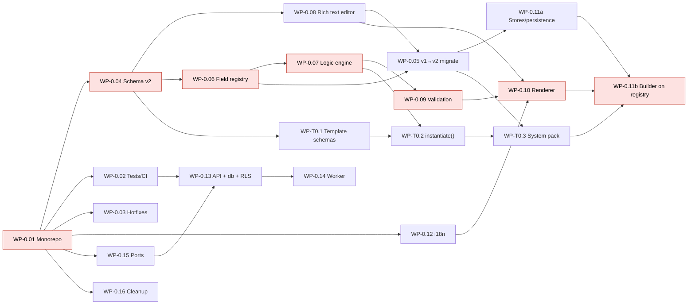
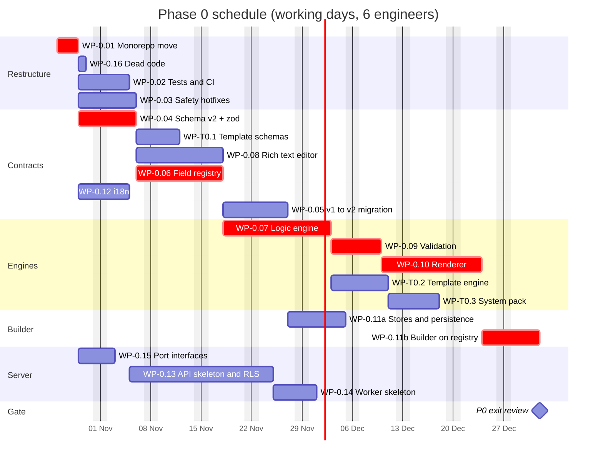
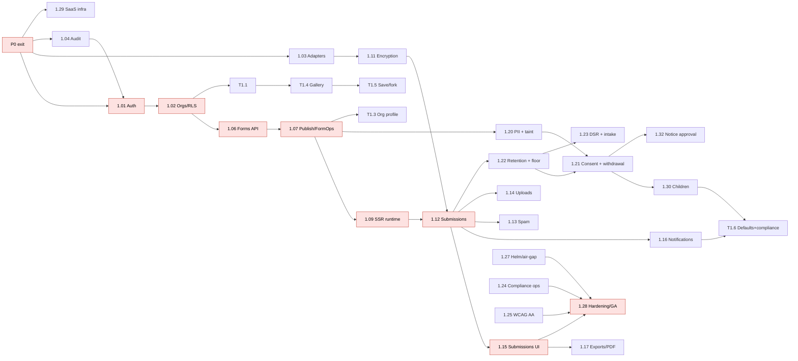
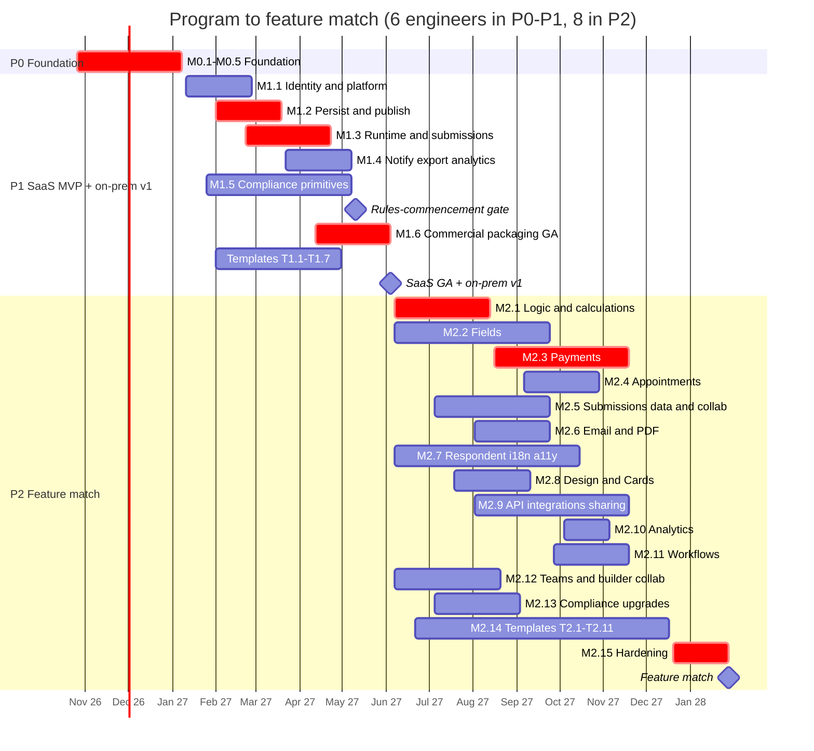

# fORM- delivery plan: from the current builder to JotForm feature match

**Status:** v1.1, revised after the compliance and feasibility reviews (`05-review-log.md`).
**Baseline:** commit `e1be409`. A single Vite 8 + React 19 app in `src/`, using npm (`package-lock.json`) and oxlint. No tests, no backend. `tsconfig.app.json` does not turn on `strict`.
**Target:** "Feature match" = all P0, P1 and P2 rows of the feature matrix shipped: **306 rows** (P0 46, P1 88, P2 172), including the template rows. Pointer rows (BLD-13, DSN-03, DSN-09) are not counted. The fixed decisions are not reopened.
**Inputs:** the codebase map (bug ids B*, S*), the feature matrix (`01`), the schema (`02`), the architecture (`03`) and the templates spec (`06`). Names, packages, tables and roles follow the architecture (ADR-0001): `@form/*` scope, `packages/registry`, `packages/ports` + `adapters`, `memberships`, `audit_log`, `fr_migrator`, Postgres 18.

---

## 0. Assumptions, units and team

### 0.1 Units and conventions
- **ed** = engineer-day. Planning capacity is **4 ed per engineer per week**.
- Each WP has a **Size** (ed, before buffer) and a **Parallel?** note.
- **WP ids:** `WP-0.xx`, `WP-1.xx`, `WP-2.xx` for platform and product work; `WP-T0.x`, `WP-T1.x`, `WP-T2.x` for templates (ids from the templates spec).
- **Size floor rule.** A WP's size must be at least the sum of the lower Cx bounds of the matrix rows it delivers (S = 1, M = 3, L = 11, XL = 31 ed). A CI script (`docs/tools/check-wp-sizes`) checks the §8 traceability against the matrix. Re-sizing in v1.1 brought payments, appointments, logic, audit, the logic engine, the renderer, connectors and encryption above their floors.
- **Definition of Done** for every WP, in addition to its acceptance criteria:
  - tests in CI; user-facing strings through `@form/i18n`; respondent UI passes axe;
  - every new table has RLS, appears in the isolation suite for **every actor kind**, and declares its erase/retain rule in the PII coverage manifest;
  - every operator-relevant state change, and every denied attempt, emits an audit event;
  - the edition check passes (saas / onprem / airgapped), with no outbound call unless allowed;
  - behind a flag until its milestone ships; a docs page exists.

### 0.2 Team

| Role | P0 | P1 | P2 | Focus |
|---|---|---|---|---|
| FE-1 (builder lead) | 1 | 1 | 1 | Builder, stores, registry views, rule builder |
| FE-2 (renderer and a11y) | 1 | 1 | 1 | Renderer, SSR runtime, embed SDK, WCAG |
| BE-1 (platform lead) | 1 | 1 | 1 | API, RLS, publish, submissions |
| BE-2 (data and compliance) | 1 | 1 | 1 | Logic, validation, encryption, DSR, retention |
| FS-1 (full-stack) | 1 | 1 | 1 | Templates, i18n, notifications |
| SRE/Sec-1 | 0.5–1 | 1 | 1 | CI, Helm, air-gapped bundle, SaaS infrastructure, SOC 2 evidence |
| FE/BE-3, BE-4 (payments, integrations) | – | – | 2 | Join at the start of P2 |
| Product designer | 0.5 | 1 | 1 | |
| QA / accessibility tester | 0.5 | 0.5 | 1 | |
| PM | 1 | 1 | 1 | |
| Legal counsel (DPDP, IT Act, CERT-In) | ad hoc | 0.3 | 0.2 | Consent, DSR, KYC, children's data, breach texts |
| Template author / content writer | – | 0.5 | 1 | Also manages the translation vendor |

**Engineers:** 6 in P0–P1, 8 in P2 (recommended). §6 gives 4- and 6-engineer variants.

### 0.3 Effort and calendar summary

| Phase | Raw ed | Buffer | Planned ed | 4 engineers | 6 engineers | 6 → 8 engineers (recommended) |
|---|---|---|---|---|---|---|
| P0 Foundation | 162 | +16 (10%) | 178 | ~12 wk | **~10 wk** (critical path) | 10 wk |
| P1 SaaS MVP + on-prem v1 | 464 | +46 (10%) | 510 | ~32 wk | **~21 wk** | 21 wk |
| P2 Feature match | 920 | +138 (15%) | 1,058 | ~66 wk | ~44 wk | **~33 wk** |
| **Total** | **1,546** | +200 | **1,746** | ~110 wk | ~75 wk | **~64 wk** |

**Calendar (recommended staffing):**
- P0: Mon 2026-10-26 → Fri 2027-01-08 (includes the year-end week).
- P1: 2027-01-11 → 2027-06-04: **SaaS GA and on-prem v1**. The DPDP Rules apply from about **13 May 2027**; the M1.5 gate on 2027-05-10 makes every commencement duty live before then for any tenant processing real data (design partners included).
- P2: 2027-06-07 → 2028-01-28 (includes the year-end week): **feature match**.

v1.0 planned 1,289 raw ed (P2 at 30 weeks). The increase comes from re-sizing to the Cx floors (+~170 ed in P2), moving DPDP commencement duties into P1, the SSR runtime, SaaS infrastructure, the audit redesign and the template-customisation additions.

---

## 1. Milestones

| Milestone | Window | Exit criterion |
|---|---|---|
| **M0.1 Monorepo green** | P0 W1 | `apps/builder` runs unchanged from the pnpm/Turborepo workspace; CI required on `main`; ADR-0001 merged |
| **M0.2 Safe builder** | P0 W2 | Interim fixes for S1–S4, B1/B2, B4, B12, B17–B19 merged with regression tests |
| **M0.3 Contracts frozen** | P0 W4 | `@form/schema` v2 + zod twins + `@form/registry` contract + rich-text AST + template schemas |
| **M0.4 Engines** | P0 W9 | `logic@2` compile/evaluate passing the cross-browser determinism corpus, page-scoped validation, `FormRenderer`, `instantiate()` |
| **M0.5 Builder on v2 + server skeletons** | P0 W10 | Builder edits v2 documents, persists to IndexedDB, previews through `@form/renderer`; API and worker skeletons pass RLS meta-tests including partitions and every actor kind |
| **M1.1 Identity and platform** | P1 W1–7 | Auth, orgs, roles incl. `data.route`, adapters, audit chain with denied events, SaaS infrastructure baseline |
| **M1.2 Persist and publish** | P1 W4–10 | Server drafts with CAS, immutable versions, FormOps, access control, org profile, notice approval |
| **M1.3 Runtime and submissions (design-partner alpha)** | P1 W7–15 | SSR runtime on the user-content domain, embeds, submissions stored, encrypted, purpose-filtered; inbox |
| **M1.4 Notify, export, analytics** | P1 W11–17 | Emails, exports, Chromium PDFs, webhooks with purpose gating, analytics |
| **M1.5 Compliance primitives + Rules-commencement gate** | P1 W3–18; **gate 2027-05-10** | PII tagging and taint, Consent block with full notice and language picker (en, hi), withdrawal, retention + statutory floor, DSR v1 + intake, children's data, breach and CERT-In tooling, platform-as-fiduciary, WCAG AA — all live for every tenant processing real data |
| **M1.6 Commercial, packaging, GA** | P1 W14–21 | Billing, Helm (external-DB profile), multi-hop air-gapped bundle, pen test → **SaaS GA + on-prem v1 (2027-06-04)** |
| **M2.1–M2.15** | P2 W1–34 | Domain tracks (§5), flagged, GA in the monthly release train |
| **FM (feature match)** | 2028-01-28 | All 306 P0–P2 rows shipped and traced (§8) |

---

## 2. Phase 0: Foundation (implementation-ready)

**Goal:** the builder works at every step and, at the end, edits **schema v2** documents through the **field registry**, previews through a **store-independent renderer** with **page-scoped, visibility-aware validation** and **safe rich text**. Packages are pure and isomorphic. The API and worker skeletons enforce RLS from the first table.

**Rules for the P0 sequence:**
1. WP-0.01 is a one-day code freeze; nothing else touches `src/` until it merges.
2. Later WPs change `apps/builder` in small PRs; the Playwright smoke test from WP-0.02 stays green on every PR.
3. **v1 code and v2 packages never change in the same PR.** The builder switches to v2 in WP-0.11a/b behind the `migrate()` adapter.

**P0 WP order (dependency order):** WP-0.01 → WP-0.16 → WP-0.02 → WP-0.03 → WP-0.04 → WP-0.12 → WP-0.15 → WP-T0.1 → WP-0.08 → WP-0.06 → WP-0.05 → WP-0.07 → WP-0.13 → WP-0.09 → WP-0.11a → WP-T0.2 → WP-0.14 → WP-0.10 → WP-T0.3 → WP-0.11b.

### WP-0.01: Monorepo restructure (pnpm + Turborepo); move `src/` to `apps/builder`
- **Goal:** the ADR-0001 layout with zero behaviour change and git history kept. **Rows:** FND-01.
- **Scope:** repo root, `apps/builder/**`, `pnpm-workspace.yaml`, `turbo.json`, `packages/tsconfig/**`, `.gitignore`, `README.md`, `docs/adr/0001-monorepo.md`.
- **Depends on:** none. **Size:** 3 ed. **Parallel?** No (critical-path start, one engineer + reviewer, `src/` frozen).

**Exact steps:**
1. **Preconditions.** Node 24 LTS (Vite 8 needs ≥ 20.19 / 22.12), `.nvmrc` = `24`, `corepack enable`, on Windows `git config core.longpaths true`. Branch `chore/monorepo`.
2. **Commit A — pure move, no content edits** (rename detection keeps history):
   ```sh
   rm -rf dist
   mkdir -p apps/builder
   git mv src index.html public vite.config.ts tsconfig.json tsconfig.app.json tsconfig.node.json apps/builder/
   git mv package.json apps/builder/package.json
   git rm package-lock.json
   git commit -m "chore: move builder app into apps/builder (no content changes)"
   ```
   `.oxlintrc.json` and `README.md` stay at the root.
3. **Commit B — workspace wiring:**
   - `pnpm-workspace.yaml`: `packages: ["apps/*", "packages/*"]` plus a `catalog:` for react, zod and typescript.
   - Root `package.json`:
     ```json
     {
       "name": "form-monorepo", "private": true, "type": "module",
       "packageManager": "pnpm@10.<x>.<y>",
       "engines": { "node": ">=24" },
       "scripts": {
         "dev": "turbo run dev --filter=@form/builder",
         "build": "turbo run build", "typecheck": "turbo run typecheck",
         "test": "turbo run test", "e2e": "turbo run e2e", "lint": "oxlint"
       },
       "devDependencies": { "turbo": "^2", "oxlint": "^1.81.0", "typescript": "~6.0.2" }
     }
     ```
   - `apps/builder/package.json`: `"name": "@form/builder"`, dependencies unchanged; scripts `dev: vite`, `build: tsc -b && vite build`, `typecheck: tsc -b`, `preview: vite preview`; remove its `lint` script.
   - `turbo.json`:
     ```json
     { "$schema": "https://turbo.build/schema.json",
       "tasks": {
         "build":     { "dependsOn": ["^build"], "outputs": ["dist/**"] },
         "typecheck": { "dependsOn": ["^typecheck"] },
         "test":      { "dependsOn": ["^typecheck"], "outputs": ["coverage/**"] },
         "e2e":       { "dependsOn": ["build"] },
         "dev":       { "cache": false, "persistent": true } } }
     ```
   - `packages/tsconfig` (`@form/tsconfig`): `base.json` (current compiler options without `paths`/`include`) and `strict.json` (adds `strict`, `exactOptionalPropertyTypes`, `noUncheckedIndexedAccess`, `noImplicitOverride`, `isolatedModules`). Packages extend `strict.json`; `apps/builder` keeps its config until WP-0.11b.
   - **Internal packages are source-only:** `"exports": { ".": "./src/index.ts" }`, `"type": "module"`, no build step. Vite, Vitest and `tsx` consume the TypeScript; production Node apps are bundled with **tsup** (WP-1.27).
   - `.turbo` in `.gitignore`. No path changes are needed.
4. **Install and verify:** `pnpm install` (allow build scripts only via `onlyBuiltDependencies`). Checks: `pnpm dev` serves `/builder/demo` (add a block via slash menu, preview, submit); `pnpm build` output within ±1% gzip of a pre-move build; `pnpm lint` and `pnpm typecheck` green; `git log --follow apps/builder/src/store/useFormStore.ts` reaches `e1be409`.
5. **README:** workspace map, prerequisites, commands. **ADR-0001:** the layout from architecture §1.1.

**Acceptance:** all step-4 checks pass; commit A contains only renames.

### WP-0.16: Dead code and copy cleanup
- **Rows:** FND-14. **Scope:** delete `App.css`, `assets/*`, `ui/sheet.tsx`, `DialogTrigger`/`DialogClose`, `Select` in `ui/input.tsx`, the `FieldIcon` export, `isInputBlock`, `canPairBeside`, `.success-burst`; remove competitor copy (`ThemeSettings.tsx:19`).
- **Depends on:** WP-0.01. **Acceptance:** no unused exports in touched files; build size does not grow. **Size:** 1 ed. **Parallel?** Yes.

### WP-0.02: Test harness, characterisation tests and CI
- **Goal:** a safety net before refactors. **Rows:** FND-11 (tests and CI).
- **Scope:** root `vitest.config.ts` (`test.projects`), per-package configs (`node` for packages, `jsdom` for renderer and builder); `apps/builder/e2e/**` (Playwright); `.github/workflows/ci.yml`; `CODEOWNERS` (two reviewers on `packages/logic`, `packages/db`, `packages/crypto`, `apps/api/src/authz`); PR template; `renovate.json`; `.dependency-cruiser.cjs`.
- **Dev dependencies:** `vitest`, `@vitest/coverage-v8`, `jsdom`, Testing Library (react, user-event, jest-dom), `fast-check`, `@playwright/test`, `@axe-core/playwright`, `dependency-cruiser`.
- **Steps:**
  1. Characterisation tests for `lib/{logic,zodFromBlocks,layout}.ts`; each confirmed bug (B1, B2, B4, B7, B8, B9, B13, B14, B15, B16, B17, B18, B19, B21) as `it.fails(...)`, flipped by its fixing WP.
  2. Playwright `smoke.spec.ts` (insert Short text → Preview → fill → Submit → thank-you) and `xss.spec.ts` (fails on any `dialog`; red until WP-0.03).
  3. CI jobs (Node 24, frozen lockfile, Turbo cache): `check` (lint, typecheck, test, build); `e2e` (Chromium); `deps` (dependency-cruiser layer rules from architecture §1.3); `security` (osv-scanner, gitleaks); `db` (added by WP-0.13); `determinism` (added by WP-0.07).
  4. Required checks on `main`; Renovate with `minimumReleaseAge: "14 days"`.
- **Depends on:** WP-0.01. **Acceptance:** CI < 10 min clean; failing tests block merge; importing `react` from `packages/schema` fails `deps`; coverage uploaded. **Size:** 5 ed. **Parallel?** Yes.

### WP-0.03: Interim safety and correctness hotfixes in the v1 builder
- **Goal:** remove critical exposures now; each fix is replaced by its v2 counterpart later. **Rows:** FND-09 (part), BLD-06, FND-11 (error boundary).

| Fix | Change | Replaced by |
|---|---|---|
| S1/S2 | DOMPurify (allowlist `b i u s a span br p`; `style` only `color`/`background-color`) at `RichText.tsx:40` and every `dangerouslySetInnerHTML` in `FormPreview.tsx:233-246` | WP-0.08 |
| S3 | `FormCanvas.tsx:134-135` escapes plain text before saving | WP-0.08 |
| S4 | `RichText.tsx:158-162` allows only `https:`, `http:`, `mailto:`, `tel:`; `rel="noopener noreferrer nofollow"` | WP-0.08 |
| S6 | Redirect only for `https?:`, same tab | WP-1.07 |
| B1/B2 | Next triggers only `idsOnCurrentPage ∩ visible`; schema from visible blocks only | WP-0.09 |
| B4/B5/B6 | Signature sent only with strokes; DPR scaling with ResizeObserver; Clear button; stable `onChange` | WP-0.10 |
| B12 | try/catch around `new RegExp`; `ErrorBoundary` around preview and canvas | WP-0.09 |
| B17 | zundo `partialize` + `equality: (a, b) => a.form === b.form` | WP-0.11a |
| B18 | Remove global `pauseForTyping`; throttle per call site | WP-0.11a |
| B19 | Immutable updates in `reorderBlocks` / `placeBeside` | WP-0.11a |
| B22 | Guard redo while typing | WP-0.11a |
| B28 | Clamp `ratingMax` 1–10, scale 2–10 | registry |

- **Depends on:** WP-0.01, WP-0.02. **Acceptance:** `xss.spec.ts` green in builder and preview; related `it.fails` flipped; a 3-page form with a required field on page 3 advances from page 1; a required empty signature blocks submit; 10 block-select clicks add no history entries; invalid pattern `[` shows an inline error. **Size:** 6 ed. **Parallel?** Yes.

### WP-0.04: `packages/schema`: v2 types, zod twins, V1 namespace, structural validation
- **Goal:** freeze the contract. **Rows:** FND-02, FND-07 (types).
- **Scope:** `packages/schema/` (`@form/schema`; deps `zod@^4`, `canonicalize` (RFC 8785), `@noble/hashes`).
- **Steps:**
  1. Copy the verified `v2.ts` (schema doc §2) and split it by section into `src/v2/*.ts`; re-export from `src/index.ts`. Move the negative checks to `test/types.negative.test-d.ts`.
  2. Zod twins in `src/v2/zod/*.ts`: ids via `z.custom<BlockId>(isOpaqueId)`; recursive `RichDoc`/`InlineDoc` via `z.lazy` with node-count and depth limits; `z.discriminatedUnion` everywhere; **every object twin is strict** (`z.strictObject`: unknown keys are rejected, never stripped; ADR-0002 §1). **The `RichDoc`/`InlineDoc` types and validators ship here**, so the registry does not wait for the TipTap editor.
  3. Equality tests `expectTypeOf<z.infer<typeof X>>().toEqualTypeOf<X>()` for every export; a script fails on any export without a twin.
  4. `src/v1.ts`: V1 types + lenient `parseV1`.
  5. `src/validate/structure.ts`: `validateStructure(def)` for I1, I3, I4, I5/I6 (rich-text validator), I7, I12, I14.
  6. `src/hash.ts`: `contentHash(x) = sha256(JCS(x))`, isomorphic, synchronous.
  7. **Decision gate (end of W2):** D1 money = `MinorUnits` string; freeze the twins.
- **Depends on:** WP-0.01. **Acceptance:** `tsc` strict + `exactOptionalPropertyTypes` + `noUnusedLocals` clean; the 5 negative checks still fail; 0 twin gaps; fast-check `parse(JSON.parse(JSON.stringify(x))) ≡ x` for `Block`, `FormDefinition`, `TemplateVersionPayload`; no React/DOM imports. **Size:** 10 ed. **Parallel?** Two engineers by section.

### WP-0.12: `packages/i18n`: ICU framework, `en-IN`, formatting
- **Rows:** FND-12. **Scope:** `createI18n(locale, catalogs)` on `intl-messageformat`; number (lakh/crore), `DatePattern` and currency formatters; catalogues `locales/en-IN/{renderer,builder,system}.json`; pseudo-locale `en-XA`; `pnpm i18n:extract`; **a pinned grapheme segmenter** (`unicode-segmenter`, pinned exactly) exported for `logic` and `validation`. **Latin digits in every locale** (native digits are a later per-locale option; ADR-0002 §6).
- **Depends on:** WP-0.01. **Acceptance:** every `SYSTEM_MESSAGE_KEYS` entry exists in `en-IN` (the test imports the constant from `@form/schema`, a devDependency; no hand copy); `format(1234567.89)` → `12,34,567.89`; dates `DD-MM-YYYY`; no unwrapped renderer text under `en-XA`; segmenter results identical in Node, Chromium, Firefox and WebKit on an Indic corpus. **Size:** 5 ed. **Parallel?** Yes.

### WP-0.15: Port interfaces, job contracts and edition config
- **Rows:** FND-17 (interfaces), FND-19 (shape).
- **Scope:** `packages/ports/src/{storage,mailer,kms,search,captcha,scan,geoip,guardian,audit-sink,egress,queue}.ts` (interfaces + the `JobData` map); contract suites in `packages/testkit` (`runStorageContract(impl)` …); dev implementations in `packages/adapters` (filesystem storage, SMTP to Mailpit, local-keyfile KMS, no-op scanner, manual guardian verifier); `@form/config` edition schema (`DEPLOYMENT_MODE`, `EGRESS_POLICY`, internet features off when `none`).
- **Depends on:** WP-0.01. **Acceptance:** dev implementations pass their contracts; air-gapped config rejects `integration:*` and third-party captcha. **Size:** 3 ed. **Parallel?** Yes.

### WP-T0.1: Template payload schemas (TPL-01)
- **Scope:** `packages/schema/src/v2/templates.ts` + twins: the 7 kinds, `TemplateVariable`, `LockSpec`, `TemplateRef`, `TemplateForkBinding`, `var` node, `Origin`, `FormpackManifest`, `migrate()` hooks.
- **Depends on:** WP-0.04. **Acceptance:** `_kindsOk` holds; round-trips pass; a literal email recipient fails type-check and parse; the 5 current templates (after WP-0.05) validate. **Size:** 4 ed. **Parallel?** Yes.

### WP-0.08: Rich text as a constrained AST (TipTap) with safe rendering
- **Goal:** remove every HTML sink. **Rows:** FND-08, BLD-03, PROP-01 (label), S1–S4.
- **Scope:**
  - `packages/schema/src/richtext/`: `fromHtml.ts` (v1 HTML → AST via `htmlparser2` allowlist, never executes; `<font>`/`<span style=color>` → `textColor`), `toPlain.ts`, `normalize.ts`.
  - `packages/renderer/src/richtext/RichTextView.tsx`: node switch to React elements; link `rel`/`target` added at render; `pipe` and `var` through a resolver prop.
  - `apps/builder/src/components/editor/{InlineEditor,RichEditor}.tsx`: TipTap 3 with Link (`isAllowedUri`), TextStyle/Color/Highlight limited to tokens + palette; reserved `pipe` and `var` extensions; paste keeps only allowlisted marks.
  - Delete `RichText.tsx` and the DOMPurify shim.
- **Depends on:** WP-0.04. **Acceptance:** ≥ 150-payload XSS corpus → zero `on*` attributes, zero `javascript:` hrefs, no `dialog`; CI grep for `innerHTML|dangerouslySetInnerHTML|execCommand` finds 0; editor ↔ AST round-trips stable on 50 fixtures; paste from Docs/Word keeps only bold, italic, underline, links, lists; copy and paste between builder editors keeps every allowed mark and node through the builder's own AST clipboard payload (`application/x-form-rich-text+json`), normalized and limit-checked again on paste (ADR-0002 §7). **Size:** 10 ed. **Parallel?** Yes (FE-2), alongside WP-0.06.

### WP-0.06: Field registry (FND-03) in `packages/registry`
- **Rows:** FND-03; FLD-01/02/07/09/10/11/20/21/22/23 and PROP-03/06/14/15 (registry port).
- **Scope:** `packages/registry/src/{define.ts, index.ts (REGISTRY: FieldRegistry), availability.ts, fields/<type>.ts}`.
  - **P0-available types**, fully implemented: `short_text`, `long_text`, `email`, `phone` (basic), `number`, `url`, `single_choice`, `multi_choice`, `date`, `time`, `rating`, `linear_scale`, `nps`, `ranking`, `file_upload`, `signature`, `hidden`, `heading`, `paragraph`, `divider`.
  - **Other types** via `defineStub(type, capability, defaultConfig)` for value types and `defineStubBlock(type, kind, capability, defaultConfig)` for plain blocks (real `configSchema` where specified, `palette: []`, availability P1/P2; `compile()` returns `missing_capability`). Capabilities without a named `Capability` use `x-field:<type>`; `DRAFT_DEFAULT_CONFIG_TYPES` lists the types whose default config is a draft the schema rejects (`repeating_group`). See schema §2.2 and ADR-0002 §2.
  - **Scalars:** `answerScalar(block, value, path)` is the one scalar contract; the per-type `toScalar` gets no block parameter.
  - Fixes: one answer shape per choice type (B25); unanswered NPS/scale absent (B7); ranking absent until interaction (B8); rating max 1–10 (B28); `disabled` + `required` lint (B27).
  - Default compliance: `email` personal/contact with `principalIdentifier: 'email'`; `phone` personal/contact; `signature` personal/identity; free text personal/free_text; `hidden` none (flagged for review).
- **Depends on:** WP-0.04 (types incl. `InlineDoc`). **Does not wait for WP-0.08.** **Acceptance:** the `FieldRegistry` mapped type compiles; table test per available type (default config parses, samples accepted, 5 invalid samples rejected each, `isEmpty` agrees with I9); operator matrix and export header snapshots; no React import. **Size:** 12 ed. **Parallel?** Two engineers by type family.

### WP-0.05: v1 → v2 migration and fixture corpus
- **Rows:** FND-02 (migration); data-level parts of B10, B15, B16, B21, B25–B28, S5–S7.
- **Scope:** `packages/schema/src/migrate/{index.ts, v1-to-v2.ts, notes.ts}` per schema §4.2 (`MigrationContext` injected); `test/fixtures/v1/`: the 5 templates + 30 hand-made v1 forms each exercising one of B1–B28 / S1–S7.
- **Depends on:** WP-0.04, WP-0.06, WP-0.08. **Acceptance:** golden output per fixture (seeded `idFactory`); idempotent; every output passes `validateDefinition(…,'save')`; expected `MigrationNote` codes; password only in `plaintextPasswordToHash`; show/hide parity with WP-0.07. **Size:** 8 ed. **Parallel?** Yes (FS-1).

### WP-0.07: `packages/logic`: `logic@2` compile and evaluate (v1-parity subset)
- **Rows:** FND-06; semantics of LOG-03/04; B21.
- **Scope:** `packages/logic/src/`: `cells.ts`; `compile.ts` (steps, reads, writes, **same-cell writer edges in authored order**, **`on_path` steps**); `plan.ts` (Kahn, ties by rule index then `documentOrder`); `cycles.ts` (paths, "conflicting writers" hint); `pageOrder.ts` (I8, **transitive**, incl. validation bounds); `taint.ts` (I13); `evaluate.ts`; `operators.ts`; `text.ts` (NFC + generated case-fold table, pinned grapheme length from `@form/i18n`); `decimal.ts` (**decimal.js full**, precision 34); `validateDefinition.ts`; `projectForRuntime.ts` (keeps `reads`, drops server rule steps); `trace.ts`.
- **P0 subset:** `ConditionGroup` and every comparison operator incl. dates; actions show, hide, require, unrequire, enable, disable; `Expr` limited to `lit`, `ref`, comparisons. Others compile to `missing_capability` until WP-2.01–2.03.
- **Contracts (ADR-0002 §2):** `compile()` treats every `missing_capability` issue as fatal (`{ ok: false }`), whether it comes from a registry stub's lint or from logic outside the P0 subset; answers are read only through `answerScalar(block, value, path)`.
- **Determinism harness:** the fixture corpus runs in Node and, via Playwright, in Chromium, Firefox and WebKit; CI job `determinism` diffs `EvalState` JSON byte-for-byte.
- **Depends on:** WP-0.06. **Acceptance:** v1 parity on 35 fixtures × 200 answer sets (except documented fixes); cross-engine determinism green; fuzzing shows `evaluate` never throws; cycles, conflicting writers and page-order violations reported with paths (golden test for the A/B/C writer case); 300-block/200-rule form evaluates < 5 ms p95 in Node, incremental < 1 ms; B21 flipped. **Size:** 20 ed. **Parallel?** BE-2 leads, BE-1 helps (pageOrder, taint, validateDefinition).

### WP-0.13: `apps/api` skeleton and `packages/db` with RLS from the first table
- **Rows:** FND-15, CMP-01 (foundation).
- **Scope:**
  - **`packages/db`:** Drizzle tables `orgs`, `users`, `memberships`, `forms`, `form_drafts`, `audit_pending`/`audit_log` (placeholders); roles `fr_migrator`, `fr_app` (`NOBYPASSRLS`), `fr_template_seeder`, `fr_system_agg`; null-safe helpers (`app_org()` …, `app_subject_ids()`); `withTenant()` with read-only/read-write modes; schema `parts` with no grants to `fr_app`; definer functions `list_user_orgs`, `membership_for`, `orgs_due_for`, `resolve_job_org`, `create_partitions`; RLS meta-tests (forced RLS on every `org_id` table, no grants on partitions, no raw `current_setting(` in policies).
  - **`apps/api`:** Fastify 5 `buildApp(config)`, fastify-type-provider-zod, helmet, cors, under-pressure, swagger; request context (dev header stub until WP-1.01); problem+json errors; pino with redaction **and query-string scrubbing**; OTel (OTLP only when configured); `/livez`, `/readyz` (incl. NTP offset check); `GET /v1/forms` as the RLS demo.
  - **Dev infrastructure:** `deploy/docker/compose.dev.yaml` (Postgres 18, SeaweedFS for the S3 API, dev and CI only (ADR-0002 §5), Mailpit, optional ClamAV, otel-lgtm).
  - **Testcontainers harness** and the CI `db` job.
- **Depends on:** WP-0.02, WP-0.15. **Acceptance:** `pnpm --filter @form/api dev` runs under `tsx watch`; isolation for user, API-key, system and respondent actors (no policy raises without a user id); direct `SELECT` on a partition as `fr_app` is denied; meta-test fails on a table without policy (negative test); OpenAPI JSON produced; `db` job < 3 min. **Size:** 14 ed. **Parallel?** Yes (BE-1), off the builder critical path.

### WP-0.09: `packages/validation`: per-page, visibility-aware, isomorphic
- **Rows:** FND-05, VAL-01, VAL-05, VAL-07, VAL-10, RSP-02.
- **Scope:** `normalize.ts` (I9); `validateAnswers(version, evalState, answers, { scope: page|submit, locale, today, messages })` validating only `required_eff`/`visible_eff` blocks in scope plus `submitBlocks`; `errors.ts` (zod issues → codes, `required` first; fixes B14); **regex through `re2js` on client and server** with a 256-char cap; no `FileList`, no DOM.
- **Depends on:** WP-0.07. **Acceptance:** table tests per type; property: no error outside `visible_eff` or the current page; B1, B2, B7, B8, B9, B13, B14 flipped; runs with `document` undefined; regex corpus (`\s` with NBSP, `\w` with Devanagari, `i` with non-ASCII) gives identical verdicts in all engines; every code has an `en-IN` message. **Size:** 7 ed. **Parallel?** On the critical path.

### WP-0.11a: Builder state: document and UI stores, command layer, local persistence, routing
- **Rows:** FND-10, BLD-05, BLD-06, BLD-11 (URL sync); B17–B23.
- **Scope:** `apps/builder/src/state/`: `documentStore.ts` (zustand + immer + zundo over `{ doc }`, `equality: (a,b) => a.doc === b.doc`), `uiStore.ts`, `commands/*.ts` (`dispatch(op)`, validated; typing coalesced per `(blockId, path)` within 600 ms by merging commands), `history.ts`. `persistence/`: `DocumentRepository { list, load, save }`, `IndexedDbRepository` (`idb-keyval`), BroadcastChannel tab-conflict warning. Routes `/forms`, `/builder/:id`, `/builder/:id/preview` (URL ↔ mode both ways). Load runs `migrate()` and shows notes (until WP-0.11b the store edits the v1 document the UI views read and drafts stay `format: 'v1'`; load runs `migrateV1ToV2` over it and shows the notes without storing the result, BL-143). Duplicate deep-clones with fresh ids, **strips `origin`**, does not copy rules; paste strips `origin` too. Delete lists referencing rules and offers remove/disable.
- **Depends on:** WP-0.05. **Acceptance:** B17–B23 flipped; random op sequences: undo^n then redo^n returns the same document, history never holds UI-only changes; reload restores from IndexedDB; v1 import shows notes; duplicated blocks carry no `origin`. **Size:** 8 ed. **Parallel?** Yes (FS-1).

### WP-T0.2: `packages/templates-core` engine (TPL-03)
- **Scope:** `instantiate(version, ctx)` (`uuidv5(idSeed, sourceId)` ids, option ids kept, references remapped, key collisions suffixed, origin stamps, bake variables, optional parts); `insertSnippet(...)` → `DocumentOp[]`, `keyMap`, binding; `resolveVariables(bake)`; `lockFingerprint` (not enforced); pure parts of `sanitizeForTemplate` (PII regex scan, strip access/ops/analytics IDs, literal recipients → placeholders).
- **Depends on:** WP-T0.1, WP-0.07. **Acceptance:** instances pass `validateDefinition(…,'save')`; same seed → byte-identical output in Node and the three browsers; different seeds → disjoint ids; clashing snippet keys → `pan_2` + correct `keyMap`; sanitiser catches all planted PII in a 40-case corpus. **Size:** 8 ed. **Parallel?** Yes.

### WP-0.14: `apps/worker` skeleton
- **Rows:** FND-16. **Scope:** pg-boss; handler registry; **signed job envelope** (`{ v, orgId, resource, data, sig }`, HMAC verified, org re-derived with `resolve_job_org`); per-job tenant context with a minimal permission set; retry/backoff/DLQ policies; cron; graceful `SIGTERM`; sample jobs `system.heartbeat`, `partitions.maintain` (calls `create_partitions`) and `templates.seed` (stub).
- **Depends on:** WP-0.13. **Acceptance:** API-enqueued job processed under RLS for its org; a forged job (wrong org for the resource, or bad signature) is rejected and audited; `SIGTERM` mid-job retries; `partitions.maintain` creates partitions in `parts` with forced RLS. **Size:** 4 ed. **Parallel?** Yes.

### WP-0.10: `packages/renderer`: store-independent `FormRenderer`
- **Rows:** FND-04, BLD-11, DSN-11, FLD-10 (accessible dropdown); starts RSP-06.
- **Scope:** `FormRenderer.tsx` props `{ version: RuntimeFormVersion; mode: 'live'|'preview'; status; initialAnswers?; onSubmit; onPartialSave?; uploader; locale; theme?; onEvent? }`; `eval/EvalProvider.tsx` (`useWatch`-driven incremental evaluation from `reads`; **`meta.now` frozen at session start**); `rhfResolver.ts`; `controls/<type>.tsx` (`Record<AvailableType, Control>`); `layout/rows.ts`; `screens/{Ending,Status}.tsx`; `theme/cssVars.ts`; `signature/SignaturePad.tsx` (DPR, Clear, typed alternative); `Confetti.tsx` (reduced motion); `styles.css` scoped under `.fr-root`. **SSR-ready from the start:** no `window`/`document` at module scope, deterministic ids (`useId`), hydration test.
- **Order of work:** move `PreviewField`, `Control`, `wrapAffix`, `ScreenShell`, `pagesOf` unchanged → v1 `FormPreview` becomes a store-reading wrapper → evaluator context → callbacks → v2 types and registry controls → contract tests → builder `PreviewPane` wrapping `<FormRenderer>` in `DeviceFrame` (preview compiles locally with `compile` + `projectForRuntime`).
- **Accessibility baseline:** `label htmlFor`/`id`, `aria-invalid`, `aria-describedby`, `fieldset`/`legend`, `role="radiogroup"` + `aria-checked` for rating/scale/NPS, focus to first error, `aria-live` status, required marker in theme colour + sr-only text.
- **Depends on:** WP-0.08, WP-0.09, WP-0.12. **Acceptance:** contract test per type (render → answer → validate → clear → payload shape); e2e: 3 pages, logic hides a required field, submit works, hidden answer absent from `onSubmit`; `renderToString` + hydrate without mismatch on all fixtures; axe 0 serious/critical; no `zustand` or `apps/*` imports; ≤ 90 KB gz excluding React and catalogue; signature `uploader` receives a PNG `Blob`. **Size:** 18 ed. **Parallel?** FE-2 leads, FE-1 helps.

### WP-T0.3: `packages/templates`: system templates as data, signed pack build (TPL-02)
- **Scope:** `packages/templates/src/system/core/*.json` (contact, feedback, NPS, job application, event registration as v2 payloads from `migrate()` output, hand-edited); `pnpm templates:build` (validate against registry and logic, write `dist/system-core-<ver>.formpack`, sign with Ed25519 dev key; per-key algorithm field); builder imports the built pack.
- **Depends on:** WP-T0.2, WP-0.05. **Acceptance:** build fails on a registry/logic issue (negative fixture); one changed byte fails verification; New-form gallery lists the 5 and instantiates offline; `src/data/templates.ts` deleted. **Size:** 6 ed. **Parallel?** Yes.

### WP-0.11b: Builder UI on registry and v2; New-form flow through templates
- **Rows:** BLD-01, BLD-04, BLD-05, FND-13, PROP-01/03/06/14/15.
- **Scope:** `apps/builder/src/fields/{canvas,inspector,icons,tiles}.ts` as registry views; inspector sections General / Options / Validation / Logic / Privacy (purpose picker in P1); options editor keeps ids, editable `code`, never derives values from labels (B15, B16); per-block Logic tab writes a form-level `Rule` with typed operands and sets/clears `initiallyHidden` (D2); slash menu and palette from registry `palette`; New-form dialog (*Blank* / *From template* via `instantiate()` over the pack); per-block selectors; builder `strict: true`; the document store, commands and drafts move to `FormDefinition` (`format: 'v2'`; a `v1` draft is migrated once on load and saved back, BL-143) with `DocumentOp` dispatch (BL-085); block copy and paste, where paste strips `origin` and copies no rules (BL-144); delete `lib/{fields,logic,zodFromBlocks}.ts`, `types/form.ts`, `FormPreview.tsx`, `TemplateModal.tsx`.
- **Depends on:** WP-0.10, WP-0.11a, WP-T0.3. **Acceptance:** every available type has canvas preview, inspector, icon and control; in a 200-block form, typing commits < 16 ms p95 and only that block re-renders; e2e: create from template → 3-page form with show/hide → preview → submit; no `V1.` symbol outside `packages/schema/src/migrate`. **Size:** 10 ed. **Parallel?** Three engineers.

### Phase 0 exit gate
- All 46 P0 rows traced to merged WPs (§8).
- The builder only edits v2; preview runs `@form/renderer`; B1–B29 and S1–S4 fixed or carried with a named P1 WP (S5–S11).
- `schema`, `registry`, `logic`, `validation` ≥ 90% line coverage; determinism green in Node + Chromium + Firefox + WebKit.
- API and worker run locally with RLS; meta-tests (incl. partitions and actor kinds) in CI.
- ADRs merged: 0001 monorepo, rich text (0020), logic engine (0021), registry (0022), RLS model (0015, 0016).

---

## 3. Phase 0 critical path



There is no edge WP-0.08 → WP-0.06: the `RichDoc`/`InlineDoc` types ship in WP-0.04.



**Critical path:** 0.01 (3) → 0.04 (6) → 0.06 (8) → 0.07 (11) → 0.09 (5) → 0.10 (10) → 0.11b (6) = **49 working days (~10 weeks)**.
**Slack:** WP-T0.3 ≈ 4 days (it ends day 39; 0.11b starts day 44); WP-0.11a ≈ 2.5 weeks; WP-0.05 ≈ 1 week; server track (0.13/0.14) ≈ 4.5 weeks.
**To shorten it:** start WP-0.07 on a 6-type registry subset at day 3 of WP-0.06; pair a second engineer on WP-0.10 controls.

---

## 4. Phase 1: SaaS MVP and on-prem v1 (21 weeks, 6 engineers)

### M1.1 Identity and platform

**WP-1.01: Authentication and sessions** (WSP-01, WSP-08)
- **Scope:** `apps/api/src/modules/auth/**`, `packages/db/schema/auth.ts`, `apps/builder/src/pages/auth/*`. **In-house auth (ADR-0017)** on the architecture tables: argon2id (`@node-rs/argon2`), magic link, Google and Microsoft OIDC via `openid-client` (SaaS only), server-side sessions (`__Host-fr_sess`), rotation on privilege change, password reset, TOTP 2FA with 10 hashed recovery codes, per-IP and per-account throttling, **Fetch-Metadata + `X-FR-Client` CSRF guard (ADR-0008, no tokens)**, every auth event audited (including failures and denials).
- **Depends on:** WP-0.13, WP-0.15 (dev Mailpit adapter; **not** WP-1.03), WP-1.04 (audit). **Acceptance:** e2e sign-up → verify → 2FA enrol → sign out → TOTP sign-in → recovery-code sign-in; session-fixation test; cross-site POST without the header is rejected; OIDC hidden air-gapped. **Size:** 15 ed. **Parallel?** Two engineers; 1.02 starts when sessions exist.

**WP-1.02: Organisations, members, invites, roles, RLS everywhere** (WSP-02, WSP-03, WSP-09, CMP-01)
- **Scope:** `orgs`, `memberships`, `invites`, `org_settings`; roles Owner/Admin/Editor/Viewer mapped to permission sets incl. **`data.route`** and `compliance.approve_notice`; org defaults `en-IN`, `Asia/Kolkata`, `DD-MM-YYYY`; org switcher via `list_user_orgs()`; `X-FR-Org` via `membership_for()`; isolation-suite generator per table and actor kind.
- **Depends on:** WP-0.13, WP-1.01. **Acceptance:** cross-org CRUD affects 0 rows for every actor kind; Viewer gets 403 (audited) on draft writes; expired invite rejected. **Size:** 12 ed.

**WP-1.03: Adapter implementations** (FND-17)
- **Scope:** S3 API (aws-sdk v3) with `capabilities()`; SMTP (nodemailer); KMS: AWS, GCP, Azure Key Vault, Vault transit, keyfile; signing keys app-held and KMS-wrapped (Ed25519) with an ES256 KMS-native option; Postgres FTS; captcha (PoW default; hCaptcha/Turnstile/reCAPTCHA opt-in); ClamAV; GeoIP; GuardianVerifier (existing account, manual review); AuditSink (WORM bucket, syslog/OTLP). SeaweedFS (S3 API) only in dev/CI containers (ADR-0002 §5). **Contract suites deferred from WP-0.15** land here, one per port with its first production implementation: captcha, GeoIP, egress, queue (run against the WP-0.14 pg-boss adapter), audit-sink and search (ADR-0002 §4).
- **Depends on:** WP-0.15. **Acceptance:** each implementation passes its contract suite (SeaweedFS, Vault, Mailpit, ClamAV containers; cloud KMS mocked + nightly real-account job); egress-blocked run passes with on-prem implementations; Object Lock absent → checkpoints go to the syslog sink. **Size:** 15 ed. **Parallel?** Split by adapter.

**WP-1.04: Audit log: pending queue, chain worker, denied events** (CMP-02)
- **Scope:** `audit_pending` (in-transaction append), separate-connection writer for denied/error events, `audit.chain` per-org worker, `audit_log` partitioned in `parts`, head/trigger checks, `audit.checkpoint` (signed, WORM or syslog), `audit.verify`, `audit.archive`, `audit.append()` helper with answer-value lint and scrubber, read-audit helpers (detail, grid page, API, export, download).
- **Depends on:** WP-0.13, WP-0.14. **Acceptance:** tampering detected; a 403 produces an audit row; chain lag < 5 s under load; no head lock held by business transactions; event-catalogue test lists every emitted code. **Size:** 12 ed.

**WP-1.05: Edition flags and builder security headers** (FND-19, FND-20 builder)
- **Scope:** edition config surfaced to the UI; builder CSP `script-src 'self'`, `frame-ancestors 'none'`, Trusted Types; `Referrer-Policy`.
- **Depends on:** WP-0.15. **Acceptance:** CSP violation-report test; edition matrix test. **Size:** 4 ed.

**WP-1.29: SaaS platform infrastructure** (CMP-16, CMP-18 infra part)
- **Scope:** IaC for Mumbai (primary) and Hyderabad (DR): Kubernetes clusters, managed Postgres 18 with PITR and cross-region replica, S3 buckets (staging unversioned, others versioned, audit with Object Lock), CDN with India TLS termination and query-less cache keys, India-hosted SMTP provider and sending domain (SPF, DKIM, DMARC), the user-content registrable domain (D13), staging and prod environments, NTP to NIC/NPL, log and trace storage in India with 365-day retention, on-call rota and paging, secrets management.
- **Depends on:** P0 exit. **Acceptance:** staging deploy from CI; DR failover drill; restore drill evidence; log retention and region verified; NTP offset alerting live. **Size:** 20 ed. **Parallel?** SRE, alongside everything.

### M1.2 Persist and publish

**WP-1.06: Forms API and builder persistence swap** (BLD-07, WSP-06, FND-10 completion)
- **Scope:** forms CRUD; `PUT /v1/forms/:id/draft` with `If-Match` (409 + merge prompt); autosave every 2 s idle; forms list (search, sort, favourite, clone, archive, trash/restore); v1 JSON import (server `migrate`, password hashed in the same request); `ApiRepository` replaces `IndexedDbRepository` (IndexedDB stays as offline cache).
- **Depends on:** WP-1.02, WP-0.11a, **WP-T0.3**. **Acceptance:** concurrent edits → 409 + merge UI; reload shows latest draft; v1 password never in a draft; every endpoint in the RLS suite. **Size:** 14 ed.

*As built (15 Nov 2026, on the integration branch `wf/core`).* The API half is complete: forms CRUD, `PUT /v1/forms/:id/draft` with `If-Match`, the list (search, sort, favourites, signed cursors), clone, archive, trash and restore, and the v1 import with the password hashed in the same request (architecture §3.3). The builder works on the server's draft: `CachingApiRepository` replaces `IndexedDbRepository` as the source of truth (IndexedDB stays as the offline cache, one database per org, BL-231), autosave writes the cache after 400 ms and the server after 2 s idle, a 409 opens the merge dialog (keep mine, take theirs, copy mine to a new form), and `/forms`, `/forms/:id/responses` and `/builder/:id` need a signed-in member (BL-206; the signed-out, IndexedDB-only builder is gone, a product-owner decision for this run). Trash and restore without hard delete is enough for this WP (a product-owner decision).

How to read the **State** column here and under WP-1.07, WP-1.12 and WP-1.15. *Passed*: the test ran green on `wf/core` on 15 Nov 2026 (unit tests on a laptop; integration tests against Postgres in Docker on the build server). *Passed on demand*: a performance check that the default `test:int` run leaves out and `FORM_PERF=1` turns on. *Written, runs in the final e2e*: a Playwright spec that needs the whole stack and is run only by the final e2e pass, which has not run yet. *Waits on WP-x*: nothing proves the line yet, and the named WP or backlog row owns it.

| Acceptance line | Proved by | State |
|---|---|---|
| Concurrent edits give 409 and a merge UI | `apps/api/test/forms.int.test.ts` "creates the draft at If-Match 0, then two PUTs with the same If-Match: the second gets 409 with the server draft and draftRev" and "lets exactly one of several parallel PUTs from the same revision win"; `apps/builder/src/components/builder/DraftConflictDialog.test.tsx` "is closed until the server answers 409, then lists what differs and cannot be dismissed", "keep mine: sends the document on screen again, on top of the server revision from the 409" and "take theirs: loads the server draft into the document store and caches it clean at its revision"; `apps/builder/src/persistence/persistence.test.ts` "a 409 from an autosave opens DraftConflictDialog with what differs"; `apps/builder/e2e/drafts.stack.spec.ts` "keep mine: the second browser to save gets the merge dialog, keeps its version, and a reload shows it" and "take theirs: the second browser loads the other version and nothing of its own is saved over it" | Passed; the two e2e tests are written and run in the final e2e |
| Reload shows the latest draft | `apps/api/test/forms.int.test.ts` "answers GET draft after a PUT with the latest draftRev, in the body and as the ETag"; `apps/builder/src/persistence/CachingApiRepository.test.ts` "prefers a higher server draftRev over a clean cache, keeps the local ops and caches the server draft"; `apps/builder/src/pages/routes.test.tsx` "reopening a form restores what was saved (reload)" | Passed |
| A v1 password is never in a draft | `apps/api/test/forms.int.test.ts` "refuses a draft the strict definition does not know: an unknown key such as settings.password is a 422 and is not stored", "stores a v2 draft, hashes the password with argon2id into form_access, and leaves no password anywhere else" and "writes one form.imported audit record that says a password was hashed and carries no password"; `apps/builder/src/persistence/CachingApiRepository.test.ts` "never reaches the cache while signed in, on any write" | Passed |
| Every endpoint is in the RLS suite | `apps/api/test/isolation.int.test.ts` "has a case for every auth:user and auth:account route, none stale and none twice", and for each route "naming org B: org A’s rows look as if they do not exist, and none change" and "naming org A: a user route answers 403 and audits it; an account route ignores the header"; `packages/db/test/rls.int.test.ts` "covers every table in public" | Passed |

The scope lines that are not acceptance lines are proved too: autosave "writes the cache within 400 ms and PUTs once after 2 s idle, with If-Match = the server revision" (`apps/builder/src/persistence/persistence.test.ts`); the list pages by cursor in every sort, search treats `%`, `_` and `\` as characters, favourites are per member, and clone, archive, trash and restore write their audit records and are race-safe (`apps/api/test/forms-list.int.test.ts`); a viewer's draft write is an audited 403 (`apps/api/test/forms.int.test.ts` "lets a viewer read a draft, and gives the viewer an audited 403 on a write (BL-228)").

*Not built here:* **hard `DELETE /v1/forms/:id`** and the purge of trashed forms (BL-271, with the legal hold of WP-1.22); the generic `Idempotency-Key` table for `POST /v1/forms` (create is idempotent by the client's id: BL-274); forms made in the signed-out builder are not carried over: the old browser database is deleted at the first sign-in (BL-273, a product-owner choice); the 5 MB draft cap is unreachable behind the 1 MiB body limit (BL-278); v1 logo and cover URLs come back as notes until WP-1.08; per-block rebase `PATCH` and presence (BLD-14) and the version history, diff and revert UI (BLD-09, BLD-10) are WP-2.30.

**WP-1.07: Publish pipeline, FormOps and access control** (PUB-01, PUB-03, BLD-08, VAL-04, END-02, ACC-01–05, ACC-08)
- **Scope:** immutable `form_versions` (trigger) and `form_version_state` (retirement after `acceptPreviousVersionsHours`); publish = `resolveForPublish` → `validateDefinition('publish')` → server `compile` + compare → `contentHash`; re2js regex checks; URL schemes; consent `noticeVersion` bump on rendered-notice hash change; FormOps tables with `rev` and audit diffs; access UI (enable, time-zone-aware open/close, limit, embed and redirect allowlists); argon2id password + `POST /f/:slug/unlock`; slugs with redirects. `resolveForPublish` takes the org profile through an interface; the profile itself lands in WP-T1.3 (no mutual dependency).
- **Depends on:** WP-1.06, WP-0.07. **Acceptance:** `UPDATE form_versions` fails; unsafe regex, `javascript:` redirect, logic cycle → 422 with codes; tampered client plan rejected; password hash never in a response; limit N under 50 concurrent submits accepts exactly N; a submission to the previous version within 72 h is accepted, after retirement → `version_superseded`. **Size:** 16 ed.

*As built (15 Nov 2026, on `wf/core`).* Migration 0020 made `form_versions` immutable and added `form_version_state`, `form_access`, `form_slugs`, `form_counters` and `form_favourites` (architecture §2.4). Publish is one pure pipeline shared with `POST …/validate` (strict parse, `resolveForPublish` with the org profile behind an interface that has none until WP-T1.3, `validateDefinition('publish')`, the regex and redirect checks, `compile` and the plan-hash comparison), idempotent by draft revision. The access API (`GET` and `PUT …/access`, the password, the address) and the respondent unlock (`POST /v1/p/:slug/unlock`, served by the API process until the runtime host of WP-1.09) are built, and the builder has an Access panel on them and a public fill page that shows the form's status, unlocks on the server and follows an old address to the new one. A password form withholds its questions until the visitor has unlocked it, whatever the status. The plain-text password and closed switch that older builds kept in the browser are sent to the server when the form opens and then removed from the browser (BL-145).

| Acceptance line | Proved by | State |
|---|---|---|
| `UPDATE form_versions` fails | `packages/db/test/rls.int.test.ts` "refuses UPDATE and DELETE to fr_app (no privilege) and to the owner (trigger)" | Passed |
| Unsafe regex, `javascript:` redirect and logic cycle give 422 with codes | `apps/api/test/publish.int.test.ts` "refuses a draft with an unsafe regex, a javascript: redirect and a logic cycle, listing each with its path, and stores nothing"; `apps/api/src/publish/pipeline.test.ts` "reports an author regex that RE2 cannot run, at the pattern", "reports a redirect to a script URL, at the ending" and "reports a logic cycle, at the rule"; `packages/validation/test/definitionChecks.test.ts` "refuses a backreference, with the path of the pattern source"; `packages/schema/test/structure.test.ts` "rejects %s in a redirect ending" (ten cases, a `javascript:` URL among them); `apps/builder/e2e/publish.spec.ts` "a javascript: redirect blocks publish, and the issue is shown with nothing published" | Passed; the e2e test is written and runs in the final e2e |
| A tampered client plan is rejected | `apps/api/test/publish.int.test.ts` "refuses a hash that differs from the server’s compile, stores no version and no plan"; `apps/api/src/publish/pipeline.test.ts` "refuses a hash that differs, as a plan mismatch that names both, and returns no plan to store" | Passed |
| The password hash is never in a response | `packages/db/test/rls.int.test.ts` "raises insufficient_privilege when password_hash is selected, however it is asked for, as any actor kind"; `apps/api/test/access.int.test.ts` "never carry password_hash or an argon2 string, errors included"; `apps/api/test/unlock.int.test.ts` "never carry password_hash, an argon2 string, or a password that was sent" | Passed |
| A limit of N under 50 concurrent submits accepts exactly N | `apps/api/test/submit-limits.int.test.ts` "stores exactly N responses when 50 submits race for a limit of N = 5, and refuses the other 45 with LIMIT_REACHED" and "counts with one guarded update: 40 transactions racing past the status check admit exactly the limit"; `packages/db/test/rls.int.test.ts` "with a limit of N, N concurrent guarded updates take exactly N places" | Passed |
| A submission to the previous version within 72 h is accepted; after retirement it is `VERSION_SUPERSEDED` (409) | `apps/api/test/submit-limits.int.test.ts` "takes answers for the previous version 71 hours after the republish and refuses them 73 hours after (default 72)" and "never takes a version that was retired" | Passed. The window is computed at submit time; the job that records `retired_at` is BL-270 |

The password rules and the unlock are proved beyond the acceptance lines: a wrong password and a form with no password cost the same argon2id work and give the same answer, a token from before the last password change no longer opens the form, and the budgets per address and per form refuse even the right password once spent (`apps/api/test/unlock.int.test.ts` "costs the same argon2id work for a form with a password and for one without", "follows a change of password: the old one stops working at once" and "counts every attempt per address and form, then answers 429 with Retry-After, even for the right password"). The builder side: `apps/builder/src/components/builder/access/AccessPanel.test.tsx` "turning the form off sends enabled: false with the closed message as the closed screen" (and the Access panel only ever shows that a password is set, never the password), `apps/builder/src/pages/PublicFillPage.test.tsx` "asks for the password, unlocks on the server, keeps the token in memory and sends it as X-FR-Access, then shows the form", and `apps/builder/e2e/public-fill.stack.spec.ts` "password form: the visitor cannot see the questions, a wrong password is refused, the right one opens the form and a submit lands in the responses" (written, runs in the final e2e).

*Not built here:* the consent `noticeVersion` bump and `consent_not_reviewed` (WP-1.21 and WP-1.32); the org-profile values in `variables_snapshot` (WP-T1.3); the CDN purge and the stored `runtime_projection` (WP-1.09); `Idempotency-Key` on publish (it is idempotent by `expectedDraftRev`; the generic table is BL-274); the embed allowlist is stored and validated but not enforced as `frame-ancestors` until the runtime host exists (WP-1.09, a product-owner decision); unlock budgets per visit token (WP-1.09, WP-1.13); uniqueness and one-per-verified-email (ACC-07, ACC-09, WP-2.18); status screens other than "closed" authored from ending templates (TPL-09, WP-T1.6) and server-rendered status screens (WP-1.09); the org purge that may pass the immutability trigger (CMP-17, BL-271); the job that writes `retired_at` (BL-270).

**WP-1.08: Asset store and theme** (DSN-01, DSN-07, CMP-12)
- **Scope:** content-addressed asset store (`assets` + `asset_refs`); logo/cover/image upload (`AssetRef` only); v1 `logoUrl`/`coverUrl` import job; theme tokens → CSS variables; progress bar from the evaluator path (B10); plan-gated branding (off on-prem); bundled base fonts.
- **Depends on:** WP-1.03, WP-0.10. **Acceptance:** runtime page makes zero third-party requests; external image URL rejected at save; identical uploads stored once. **Size:** 7 ed.

**WP-1.32: Notice approval gate** (CMP-24)
- **Scope:** `compliance.approve_notice` permission; `POST /v1/forms/:id/notice/approve` storing the hash of notice + purposes + lawful bases; publish error `consent_not_reviewed` when the hash differs; approval UI with rendered notice preview per locale; audit.
- **Depends on:** WP-1.07, WP-1.21 (notice rendering). **Acceptance:** editing a purpose after approval blocks publish until re-approved; approvals audited. **Size:** 4 ed.

### M1.3 Runtime and submissions (design-partner alpha at the end)

**WP-1.09: `apps/runtime`: React SSR renderer and iframe embed** (PUB-02, PUB-04, RSP-01, FLD-16, END-01, FND-20 runtime)
- **Scope:** React 19 `renderToPipeableStream` server entry + hydrated client; `GET /f/:slug` from cached `RuntimeFormVersion` (`projectForRuntime`); `ETag = contentHash`; cache by path only (query excluded); `POST /session`; status screens; unlock flow; **hash-based CSP** computed at publish (`'strict-dynamic'`, Trusted Types report-only with payment/captcha scripts); per-form `frame-ancestors`; `Referrer-Policy: no-referrer`; prefill read on the client then removed with `history.replaceState`; date picker (en-IN); endings from the AST; served on the user-content domain (ADR-0013). Budget: LCP < 1.5 s on a Moto G-class device over 4G, JS < 120 KB gz.
- **Depends on:** WP-1.07, WP-0.10, WP-1.08. **Acceptance:** leak snapshot (no `note`, `origin`, server actions or steps, password, recipients, webhook URLs); identical CSP for two visitors of a cached page; framing from a non-allowlisted origin blocked; prefill params absent from the address bar, logs and CDN cache key; Lighthouse CI budget passes; hydration has no mismatch. **Size:** 23 ed. **Parallel?** FE-2 + FE-1.

**WP-1.10: Embed SDK, URL prefill, hidden capture** (PUB-05, PRE-01, FLD-30)
- **Scope:** `@form/embed` (iframe, auto-resize over origin-checked `postMessage`, params passed via fragment/postMessage); prefill by `key` / `key[part]` honouring `allowPrefill` (sensitive refused by default, audited); prefill URL builder; hidden fields from `url_param`/`utm`.
- **Depends on:** WP-1.09. **Acceptance:** prefill e2e; sensitive prefill ignored and audited; foreign-origin message ignored. **Size:** 8 ed.

**WP-1.11: Field-level encryption** (CMP-07)
- **Scope:** three-level hierarchy (KMS root → org KEK → purpose DEKs incl. `statutory`); AES-256-GCM `EncryptedAnswer` with AAD; `EncryptedScalar` for tainted computed values; sensitive-by-default; DEK rotation; blind-index columns for `principalIdentifier` fields; KMS unwrap metrics.
- **Depends on:** WP-1.03. **Acceptance:** round trips; changed AAD fails; rotation without downtime; **a backup taken after an erasure contains no recoverable copy of the erased data, and the restore drill shows earlier backups expire within 35 days** (no crypto-shred claim). **Size:** 12 ed. **Parallel?** Yes.

**WP-1.12: Submission pipeline** (SUB-01, VAL-09, LOG-25, CMP-19, ACC-04)
- **Scope:** `POST /f/:slug/submissions` per architecture §2.5: evaluation, validation, encryption and blind indexes outside the transaction; idempotency insert first; inserts; one `submission.fanout` job; counters last; gap-free per-block unique-ID counters (`form_id_counters`); limit counted for `complete` only; held statuses; respondent `app.subject_ids` scoping; server meta from `SubmissionRequest.client` (`pageUrl`, `referrer`, `device`); version acceptance policy; partitions in `parts`, no default partition.
- **Depends on:** WP-1.07, WP-1.09, WP-1.11. **Acceptance:** injected hidden-field answer not stored; replay returns the same result without counting twice; client/server `EvalState` parity on the corpus; p95 < 150 ms for a 50-field form at 50 RPS on one node; a single form sustains ≥ 500 submits/s in the load test without errors; respondent context cannot read another submission. **Size:** 16 ed.

*As built (15 Nov 2026, on `wf/core`; WP-1.09 and WP-1.11 are not built).* Migration 0021 moved the prototype's responses into the partitioned `submissions` table and added `submission_idempotency` and `form_id_counters` (architecture §2.4). `POST /v1/p/:slug/submissions` (the API process serves it until the runtime host of WP-1.09, which will serve `/f/:slug/submissions`) runs the pipeline of `apps/api/src/submit/`: resolve the slug, read the access rules and the counter, accept the live version or the previous one inside its window, evaluate and validate on the server at the page view's instant and with its details, then one transaction in the order architecture §2.5 now documents; answers are stored as plain jsonb (`answer_codec_version` 0) until WP-1.11. Invalid answers are 422 `SUBMISSION_INVALID` with each field named and a stale version is 409 `VERSION_SUPERSEDED` (the product owner's decisions; the fill page is the only client and was updated); the effects (the search document, one `submission.fanout` job through the outbox, the gap-free unique IDs) run in the same transaction.

| Acceptance line | Proved by | State |
|---|---|---|
| An injected hidden-field answer is not stored | `apps/api/test/public-submit.int.test.ts` "drops the answer to a field a rule hides, and to a hidden block the page address did not set" and "fills a hidden block from the page address the browser reported, and never from the answers it sent"; `apps/api/src/submit/meta.test.ts` "keeps the answers of blocks the respondent answers and drops the four kinds the server fills in" | Passed |
| A replay returns the same result without counting twice | `apps/api/test/public-submit.int.test.ts` "gives a retry the first result, counts it once and says it is a replay; other answers under the same key are refused" and "stores one response when the same request arrives several times at once"; `apps/api/test/submit-effects.int.test.ts` "is not enqueued a second time by a replay of the Idempotency-Key, which also indexes nothing twice"; `apps/builder/src/pages/PublicFillPage.test.tsx` "reuses the same Idempotency-Key on a retried submit, and a different one for other answers" | Passed |
| Client/server `EvalState` parity on the corpus | `apps/api/src/validate-submission.parity.test.ts` "covers the whole corpus: 35 v1 forms and the random forms, 200 answer sets each", with one run per form ("v1 parity form $name: 200 answer sets", "random form $name: 200 answer sets", "$name with the page view details: 200 answer sets") | Passed in Node. Not run in browsers here: the Playwright determinism job (`pnpm test:determinism`) pins the engine's output on the same corpus in Chromium, Firefox and WebKit |
| p95 < 150 ms for a 50-field form at 50 RPS on one node | `apps/api/test/submit.perf.int.test.ts` (one test: 50 clients, 1 000 submits, a 50-field form with 10 rules, a unique `Idempotency-Key` each, the server's own time from an `onResponse` hook; limit 150 ms times `FORM_PERF_SLACK`, default 2) | Passed on demand (`FORM_PERF=1`). Measured on 15 Nov 2026 with the app on a laptop and Postgres across the LAN on the build server: p95 117 ms at 50 requests a second (the limit is 150 ms times 2). The commit that added the test measured 22 to 24 ms with the app and Postgres on one host |
| A single form sustains ≥ 500 submits/s in the load test without errors | The same file's saturation run (50 clients, no pause) prints the figure and asserts no failure and the stored counts; it asserts no rate | **Waits on WP-1.28** (the k6 load test; architecture §2.5 says "to be confirmed"). Measured: about 165 submits a second on the build server with the app and Postgres on one host, about 130 on a laptop with Postgres beside it, and 73 with Postgres across the LAN; the profile and the fixes are BL-276 |
| A respondent context cannot read another submission | `apps/api/test/public-submit.int.test.ts` "lets a respondent context read the responses its verified token names and no other, and an anonymous one none"; `packages/db/test/rls.int.test.ts` "shows a respondent the submissions whose verified token it holds, and still no file rows"; `apps/api/test/security-review.int.test.ts` "a respondent transaction (the public routes) cannot read or delete submissions and files" | Passed |

Beyond the acceptance lines: the limit and the version window are proved under load and with a frozen clock (the WP-1.07 table above), the unique IDs give 20 concurrent submits the numbers 1 to 20 with no gap (`apps/api/test/submit-effects.int.test.ts` "give 20 concurrent submits the numbers 1 to 20 with no gap and no repeat"), and migration 0021 on a database filled the way the prototype filled it keeps every row, files and counters, including the responses of a form that was never published (`packages/db/test/migrations.int.test.ts` "moves every row with the form version it was received on, in the order it was received, and keeps what the forms counted" and "files the responses of a form that was never published under a retired legacy version instead of refusing or dropping them").

*Not built here:* encryption of sensitive and tainted answers and the blind indexes (WP-1.11); consent records and dropping answers without consent (WP-1.21); the held statuses `pending_scan`, `pending_guardian_consent` and `pending_payment` (WP-1.14, WP-1.30, WP-2.11); captcha, honeypot and the visit-token rate keys (WP-1.13; the per-address throttle stays); edit and receipt tokens (WP-1.11, WP-2.18, WP-2.33); `response_enc` on the idempotency table (WP-1.11); `delete_after` from purposes and retention (WP-1.22; a placeholder of ten years stands in); the consumers of `submission.fanout` (notifications, webhooks, integrations, workflows: WP-1.16, WP-1.18) and the disclosures rows of owner notifications (WP-1.16); `search.reindex` when a field's sensitivity changes (WP-1.20); the 500 submits a second figure and the k6 load test (WP-1.28, BL-276); the sweep of expired idempotency rows (BL-269); the server-rendered `POST /f/:slug/submissions` (WP-1.09).

**WP-1.13: Spam and abuse controls** (SPM-01, SPM-02, FLD-29, CMP-11)
- **Scope:** honeypot and minimum fill time; Postgres rate limiter keyed by visit token with IP as a spam signal (CGNAT-friendly, architecture §3.5); **proof-of-work captcha default everywhere**, third-party providers per-form opt-in with recipient declaration; daily salt for rate keys, per-form salt for uniqueness; `signals.ttl` job nulls stored IP/UA hashes after the TTL.
- **Depends on:** WP-1.12. **Acceptance:** bot script blocked; 200 respondents behind one IP submit successfully (with at most an on-suspicion PoW); no raw IP stored anywhere (DB scan); hashes nulled after TTL; air-gapped uses PoW with no outbound call. **Size:** 8 ed.

**WP-1.14: Uploads and signatures** (FLD-26, FLD-28, EXP-02)
- **Scope:** **presigned POST** into the unversioned staging bucket → complete → `file.inspect` (MIME sniff, dual allowlist, EXIF strip, ClamAV, encrypt sensitive, copy to uploads, delete staging); size, count, quota; uploads bound to draft or submission when one exists; signature PNG through `uploader` with WFL-07 evidence hash; downloads via short-lived URLs or streaming.
- **Depends on:** WP-1.03, WP-1.12. **Acceptance:** `.png` executable rejected; EICAR quarantined and absent from every versioned bucket; size overrun rejected by the store; signed URL expires; no data URLs. **Size:** 12 ed.

**WP-1.15: Submissions UI v1** (SUB-02, SUB-03, SUB-04, SUB-05, SUB-08, SUB-12)
- **Scope:** virtualised grid (TanStack Table) with version-union columns; inbox detail; FTS on non-sensitive, non-tainted answers (`btree_gin (form_id, doc)`); date/status filters; bulk actions; archive and trash with 30-day purge; **every read audited** (coalesced per grid page).
- **Depends on:** WP-1.12, WP-1.04. **Acceptance:** 100k submissions page < 200 ms server time; search never matches ciphertext and never scans other forms; purge removes rows and files; audit rows exist for grid pages and detail views. **Size:** 16 ed.

*As built (15 Nov 2026, on `wf/core`).* The API (`GET /v1/forms/:formId/submissions`, `GET` and `PATCH …/:id`, `POST …/bulk`, architecture §3.3) serves the grid with the columns of every version, filters, scoped search and a signed cursor, one response in full, the read and star flags, and bulk actions up to delete forever; every read is audited in the transaction that makes it. The Responses page is a virtualised TanStack Table over it, with the inbox, archive and trash folders, a debounced search box, date, read, starred and status filters, a selection that survives the pages that load while scrolling, a bulk bar (delete forever asks first) and an inbox-style reader; it no longer shows the rehearsal responses the preview keeps in the browser.

| Acceptance line | Proved by | State |
|---|---|---|
| 100k submissions page < 200 ms server time | `apps/api/test/submissions-grid.perf.int.test.ts` "serves the first page in under 200 ms of server time (times the slack)", "serves a page 50 000 responses deep in under 200 ms of server time (times the slack): the cursor seeks, it does not skip" and "serves a filtered first page (unread only) as fast", on 100 000 seeded responses | Passed on demand (`FORM_PERF=1`). Measured the same way (the app on a laptop, Postgres on the build server): the first page 38 ms, a page 50 000 responses deep 16 ms and a filtered first page 19 ms, all medians of seven reads. The commit that added the test measured about 20 ms with both on one host |
| Search never matches ciphertext and never scans other forms | `apps/api/test/submissions.int.test.ts` "finds a plain field’s text, finds nothing for a sensitive or encrypted field’s text, and never reaches another form of the org"; `apps/api/src/submissions/search-doc.test.ts` "skips encrypt and sensitive fields, so their text can never be found" and "skips an answer that is an encrypted envelope, and an answer the version has no field for, and empty text"; `apps/api/test/submit-effects.int.test.ts` "holds a plain answer’s text and neither an encrypt or sensitive field nor a value derived from one"; `packages/testkit/src/search.contract.ts` "finds a document by any of its words, within its form and org only" | Passed. Encryption itself is WP-1.11, so "ciphertext" is an encrypted-answer envelope and sensitive fields here. Other forms are never returned and the index leads with `form_id` (`submission_search_form_doc_idx`, migration 0010); no test reads the query plan |
| Purge removes rows and files | `apps/api/test/submissions.int.test.ts` "removes the rows, their search documents, their file records and the bytes, of trashed responses only", "refuses the whole call, and deletes nothing, when any response named is not in the trash", "refuses a response under a legal hold or inside its statutory retention period" and "keeps the bytes when the delete is rolled back, and the rows when only the bytes are missing"; `apps/worker/test/uploads.int.test.ts` "keeps a file a submission holds, however old, and removes it once that submission is deleted" | Passed for delete forever, which is the purge. **The automatic purge of the trash after 30 days is not built: BL-272 (WP-1.22)** |
| Audit rows exist for grid pages and detail views | `apps/api/test/submissions.int.test.ts` "leaves one audit record per page with every id shown, and one for a detail view" and "records each change on the audit chain, with the ids, and 500 ids are in the records together (BL-192)"; `packages/db/src/audit/audit.test.ts` "stores every id of a page of 500 across records, each within the metadata limit" | Passed |

What the member sees is proved by `apps/builder/src/pages/ResponsesPage.test.tsx` ("renders the API columns, including one only version 1 had, and the first page of rows", "loads the next page when the last rows come into view, and shows the answers of the later version", "asks for a search after a pause, not on every key, with the words as q", "trash calls the bulk endpoint with the selected ids, takes the rows out of the inbox, and they are in the Trash tab", "asks before deleting forever: Cancel deletes nothing, the confirmation sends the delete") and by `apps/builder/e2e/responses.stack.spec.ts` "public submit → the row appears → search finds it → trash → restore" (written, runs in the final e2e). The columns are the union over versions: `apps/api/test/submissions.int.test.ts` "shows the columns of every version of the form: a field only version 1 had and one only version 2 has".

*Not built here:* the 30-day purge of the trash (BL-272); bulk actions over more than 500 responses as a job (BL-275); revealing a masked value (`reveal=1`, WP-1.11); the export button and exports (WP-1.17); saved views and column management (WP-2.14); comments (P2).

### M1.4 Notify, export, analytics

**WP-1.16: Notifications** (NOT-01–05)
- **Scope:** per-org SMTP senders (KMS-encrypted credentials, test send); owner notifications and autoresponders with required `purposeIds`; merge tags; `EmailDoc` → HTML with masking (`inNotifications`, taint); reply-to from a field; delivery log (365 days) recording org-profile and brand state; live variables resolved at send time; at-least-once delivery with stable `Message-ID`; `disclosures` rows; withdrawal link forced into autoresponders when a dpdp consent block exists.
- **Depends on:** WP-1.12, WP-1.03. **Acceptance:** sensitive and tainted fields masked; fields outside the notification's purposes absent; SMTP failure retried and logged; merge tags HTML-escaped. **Size:** 14 ed.

*As built (16 Nov 2026, on the integration branch `wf/next`; WP-1.17 and WP-1.18 below share its migration, its job plumbing and its disclosure filter).* **Tables.** Migration 0023 (`0023_notify_webhooks_exports.sql`, architecture §2.4) made `secrets` (sealed credentials: `fr_app` can write `enc` and can never select it), `email_senders`, `notifications` (live, with a revision) and `email_messages` (the delivery log, monthly partitions in schema `parts`), plus `disclosures`, the append-only ledger of who received which fields (DPDP s.11(1)(b)) that exports and webhooks write too. **Definers.** `secret_enc(uuid)`, the one reader of `secrets.enc` (the `system` actor only, for the context's own org), and a rewritten `resolve_job_org()` that also knows `email_message`, `webhook_delivery` and `export` (architecture §2.1). **Jobs** (architecture §5.3): `submission.fanout` has its first consumer, `notificationsConsumer`, which enqueues one `notification.dispatch` for each enabled notification of the form whose trigger matches a `complete` response (`created` and `released` are "submitted", `updated` is "edited"); the dispatch writes the `email_messages` row, the `disclosures` row and the `email.send` job in one transaction, so there is no email without a log row and no log row whose send was lost; `email.send` is a `transaction: 'manual'` job (no connection is held during the SMTP session), renders the message again at send time because the log keeps no body, and sends under the `Message-ID` made at dispatch, retried 8 times from 1 minute to 6 hours. **Routes**, all `auth: 'user'` with an isolation case each: `GET` and `POST /v1/email-senders`, `PATCH` and `DELETE /v1/email-senders/:id`, `POST /v1/email-senders/:id/test` (writes need `org.settings`, the list `forms.read`); `GET` and `POST /v1/forms/:formId/notifications`, `GET`, `PUT` and `DELETE …/notifications/:id` (`forms.edit`; `PUT` names its revision in `If-Match`); `GET /v1/forms/:formId/email-log` (`submissions.read`). **Rules** (architecture §3.3 has the detail): the SMTP URL is sealed under the org's key through the `OrgSecrets` port and no route returns it; the test send goes only to the caller's own address; a notification names purposes the draft declares (422 `MISSING_PURPOSE`); a recipient outside the people who may read answers needs `data.route` on top of `forms.edit` (403 `DATA_ROUTE_FORBIDDEN`, audited; the product owner's decision for this run is that an org member who may read answers, the org's admins and a field the respondent fills in are not outside); and every answer an email shows comes from `disclosableFields`, the one filter that notifications, webhooks and exports share (architecture §5.3). **UI.** `/forms/:id/settings/:tab?` (a Settings link in the builder header) with the Emails tab (list, editor with recipients, purposes, an Insert field menu and an answers-table switch, saved at its revision) and the Email log tab (a page at a time, filtered by status; the Webhooks tab is WP-1.18), and `/org/email-senders` (list, add, change, test and delete a sender; the SMTP URL is a write-only box), linked from organisation settings. Audit codes: `notification.saved`, `notification.deleted`, `email_sender.saved`, `email_sender.deleted`, `email_sender.tested`. Problem codes: `NOTIFICATION_INVALID`, `MISSING_PURPOSE`, `SENDER_NOT_FOUND`, `RECIPIENT_NOT_FOUND`, `NOTIFICATION_REV_REQUIRED`, `NOTIFICATION_REV_CONFLICT`, `EMAIL_SENDER_IN_USE` and `EMAIL_SENDER_CHANGED` (the relay or the From address was changed while a test ran, so the result is not recorded as verified). The worker now parses `MAILER_DRIVER`, `SMTP_URL`, `MAIL_FROM`, `MAIL_FROM_NAME`, `MAIL_MESSAGE_ID_DOMAIN` and `PUBLIC_BUILDER_URL`.

How to read the **State** column here and under WP-1.17, WP-1.18 and WP-2.33. *Written*: the test is on `wf/next` and ran in the gate of the task that added it (unit tests on a laptop; integration tests against Postgres in Docker); the whole `test:int` suite, the end-to-end specs and the final review run on the integrated branch later and are not recorded here. *On demand*: a check the default run leaves out. *Not built*: the line waits on the work package named.

| Acceptance line | Proved by | State |
|---|---|---|
| Sensitive and tainted fields are masked | `apps/worker/src/effects/disclosure.test.ts` "renders MASK for a field set to mask and leaves out one set to omit, in notifications" and "masks a value derived from a sensitive field (compiled.taint) even when its own setting says include"; `apps/worker/src/effects/email/render.test.ts` "shows MASK for a field whose setting is mask: in the body, in the subject pipe and in the answers table", "masks a value derived from a sensitive field (taint), though its own setting says include" and "never carries a raw sensitive value anywhere in the message"; `apps/worker/test/notifications.int.test.ts` "sends the rendered message: subject from the answers, MASK for the masked field, nothing of the omitted or out-of-purpose ones, the platform sender by default" and, through a real SMTP server (Mailpit), "a fan-out of a complete response arrives in the inbox with the expected subject and a masked body" | Written. Answers are plain jsonb until WP-1.11, so "sensitive" is the field's classification and settings; an answer that is already sealed is masked too (`apps/worker/src/effects/disclosure.test.ts` "masks an answer it cannot read: a sealed one, or one whose type is not the field’s, even with includeSensitive") |
| Fields outside the notification's purposes are absent | `apps/worker/src/effects/disclosure.test.ts` "leaves out a personal field outside the purposes, keeps one of an included purpose, and keeps a classification-none field with no purposes"; `apps/worker/src/effects/email/render.test.ts` "leaves an omitted field and a field outside the notification’s purposes out of all three, label and value"; `apps/worker/test/notifications.int.test.ts` "inserts one email_messages row and one disclosures row, without the out-of-purpose, omitted or masked fields, and enqueues email.send" and "an autoresponder reads the respondent’s address only from a field in the notification’s purposes"; `apps/api/test/notifications.int.test.ts` "refuses an empty purposeIds and an unknown purpose with 422 MISSING_PURPOSE, and writes nothing" | Written |
| An SMTP failure is retried and logged | `apps/worker/test/notifications.int.test.ts` "a server that is unavailable leaves the row retrying with attempts 1 and a scrubbed last_error, and the job throws", "a later success sends it: the same Message-ID on both tries, sent with the provider id and time, the old error cleared; a sent row is not sent again" and "the last attempt of the queue’s policy marks the row failed (and the job still throws, for the dead-letter queue)"; `apps/api/test/email-log.int.test.ts` "shows a data_viewer the masked recipients, status, attempts, error and times, and never a full address"; `apps/builder/src/components/settings/EmailLogPanel.test.tsx` "shows the masked recipients, the status and the attempts of each email, and what the mail server said" | Written |
| Merge tags are HTML-escaped | `apps/worker/src/effects/email/render.test.ts` "escapes a value in a merge tag and in the answers table, in the html part", "escapes quotes and ampersands, in text and in the label of a row" and "escapes the subject in the html title and strips CR and LF from the subject itself" | Written |

Beyond the acceptance lines: an org's SMTP URL is never returned or stored in the clear, and one org can never open another's (`apps/api/test/email-senders.int.test.ts` "never returns the SMTP URL or anything sealed, and keeps it out of secrets.enc in plaintext"; `apps/api/test/org-mailer.int.test.ts` "answers no sender for another org's secret, and the KMS is never asked about it" and "does not open a webhook signing secret as an SMTP URL: the kind is part of what the key is bound to"; `packages/db/test/effects.int.test.ts` "refuses a member with org.settings every way of reading enc: permission denied, never an empty answer" and "names an smtp secret and nothing else: a webhook_hmac secret of its own org is refused, on insert and on update"); the test send goes to the caller only (`apps/api/test/email-senders.int.test.ts` "sends one message, from the sender, to the signed-in caller’s own address and nobody else’s, through this sender’s secret"); an outside recipient needs `data.route` (`apps/api/test/notifications.int.test.ts` "refuses a creator a fixed external address with 403 and a request.authorize denied record, and an editor may"); a fan-out delivered twice, or two dispatches at once, make one message (`apps/worker/test/notifications.int.test.ts` "writes the message once per response and notification: a fan-out delivered twice, or two dispatches at the same time, make one message"); nothing logs an address, a subject or a body ("does not log an address, a subject or a body"); a held response sends no email ("sends nothing for a response that is held, a notification that is off or gone, a respondent who gave no address, or an id that is not a uuid", and `apps/worker/test/submission-fanout.int.test.ts` "calls no consumer for a %s response, and acks it", run for `pending_review`, `rejected` and every other status that is not `complete`). What the member sees is in `apps/builder/src/components/settings/NotificationsPanel.test.tsx` ("keeps Save off until a purpose is ticked, then creates the email without choosing its id", "shows a 422 MISSING_PURPOSE next to the purposes, and takes it away when the purposes change", "shows a 403 data.route refusal next to the recipients", "on a stale revision says so, saves nothing, and Reload brings back the server’s version") and `apps/builder/src/pages/org/EmailSendersPage.test.tsx` ("adds a sender, sends the SMTP URL once, and never shows it again: the box is empty and the page never holds it").

*Not built here:* the 365-day purge of the delivery log and the blind-index column `to_bidx`, with email suppressions and a hard bounce that stops further mail (BL-302, BL-301; WP-1.22, WP-1.11 and, for bounces, WP-2.16); attachments, delayed and scheduled sends, the triggers other than `submitted` and `edited`, and the test send of a notification (BL-304; WP-2.16, with WP-1.14, WP-1.17b, WP-2.11, WP-2.13, WP-2.18 and WP-2.28); the org-profile and brand-kit state in the log and the live variables resolved from them (BL-303; WP-T1.3); the withdrawal link forced into an autoresponder and the edit, withdraw and resume buttons (BL-309; WP-1.21, WP-2.18); the publish error `recipient_not_declared` (BL-300; WP-1.20); reviewer notifications (BL-288; WP-2.33 slice 2); auth emails on `email.send` (BL-201, moved to `unassigned`: the job refuses a job that names no org); a Playwright spec for the pages (BL-308).

**WP-1.17: Exports and default PDF** (EXP-01, EXP-03)
- **Scope:** CSV/XLSX export jobs (all, selected, filtered) with formula-injection escaping, audit and `disclosures`; default PDF and print view via headless Chromium in `fr-worker-pdf` (no network, bundled Noto). No pdf-lib text path.
- **Depends on:** WP-1.15, WP-0.14. **Acceptance:** `=cmd|…` escaped; Devanagari and Tamil render correctly (visual snapshots); 100k rows < 2 min. **Size:** 12 ed.

*As built (16 Nov 2026, on `wf/next`; EXP-03, the default PDF, is not built).* **Tables.** Migration 0023 made `exports`, a request row the API inserts as `queued` and the worker moves through `running` to `ready`, `failed` or `expired` (unique `(org_id, idempotency_key)`; a member with `submissions.export` may insert only a queued row with no object, size or error, so a crafted `object_key` cannot make the download route stream another org's file), and the `disclosures` ledger it shares with WP-1.16 and WP-1.18 (architecture §2.4). **Job** (architecture §5.3): `export.build`, a `transaction: 'manual'` job; each batch of 2 000 responses (keyset by received time and id, trashed ones left out, scope `all`, `selected` or `filtered`) is one short transaction that reads, builds the cells and writes the `disclosures` rows, and the batch's bytes go to the `exports` bucket at `<orgId>/<exportId>.<ext>` between two transactions, so no connection is held during the upload and 100 000 rows are never in memory; retried twice, one hour per attempt. The file is ready with `row_count`, `bytes` and an expiry 24 hours later. A reason a retry cannot change (a scope the API never writes, no object store, an XLSX past Excel's row limit, review settings that do not parse) marks the export failed with a fixed sentence and ends the job; anything else is retried and marked failed on the last attempt, and the text in `exports.error` never holds a database message, key, path or answer. **Writers.** CSV (RFC 4180, CRLF, UTF-8 with a byte-order mark so Excel reads Devanagari and Tamil as such) and XLSX (a streaming workbook, every cell a string, never a formula); both escape every cell and header against formula injection themselves (an apostrophe before a leading `=`, `+`, `-`, `@`, tab or carriage return, also behind white space and invisible characters). **Columns.** The union over every version of the form, the newest version deciding each field's header, position and whether it is exported; what may leave is `disclosableFields` (channel `export`: purposes, `inExports`, taint; `includeSensitive` lifts a mask and never an omit); one `disclosures` row per exported response names the fields whose value is in the file. For a requester who is a reviewer with `own_unit` visibility, only the columns of their own units. **Routes** (`auth: 'user'`, `submissions.export`, an isolation case each): `POST /v1/forms/:formId/exports` (a required `Idempotency-Key`; 10 queued or running per org and 100 a day, else 429 `EXPORT_QUOTA_REACHED`; `includeSensitive` needs a reason, 422 `EXPORT_REASON_REQUIRED`; one transaction inserts the row, writes `submission.exported` and sends the job), `GET /v1/exports/:id`, `GET /v1/exports/:id/download` (streamed through the API from the object store, never a presigned URL: the product owner's decision, because every download must pass the session check and write `export.downloaded` before the first byte; 409 not ready or failed, 410 expired). An export belongs to the member who asked: anyone else, an owner included, gets 404, because the file is redacted for its requester. **UI.** An Export button in the Responses toolbar for members whose role grants `submissions.export` (read from `GET /v1/org`, hidden when unknown): CSV or Excel; all responses, the ticked rows or a received-at range; "include sensitive and encrypted fields" with a reason; the builder asks, polls and saves the file through the API, one `Idempotency-Key` per member action.

| Acceptance line | Proved by | State |
|---|---|---|
| `=cmd\|…` is escaped | `apps/worker/src/effects/export/escape.test.ts` "puts an apostrophe in front of %j" (`=cmd\|' /C calc'!A0`, `+1`, `-1`, `@SUM(A1)`, a leading tab and space) and "also catches a formula behind white space, control characters and invisible characters"; `apps/worker/src/effects/export/csv.test.ts` "escapes formula payloads in the header and in every cell, and quotes the result when it needs quotes"; `apps/worker/src/effects/export/xlsx.test.ts` "escapes the formula payload: the cell is text with a leading apostrophe" and "makes every cell a string and none a formula, whatever it looks like"; `apps/worker/test/exports.int.test.ts` "writes the response id and received-at, Devanagari and Tamil byte-exact, and escapes a formula payload" and "builds an XLSX the same way: strings only, the same texts, the formula payload escaped" | Written |
| Devanagari and Tamil render correctly (visual snapshots) | CSV and XLSX keep the text byte for byte: `csv.test.ts` "round-trips Devanagari and Tamil byte-exact", `xlsx.test.ts` "reads back the same Devanagari and Tamil strings", `exports.int.test.ts` "writes the response id and received-at, Devanagari and Tamil byte-exact, and escapes a formula payload" | The visual snapshots are the PDF's, and **EXP-03 waits on WP-1.17b** (BL-297) |
| 100k rows build in under 2 minutes | `apps/worker/test/exports.int.test.ts` "builds a CSV of ${PERF_ROWS} responses within ${PERF_BUDGET_MS / 1000} s" | On demand: by default 10 000 rows in 12 seconds; `EXPORT_PERF_ROWS=100000` runs the 2-minute case at full size, and no measurement of it is recorded yet |

Beyond the acceptance lines: who may export and what each state of a download answers is proved against Postgres and the real queue producer in `apps/api/test/exports.int.test.ts` ("refuses a data viewer, and a viewer, on every route with 403 and an audit record, and writes nothing", "lets an editor ask: 200, one exports row, one submission.exported record and one signed export.build job, in one transaction", "a repeat returns the same export and enqueues nothing: one row, one audit record, one job", "cannot be reused for another export: another format, scope, option, form or requester is 422 EXPORT_KEY_REUSED and changes nothing", "allow ${MAX_ACTIVE} exports queued or running at once: the next is 429 EXPORT_QUOTA_REACHED with Retry-After, and a finished one frees a place", "is the requester’s alone: another member of the org, an owner included, and org B all get 404" for the state and "is the requester’s alone: another editor, an owner and org B get 404 and no bytes, and leave no download record" for the download, "streams a ready export through the API with its bytes exactly, safe headers and an export.downloaded record", "is 410 EXPORT_EXPIRED once its time has passed, or when the object is gone, and the record is not written for it"); the file's contents and the reviewer redaction in `apps/worker/test/exports.int.test.ts` ("shows a 'mask' field as MASK without include_sensitive and as its value with it; an 'omit' column is absent in both", "exports the union of the columns of every version, each response under its own version", "an export requested by a unit B checker has no unit A columns and none of their values", "fails the export, and shows nothing, when the review settings no longer parse", "writes one disclosures row per exported response, recipient kind export, naming the fields whose value is in the file", "a retry after a failed upload writes one disclosures row per response, not two, and no half file stays", "marks the export failed on the last attempt with a scrubbed message that holds no answer, key or path"); the dialog in `apps/builder/src/components/responses/ExportMenu.test.tsx` ("is hidden when the org does not grant submissions.export, once the grants are known", "keeps Start off while \"include sensitive\" has no reason, then sends the reason with the request", "retries the same action with the same key when the answer was lost, so no second export is made") and the client in `apps/builder/src/persistence/exportsApi.test.ts` ("polls until the export is ready, stops there, and fetches the file through the API").

*Not built here:* **EXP-03, the default submission PDF and print view** (BL-297; **WP-1.17b**, which also takes the Devanagari and Tamil visual snapshots: the `fr-worker-pdf` image with Chromium, Noto fonts and qpdf, a product-owner decision for this run because it is too heavy); localised export headers (BL-298, BL-043; WP-1.17b); the grid's other filters in an export, which carries a received-at range only (BL-299; WP-2.14); the sweep that marks expired exports, deletes their objects and applies the bucket lifecycle rule (BL-302; WP-1.22); an export of uploaded files (EXP-02, WP-1.14); a bulk PDF zip and scheduled exports (EXP-04, EXP-09: later phases); a Playwright spec for the Export menu (BL-308). **WP-1.17b** is the name this run gives the follow-up that holds the PDF half of WP-1.17 (EXP-03, the `fr-worker-pdf` image of ADR-0009, BL-297 and BL-298); it has no size or place in the schedule yet, which the tech lead sets.

**WP-1.18: Webhooks** (INT-01)
- **Scope:** HMAC-SHA256 signing, retries, delivery log (metadata 365 days, snippet 30 days), replay, SSRF guard; **required `purposeIds`** declared in purposes' `recipients` (publish error otherwise); `data.route` permission; `disclosures`; `consent.withdrawn` event.
- **Depends on:** WP-1.12, WP-1.02. **Acceptance:** signature verifies with the published recipe; `169.254.169.254` blocked; replay works; a webhook without declared purposes cannot be saved; Creator-like roles without `data.route` get 403 (P2 roles). **Size:** 9 ed.

*As built (16 Nov 2026, on `wf/next`).* **Tables.** Migration 0023 made `webhooks` (events, key mode, optional field keys, `purpose_ids` that the CHECK requires non-empty, `files`, `consecutive_failures`, `disabled_reason`, `rev`; every command needs `data.route`), `webhook_deliveries` (monthly partitions in `parts`; one row per delivery of one event, updated as it is tried, a replay being a new row with `replay_of`; no foreign key to the response, so the delivery of a deleted response's event outlives it) and `secrets` (the signing secret, kind `webhook_hmac`; a webhook names it by id, org and kind, so it can never name an SMTP credential), and the shared `disclosures` ledger (architecture §2.4). **Jobs** (architecture §5.3): `submission.fanout`'s second consumer, `webhooksConsumer`, enqueues one `webhook.fanout` when an enabled webhook of the form subscribes to the event (`created` and `released` are `submission.created`, `updated` is `submission.updated`); `webhook.fanout` inserts one `pending` delivery per subscribed webhook and its `webhook.deliver` in the same transaction; `webhook.deliver` is a `transaction: 'manual'` job that builds the body, signs it, posts it through the tenant egress guard holding no connection, and records the result; 3 retries from 1 minute to 24 hours. **Routes**, every one `auth: 'user'` with `data.route` and an isolation case: `GET` and `POST /v1/forms/:formId/webhooks`, `GET`, `PUT` and `DELETE …/webhooks/:id`, `POST …/:id/rotate-secret`, `GET …/:id/deliveries`, `POST …/:id/deliveries/:deliveryId/replay`. **Rules.** The URL passes the edition's egress rule at every save (`https` only under `EGRESS_POLICY=open`; `http` or `https` for an allowlisted host under `allowlist`; none under `none`, the air-gapped edition: the product owner's decision) and then the tenant guard, which resolves the name and refuses private, loopback and link-local addresses (422 `EGRESS_DENIED`); the guard checks again at delivery, pins the connection to the address it vetted and follows no redirect, and the delivery log says a fixed sentence for a refused address because the guard's own message would show members what the platform's resolver returned. `purposeIds` must be declared in the draft's purposes (422 `MISSING_PURPOSE`). The signing secret is 32 random bytes sealed under the org's key and shown once as `whsec_` + base64url, at creation and after `rotate-secret`; reads show its last four characters. Each request carries `fORM-Signature: t=<unix seconds>,v1=<hex>` (HMAC-SHA256 over `<t>.<raw body>` keyed with the `whsec_…` text as shown), `fORM-Event` and `fORM-Delivery-Id`; the recipe a receiver copies, with a Python version, is [webhook-signatures.md](webhook-signatures.md), quoted from the file the tests run. The body holds only what `disclosableFields` allows for the webhook's purposes (answers named by field key or block id), the 50th failure in a row switches the webhook off and writes the audit record `webhook.disabled`, and a row in `disclosures` names the webhook's host and the field keys sent, once per delivery. **UI.** The Webhooks tab of `/forms/:id/settings/:tab?`: the list with each webhook's events, purposes and secret hint, an editor (Save stays off until there is an address, an event and a purpose; `EGRESS_DENIED` and `MISSING_PURPOSE` show beside their controls), the one-time secret dialog with a copy button, and the delivery log (fifty a time, filtered by status, with a Replay button that is off for a switched-off webhook); a role without `data.route` sees "you need the data routing permission". The builder offers only the events the worker sends today. Audit codes: `webhook.saved`, `webhook.deleted`, `webhook.secret_rotated`, `webhook.replayed` (the host, never the path or query) and `webhook.disabled`. Problem codes: `EGRESS_DENIED`, `WEBHOOK_REV_REQUIRED`, `WEBHOOK_REV_CONFLICT` and `WEBHOOK_DISABLED`.

| Acceptance line | Proved by | State |
|---|---|---|
| The signature verifies with the published recipe | `apps/worker/src/effects/webhook/sign.test.ts` "makes `t=<seconds>,v1=<64 hex>` and the recipe verifies it", "fails for a changed body, a changed timestamp and a changed secret", "quotes verify-recipe.ts verbatim, the whole file" and "has a Python recipe"; `apps/worker/test/webhooks.int.test.ts` "delivers to a local receiver that verifies it with the published recipe: succeeded, a disclosures row, answers filtered by purpose" and "signs with the secret the API shows the owner (`whsec_` and the base64url of the sealed bytes), so a receiver that follows the doc verifies it" | Written. The second test exists because a first version signed with the raw key bytes while the doc said to use the `whsec_` text: no receiver could have verified a delivery |
| `169.254.169.254` is blocked | `apps/api/test/webhooks.int.test.ts` "refuses the cloud metadata address, a private address and any http:// URL under EGRESS_POLICY=open with 422 EGRESS_DENIED, and writes nothing" and "does not say what a name resolved to"; `apps/worker/test/webhooks.int.test.ts` "is dead at once, with no request and no retry, for %s" (a host that resolves to the metadata address, the metadata address as a literal, a private address both ways) | Written |
| Replay works | `apps/worker/test/webhooks.int.test.ts` "replay: delivers again with a fresh t= and the same answers, as the same event, and adds its own ledger row"; `apps/api/test/webhooks.int.test.ts` "inserts a delivery with replay_of, the same event and response, queues exactly one webhook.deliver in the same transaction, and audits it"; `apps/builder/src/components/settings/WebhookDeliveriesPanel.test.tsx` "calls POST …/replay for the row pressed and shows the new row after the refresh" | Written |
| A webhook without declared purposes cannot be saved | `apps/api/test/webhooks.int.test.ts` "answers 422 MISSING_PURPOSE for [] and for a purpose the draft does not declare, and writes no webhook and no secret" and "checks a save the same way and leaves the stored webhook as it was"; `apps/builder/src/components/settings/WebhooksPanel.test.tsx` "keeps Save off without a purpose (and without an address or an event), and turns it on when there is one of each"; the database refuses an empty `purpose_ids` as well (`packages/db/test/rls.int.test.ts` "refuses a notification or a webhook with purpose_ids {} (or a null or empty purpose) with the check constraint, through fr_app and as the owner") | Written. The purposes are checked against the draft's `privacy.purposes`, not against each purpose's `recipients` list at publish: **`recipient_not_declared` waits on WP-1.20** (BL-300) |
| A creator without `data.route` gets 403 | `apps/api/test/webhooks.int.test.ts` "refuses a creator, a viewer and an outsider on GET, POST and replay with a 403 and a request.authorize denied record, and an editor succeeds" and "refuses every other route to a creator too, and writes nothing"; `packages/db/test/rls.int.test.ts` "shows webhooks and takes an insert only from a user with data.route (or a system job)" and "lets only data.route change or delete a webhook: the same user without it changes nothing" for the same refusal in the database | Written. Creator and the data roles exist as grants only with WP-2.29, so the test uses the roles that lack `data.route` today |

Beyond the acceptance lines: the signing secret is returned once and sealed (`apps/api/test/webhooks.int.test.ts` "is returned once by create, never by a read, and is sealed under the org’s key (the stored value holds none of it)", "is replaced by rotate-secret, which returns the new one once, seals it in place and leaves the webhook’s revision alone"); a save is a compare-and-swap ("lets exactly one of two saves with the same revision through"); another org's webhook answers 404 on every route ("gives org B a 404 for every route of org A’s webhook, with org A’s form in the path or org B’s own"); the delivery's behaviour is in `apps/worker/test/webhooks.int.test.ts` ("is retrying after a 500 and dead on the last attempt, signing each attempt afresh and writing one disclosures row for the delivery", "does not follow a 302: the redirect target is never requested, and the delivery is retried", "treats an answer over 64 KB as no usable answer and retries", "turns the webhook off at the 50th failure in a row, with an audit record, and a success before that starts the count again", "does not tell the log a policy refusal either: a host the installation does not allow gets the same fixed sentence", "never puts the secret, the address’s path or the body in the error a failed attempt throws", "a complete response reaches an enabled webhook: submission.fanout, webhook.fanout, webhook.deliver, signed and recorded"). The one-time secret on screen is in `apps/builder/src/components/settings/WebhooksPanel.test.tsx` "shows the secret from the create response once, and holds it nowhere in the page, its state or its storage after the dialog is closed".

*Not built here:* **the condition filter** (`WebhookConfig.filter`: BL-305; WP-2.01); **the events `consent.withdrawn`, `payment.succeeded` and `submission.deleted`**, which the API accepts and nothing raises (BL-306; WP-1.21, WP-2.11, WP-1.22); signed file URLs in the body (BL-307; WP-1.14); the 365-day purge of deliveries and the nulling of snippets after 30 days (BL-302; WP-1.22); `recipient_not_declared` at publish (BL-300; WP-1.20); `submission.rejected` and `submission.finalised` (BL-291; WP-2.33 slice 2); a Playwright spec for the Webhooks tab (BL-308).

**WP-1.19: Form analytics v1** (ANA-01)
- **Scope:** renderer `onEvent` beacons → batched ingest (COPY every 5 s) → hourly per-org rollups; no cookies; dashboard (views, starts, submissions, conversion, median completion time); field-level events disabled for forms with a children policy.
- **Depends on:** WP-1.09. **Acceptance:** numbers reconcile with submissions; no cookies set; children-policy forms send page-level counts only. **Size:** 8 ed.

### M1.5 Compliance primitives (Rules-commencement gate 2027-05-10)

**WP-1.20: PII tagging, privacy config, data inventory, taint** (CMP-03)
- **Scope:** Privacy inspector tab (classification, category, purposes with s.7 clauses, encrypt and prefill flags); form purposes, lawful bases, retention; fiduciary defaults from the org profile interface (rights URL, Board info, privacy contact); compiled `dataInventory`; **taint propagation and `declassify`** with audited reasons; masking hooks; publish errors `missing_purpose`, `sensitive_pipe_in_unsafe_context`, `recipient_not_declared`.
- **Depends on:** WP-0.11b, WP-1.07. **Acceptance:** `age(dob)` variable over a sensitive DOB is stored encrypted and excluded from search; piping PAN into a subject line fails publish; lowering `sensitive` needs confirmation and is audited. **Size:** 12 ed.

**WP-1.21: DPDP Consent block, notice and withdrawal** (CMP-04, CMP-05, FLD-36)
- **Scope:**
  - `consent` control in `dpdp` and `terms` modes; standalone notice with itemised data (from the inventory), purposes, **withdrawal, rights and Board-complaint text** (publish error `notice_incomplete`); one unbundled item per consent purpose, never pre-ticked;
  - **notice hash over the fully rendered notice per locale**; `noticeVersion` bump; `ConsentRecord` per item;
  - **language picker**: `en-IN` and `hi-IN` notices in P1 (system snippets with attestations), uploaded translations with `reviewedConsentLocales`, and a "request in another language" action creating a CMP-10 intake item;
  - **I14**: consent before consent-based fields (`consent_after_consent_fields`); drafts, `validate-page`, OTP and analytics carry only legitimate-use or already-granted fields;
  - `dropAnswersWithoutConsent` unconditional;
  - **withdrawal (CMP-05):** `/s/:token` one-click link on the ending and in autoresponders, `granted=false` record, `consent.withdrawn` job (erase consent-only data subject to the statutory floor, cancel scheduled emails/reminders/workflows, webhook event, confirmation email). Integration delete calls attach when INT-10 lands (WP-2.24/2.25).
- **Depends on:** WP-1.20, WP-1.12, WP-1.16, WP-1.22. **Acceptance:** unticked optional purpose → its answers not stored; notice text, inventory or variable changes bump `noticeVersion`; a notice missing withdrawal/rights/Board text fails publish; a Hindi notice can be selected and is recorded in the consent record; withdrawal takes one click, records, erases and confirms; bundled consent warns. **Size:** 22 ed. **Parallel?** Two engineers.

**WP-1.22: Retention, statutory floor and legal hold** (CMP-06, CMP-23, SUB-12 purge)
- **Scope:** `deleteAfter` from purposes and `RetentionOps` (shorten only); `statutory` and `inactivity` retention kinds (48 h notice job); **statutory hold store** with its own DEK, `statutory_hold_move()` / `statutory_hold_purge()`, audited access with `compliance.statutory_access`; per-field deletion; purge per `pii_coverage`; legal hold; drafts ≤ 60 days; DSR erasure responses state what is restricted and until when.
- **Depends on:** WP-1.12, WP-1.11. **Acceptance:** frozen-clock tests purge on the exact day; data erased within the floor lands in the hold store and is unreadable to normal roles; floor purge happens at the right date; legal hold blocks purges; purges audited. **Size:** 13 ed.

**WP-1.23: DSR v1, disclosures ledger, grievance and DSR intake** (CMP-09, CMP-10)
- **Scope:** principal lookup across forms (blind index); export (JSON + PDF) **including the `disclosures` ledger**; correction via revisions; erasure job over every `pii_coverage` table; **`pii_coverage` manifest + test** (every PII-bearing table declares erase/retain); intake: DSR and grievance requests (form template, email, manual, API), due dates ≤ 90 days, assignee, overdue alerts, response templates (`dsr_response`) with the privacy contact; identity confirmation by signed email link; per-principal objection recording (s7a).
- **Depends on:** WP-1.11, WP-1.15, WP-1.22. **Acceptance:** after erasure the principal is not found anywhere (incl. FTS, partials, prefill links, delivery snippets, export objects); disclosures listed in the export; a new PII table without a manifest entry fails CI; overdue alert fires on day N−7 and N. **Size:** 18 ed.

**WP-1.30: Children's and guardian data** (CMP-13)
- **Scope:** `ChildrenDataPolicy` modes (`age_gate` with `subject`, `lawful_guardian`, `exempt` with declaration); `pending_guardian_consent` hold (no notifications, webhooks, integrations, drafts, analytics); `guardian_verifications` table and manual review queue; existing-verified-adult-account method; guardian consent request email; `guardian.expire` job; evidence on `ConsentRecord.vpc`; tracking off for the whole form; publish error `children_policy_incomplete`; email OTP documented as a contact step only.
- **Depends on:** WP-1.21, WP-1.12, WP-1.16. **Acceptance:** an under-18 subject's submission is held and invisible to side effects until verified; expiry deletes it; manual review approval releases it and records evidence; exempt mode requires a Fourth Schedule item and justification; air-gapped offers only the two local methods. **Size:** 10 ed.

**WP-1.24: Compliance operations, breach and SOC 2 controls** (CMP-14, CMP-15, CMP-16, CMP-18)
- **Scope:**
  - incident and breach runbooks; `incidents` table; **CERT-In 6-hour reporting** procedure and drafts; Processor→Fiduciary notice (preliminary within 24 h of awareness, updates every 24 h); **fiduciary tooling**: affected-principal list by form, time window and fields, principal notices with Rule 7(1) contents via SMTP (works air-gapped), Board intimation and 72-hour report drafts;
  - DPA, sub-processor list with regions and prior-notice process; RoPA export per form and org (incl. disclosures); DR region pinned in India;
  - access reviews; break-glass (audited, time-boxed, customer notified); encrypted backups with PITR and restore drills incl. keyfile escrow; SBOM, cosign signatures, dependency scanning; annual incident tabletop;
  - **on-prem shared-responsibility (CUEC) matrix and hardening guide**; support-bundle DPA.
- **Depends on:** WP-1.04, WP-1.27, WP-1.29. **Acceptance:** tabletop and restore-drill evidence produced; break-glass creates an audit event, a customer email and an alert; an unsigned image is refused by admission policy; a mock breach produces principal notices and the Board draft in < 1 h. **Size:** 21 ed.

**WP-1.25: WCAG 2.1 AA renderer** (RSP-06)
- **Scope:** audit of all controls, endings and status screens; keyboard paths; NVDA + Firefox and VoiceOver + Safari passes; contrast against theme tokens; axe on every fixture.
- **Depends on:** WP-1.09. **Acceptance:** external audit reports zero AA failures; GIGW checklist evidence. **Size:** 15 ed.

**WP-1.31: Platform as Data Fiduciary** (CMP-21)
- **Scope:** builder-user notice at sign-up and in settings; account export and deletion (`/v1/me/export`, `/v1/me/delete`) with org-ownership checks; privacy contact and grievance route for builder users; DPA clause for anonymised cross-tenant statistics (≥ 5 distinct orgs); support-access DPA text for on-prem bundles.
- **Depends on:** WP-1.01. **Acceptance:** a user can export and delete their account; deletion keeps org data owned by the org and reassigns or blocks per policy; notice version recorded at sign-up. **Size:** 5 ed.

### M1.6 Commercial, packaging, GA

**WP-1.26: Plans, quotas, metering, billing** (WSP-10, WSP-11)
- **Scope:** metering (forms, submissions, views, storage, fields per form); usage page; plan limits from `plans.limits` merged with overrides (no deploy for limit changes); Stripe Billing (USD) and Razorpay subscriptions (INR); GST invoices; disabled on-prem.
- **Depends on:** WP-1.02, WP-1.12. **Acceptance:** over-quota submission gets the correct status; a limit override takes effect without a deploy; on-prem has no billing UI or calls. **Size:** 15 ed.

**WP-1.27: Packaging: OCI images, Helm, air-gapped bundle** (FND-18; Helm parts of TPL-05)
- **Scope:** `fr-server`, `fr-worker-pdf`, `fr-builder` images (distroless, non-root), tsup bundles; Helm chart with migrate Job, worker seeding, **external Postgres and S3 as the default profile** (CNPG and a bundled object store optional, per D14), `queueDatabase`, NTP, audit sink, `templates.*` values, NetworkPolicies; air-gapped bundle with signatures, SBOMs, **third-party notices and source offers**, ClamAV and GeoIP data, **multi-hop upgrade images** and `form-admin upgrade plan`; upgrade and rollback runbook.
- **Depends on:** WP-0.14, WP-1.03. **Acceptance:** kind cluster with **deny-all egress** installs and passes e2e (create → publish → submit → export PDF); upgrade from N−1 **and from the oldest supported release** passes. **Size:** 15 ed.

**WP-1.28: Hardening and GA**
- **Scope:** threat-model review; external pen test; k6 load (200 submit/s per node, 1M submissions, single-form spike); SLOs and alerts; operator and user docs; design-partner beta exit; GA checklist including the Rules-commencement gate evidence.
- **Depends on:** all M1.1–M1.5 WPs. **Acceptance:** zero open critical/high findings; SLO dashboards live; GA checklist signed. **Size:** 10 ed.

### Templates in P1

| WP | Scope | Depends on | Acceptance | Size |
|---|---|---|---|---|
| **WP-T1.1** Storage and RLS (TPL-04) | Templates spec §5.1 migrations, §5.2 null-safe policies incl. localizations and category links, immutability trigger, `template_for_binding()`, isolation suite per actor kind | WP-1.02 | Org A cannot list, read, search, use, diff, fork or export org B's templates (404); drafts invisible to non-reviewers; no policy raises for API-key or job actors; `fr_app` cannot write system rows | 8 |
| **WP-T1.2** Seeding (TPL-05) | `templates.seed` as `fr_template_seeder`; trust store with release key (per-key algorithm); Helm values; `form-admin templates import` | WP-T1.1, WP-0.14, WP-1.27 | Seeds offline under deny-all egress; tampered pack fails; re-seed idempotent | 6 |
| **WP-T1.3** Org profile and variables (TPL-06) | `org_profiles` API and settings UI (privacy contact, rights URL, Board info, industry); live `var` resolution in builder and preview; `resolveForPublish` writes `variables_snapshot`; `TEMPLATE_VARIABLE_UNRESOLVED`; brand refs fall back to theme defaults with a warning | WP-1.02, WP-1.07 | DPDP template without a privacy contact → 422 with `fixUrl`; published version has no `var` nodes; profile change affects drafts now and published forms only on republish | 8 |
| **WP-T1.4** API and gallery v1 (TPL-07) | List (FTS, categories), get, preview, idempotent `use` with lawful-basis confirmation; bindings; "From template" chip; New-form gallery; preview modal (Form, Endings, Data inventory); Use dialog; **single-block snippet insertion** (palette "Compliance": Consent, guardian consent, terms) client-side via `insertSnippet()` with server validation and a binding row; placeholder thumbnails for org templates | WP-T1.1, WP-T1.2, WP-1.06, WP-0.10 | Two `use` calls with one key → one form; client and server instantiate identical ids; preview runs the real renderer; Consent snippet insertable once (`oncePerForm`) | 13 |
| **WP-T1.5** Save, fork and edit (TPL-08) | Server sanitiser (PII scan, strips access/webhooks/integrations/analytics IDs, synthetic-only sample answers); personal and org scope; **fork a system template** (fork binding recorded); basic template editor (open org template → edit → publish vN, no propagation); lifecycle actions (deprecate, archive, restore, delete); metadata, category and localisation editor | WP-T1.4 | Planted PAN/email blocks save until acknowledged; a fork keeps `forked_from_version_id`; publishing v2 of an org template works; lifecycle actions audited | 8 |
| **WP-T1.6** Defaults + compliance starter set (TPL-09, TPL-10) | The P1 set in templates spec §6.4 (25 items): default emails (incl. DSR response, guardian request) and endings; Consent, guardian and terms snippets with en + hi and attestations; DSR, grievance, withdrawal, nomination and breach-intake forms in P1 variants (signed-link identity, submission id); legal review | WP-1.16, WP-1.21, WP-1.30, WP-T1.3 | New forms get default notification, autoresponder and status screens; counsel signs off consent and notice text; all pass `templates:build` | 5 (+ content, counsel) |
| **WP-T1.7** Usage and audit (TPL-11) | `template_usages`, daily rollup, popularity (≥ 5 distinct orgs), audit events | WP-T1.4, WP-1.04 | Rollup equals raw count; popularity hides templates used by < 5 orgs | 3 |

### P1 dependency graph



**P1 critical chain:** 1.01 → 1.02 → 1.06 → 1.07 → 1.09 → 1.12 → 1.15 → 1.28 = **122 ed**, about 18 weeks with pairing on 1.01, 1.07, 1.09, 1.12 and 1.15. 1.03 is not on it (WP-1.01 uses the dev mail adapter). The compliance track (1.20 → 1.22 → 1.21 → 1.30 / 1.32 / 1.23) must finish by the 2027-05-10 gate (P1 W18).

---

## 5. Phase 2: Feature match (33 weeks, 8 engineers)

**How P2 runs:** capacity-bound. Long poles: WP-2.09 (≤ 2 engineers), the payments chain WP-2.01 → 2.02 → 2.11 → 2.12 → T2.1, and the template chain WP-2.30 → T2.6 → T2.7. Each track ships behind flags and goes GA in the monthly train. Every new field type flips its registry stub and must pass completeness tests. Sizes are at or above the Cx floors of their rows.

### M2.1 Logic and calculations

**WP-2.01: Rule builder and logic semantics** (LOG-01–11, LOG-21, LOG-22, BLD-12) — 35 ed
- Form-level rules list (search, filter, enable, duplicate, names, groups, drag reorder); nested group editor; typed operands; multi-target actions incl. sections and pages; per-type operator matrix; publish-issue UX for cycles, conflicting writers and page-order violations; preview rule trace; canvas badges.
- **Depends on:** WP-0.07. **Acceptance:** 25 LOG scenarios as e2e; cycles show paths; conflicting-writer hint; trace lists fired rules; client/server agreement across browsers.

**WP-2.02: Expressions, calculations and variables** (LOG-14–20, LOG-23, FLD-33, PROP-13, VAL-13) — 45 ed
- `packages/logic/src/expr/{parser (Pratt), printer, typecheck, functions, decimal (decimal.js full, incl. trig), dates, money (gst_split)}`; `set_value`/`set_variable`/`block_submit`; calculation block; holiday calendars (`holiday_calendars`); formula editor with autocomplete; taint through expressions.
- **Depends on:** WP-2.01. **Acceptance:** parse→print→parse stable; golden tests for every function in Node and three browsers; `0.1 + 0.2 == 0.3`; `gst_split` sums exactly; fuzzed totality; server recompute rejects mismatches.

**WP-2.03: Navigation, endings and quizzes** (LOG-13, LOG-24, END-03, END-04, PRE-04, RSP-10) — 20 ed
- `skip_to_page`/`skip_to_end` with `onPath` cells and consistent Back; multiple endings; action buttons via `signed_links`; quiz scoring.
- **Depends on:** WP-2.02. **Acceptance:** skipped-page answers dropped server-side; Back retraces; a calculation reading a skipped page is null on both sides; quiz template scores correctly.

**WP-2.04: Answer piping** (PRE-02) — 8 ed
- `pipe` insertion in labels, options (`LabelText`), paragraphs, endings; live runtime resolution; server resolution in emails and PDFs; XLIFF placeholders.
- **Depends on:** WP-0.08, WP-2.01. **Acceptance:** hidden source → fallback; URL-context pipes percent-encoded; tainted pipes rejected in unsafe contexts.

### M2.2 Fields

| WP | Rows | Scope | Size |
|---|---|---|---|
| **WP-2.05** Composite and contact fields | FLD-03, 04, 05, 06, 08, PROP-02 | Full name; email confirmation and blocklists; phone (libphonenumber-js, E.164, +91); address with state/UT + PIN and US presets; spinner; sublabels; per-part logic paths and export columns | 20 |
| **WP-2.06** Choice and property upgrades | FLD-12, 13, 14, 15, PROP-05, 07, 09, 10, 11, VAL-06 | Other with text; columns; accessible searchable combobox; image choice; typed and dynamic defaults; `concealed`; label alignment; predefined lists and bulk paste; seeded shuffle; selection limits | 15 |
| **WP-2.07** Validation upgrades | VAL-02, 03, 08, 12, PROP-12 | Word limits; presets PAN, GSTIN (+PAN cross-check), PIN, IFSC, vehicle reg, **Aadhaar last 4 only**; server-enforced masks; per-locale system messages; age check | 14 |
| **WP-2.08** Date and time | FLD-17, 18, 19, FLD-20 icons | Date limits (relative, field-based on earlier pages, weekdays, ranges, holidays); `datetime` with zone; `time` range; rating icons | 10 |
| **WP-2.09** Structural fields | FLD-48, 25, 24 | Section container; repeating group with row-scoped rules (flagged, extra fuzzing) and encrypted child values; matrix modes; export flattening | 35 |
| **WP-2.10** Content and misc fields | FLD-27, 31, 32, 44, 45, 46, 47, 49, 50, PROP-08 | Take photo; context capture (off by default, PII); unique ID (`form_id_counters`, reset periods); heading subheading; paragraph images; image block (alt required); divider styles; page-break labels; submit options; 1/2/3 columns | 12 |

Acceptance highlights: invalid PIN rejected; Aadhaar full number never leaves the browser (network test); hiding a section strips descendants server-side; row-scoped fixtures agree across engines; 200 rows < 16 ms per commit; unique IDs gap-free under 100 concurrent submits; image without alt fails publish.

### M2.3 Payments

**WP-2.11: Payment framework, Stripe and Razorpay** (PAY-01, 02, 03, 06, 07, FLD-34, SUB-20) — 55 ed

*Expanded in Nov 2026 after the client demo asked for payments (§10). Rows, size and place in the payments chain are unchanged; the order of work lets slice 1 start before WP-2.02 ends (D21).*

- **Scope:**
  - **Merchant model.** Each org connects its own gateway account (`payment_accounts`: key id, KMS-encrypted key secret and webhook secret, mode `test | live`, `rev`). The org is the merchant of record and fORM- never holds funds, so the platform is not a payment aggregator. Connecting, rotating and removing an account needs a new `payments.manage` permission (owner, admin), is audited, and never returns a secret. Credentials stay in FormOps (`payments.connectionId`), never in a definition, a template or a merged draft.
  - **Gateways.** Razorpay first, as the India default (UPI intent and QR, cards, netbanking, wallets); Stripe (cards, Apple/Google Pay, ACH, Link) for orgs collecting outside India. Stripe has restricted onboarding of new Indian businesses since 2024: recheck at WP start and say so in the docs. PhonePe PG, Cashfree and PayU stay adapters on demand (PAY-16). The `PaymentGateway` port (`createOrder`, `verifyWebhook`, `fetchStatus`, `refund`) is proven in its contract suite against a fake redirect-and-callback gateway, so one can be added without touching the core.
  - **PCI scope stays SAQ-A.** Hosted checkout only (Razorpay Checkout; Stripe Checkout or the Payment Element in Stripe's iframe). No card number, CVV or UPI VPA touches our DOM, API, logs, traces or storage. Gateway scripts load only on forms with a payment block, from the origins in the hash CSP (architecture §4.5).
  - **Amount from the server.** On submit the API recomputes the total from `PaymentConfig.amount` and the stored answers: a fixed amount (one product, no options), a donation within min/max (PAY-06), or a calculated `Expr` through `packages/logic` (PAY-07), always as `MinorUnits`. `PaymentSelection.clientTotal` is advisory; a mismatch returns 422 `amount_changed`. The gateway order is created for the server's total only. The full product list is WP-2.12.
  - **Order flow.** Submit → validation → in one transaction, the submission as `pending_payment` (not counted against the limit, no fanout) and a `payments` row (`created`) → the gateway order is created outside the transaction with `payments.id` as the idempotency key (Razorpay `receipt`, Stripe `Idempotency-Key`) → `SubmitResult` `payment_required` with checkout parameters. "Pay again" reuses the same row and order while it is open.
  - **Capture only from a verified webhook.** `POST /hooks/payments/:gateway/:accountId` (the provider-callback surface, architecture §3.1) verifies the signature over the raw body (Razorpay `X-Razorpay-Signature`; Stripe `Stripe-Signature` with its timestamp tolerance), dedupes by gateway event id (`payment_events`; raw payload encrypted in object storage for 30 days), then confirms with `fetchStatus` and checks order id, amount and currency. Only then, in one transaction: payment `paid`, submission `complete`, `form_counters` and stock updated, one `submission.fanout` job. The browser's success callback only starts polling a receipt endpoint. A bad signature is a denied, audited event with no state change; an amount or currency mismatch keeps the submission held (`pending_payment`), marks the payment `mismatch` and alerts the owner. Schema: `PaymentRecord.status` gains `created` and `mismatch`.
  - **Reconciliation without inbound webhooks.** `payment.reconcile` (every 10 min) polls `fetchStatus` for open orders, so an on-prem install whose webhook URL the gateway cannot reach still completes payments. Abandoned orders expire after `abandonAfterHours` (default 24) to `payment_failed`; their answers are purged after a short retention (default 7 days, stated in the notice).
  - **Idempotency and state.** Unique `(gateway, reference)` and `(gateway, event_id)`; one open order per submission; monotonic transitions (`created → pending → paid → partially_refunded | refunded`, or `failed`); a replay returns the stored outcome.
  - **Refunds.** Refunds made in the gateway dashboard reach `PaymentRecord.status` (`refunded`, `partially_refunded`) through webhooks and reconcile, with an audit event and an owner notification. Automatic refunds through `refund()` when a paid submission cannot be accepted (limit reached, or the last stock unit taken between order and capture). Owner-initiated refunds from the submission view stay PAY-14 (P4); if a client needs them earlier, promote PAY-14 with sign-off (R6) and require a `payments.refund` permission plus the WP-2.33 four-eyes rule above an org threshold.
  - **GST-ready fields.** Billing name, email, phone and address, and an optional buyer GSTIN (format and checksum), from `PaymentConfig.billing`; place-of-supply state code; seller GSTIN and state from the org profile (WP-T1.3); HSN/SAC on the product. Stored on the payment so WP-2.12 can compute the GST split and number invoices without a schema change. Tax modes here: `none` and `flat`.
  - **Editions and egress.** `field:payment` and `capability:payments` (`@form/config`) gate the palette, publish and the runtime; air-gapped installs show no payment block and make no outbound call. With `EGRESS_POLICY=allowlist`, a gateway in `PAYMENTS_ENABLED` whose API host is missing from `EGRESS_ALLOWLIST` is a config issue and stays off. Every outbound call goes through the egress port.
  - **Compliance.** The gateway is a declared recipient: publish error `recipient_not_declared` when the form's purposes do not list it, and one `disclosures` row per payment (fields sent: name, email, phone, amount). Payment answers keep the registry's `financial` classification and `allowPrefill: false`. Payment records follow the statutory floor; tax-record retention for invoices (counsel, D17) lands with WP-2.12. Audit events: `payment.account_*`, `payment.order_created`, `payment.captured`, `payment.failed`, `payment.refunded`, `payment.mismatch`, `payment.webhook_rejected`.
  - **Respondent and owner UI.** The registry `payment` stub becomes available (config schema, control, export columns for amount, status and reference). A "Confirming your payment" status screen until the webhook lands; receipt through a signed link; the SUB-20 pending/failed view with filters; a payment status column in the grid. Test-mode submissions are marked and kept out of limits, analytics and default exports. Form merge (`packages/schema/src/merge`) keeps refusing two payment blocks and carries no gateway connection into the merged draft.
  - **Order of work.** Slice 1: port, Razorpay, fixed and donation amounts, webhook capture, reconcile, SUB-20 (needs WP-1.12, not WP-2.02). Slice 2: Stripe, calculated amounts (needs WP-2.02), automatic refunds.
- **Depends on:** WP-1.12, WP-1.07, WP-1.11, WP-1.16, WP-1.20, WP-1.03 (egress port, KMS), WP-T1.3; WP-2.02 for calculated amounts only.
- **Acceptance:**
  - sandbox e2e for Razorpay (UPI and card) and Stripe (card) from submit to `complete`, driven only by the webhook; with webhooks blocked the submission stays `pending_payment` and reconcile completes it;
  - a tampered client total, price or quantity → 422 `amount_changed`; the gateway order amount equals the server total on the whole amount corpus (property test);
  - a bad signature → 401, a denied audit event, no state change; one event delivered five times → one transition, one fanout, one stock decrement;
  - a webhook amount or currency that differs from the order → payment `mismatch`, submission never `complete`;
  - limit N with N + 3 concurrent paid checkouts → exactly N `complete`, the others refunded automatically and told so;
  - a dashboard refund shows as `refunded` / `partially_refunded` within one reconcile cycle, audited, owner notified;
  - no card number, CVV or UPI VPA in the database, logs, traces or object storage after a full sandbox run (scan); gateway scripts only on forms with a payment block;
  - air-gapped: no payment block in the palette, publish refused by the edition check, zero outbound calls; allowlist edition with the gateway host missing → config issue, gateway off;
  - gateway secrets never in a response, log, definition or merged draft;
  - a form whose purposes do not declare the gateway fails publish with `recipient_not_declared`; each payment writes a `disclosures` row.
- **Parallel?** Two engineers (port, Razorpay, webhooks and reconcile; Stripe and the UI).

**WP-2.12: Commerce** (PAY-04, 05, 08, 09, 10, 11, 12) — 55 ed
- Product list; subscriptions (Stripe Billing, Razorpay Subscriptions; UPI Autopay limits documented); coupons; tax incl. GST split; shipping; receipts and GST invoice numbering (from the buyer GSTIN, place of supply and HSN/SAC that WP-2.11 stores); stock.
- **Depends on:** WP-2.11. **Acceptance:** GST fixtures (intra → CGST+SGST, inter → IGST); last unit sold exactly once; coupon limits respected.

### M2.4 Appointments

**WP-2.13: Appointments** (FLD-35, SUB-16 calendar view, INT-11) — 40 ed
- Slot engine (weekly rules, buffers, capacity, notice, rolling window, holidays, zones); `appointment_slots` capacity table + `appointment_holds` with expiry; reminders; ICS; calendar view; Google/Microsoft busy-blocking and event creation (SaaS).
- **Depends on:** WP-2.08, WP-1.16, WP-2.24. **Acceptance:** concurrent bookings for the last seat → one success, one `slot_unavailable`; capacity-3 slots never overbook under 50 concurrent requests; reminders correct across zones; expired holds free capacity within a minute.

### M2.5 Data and collaboration on submissions

| WP | Rows | Scope | Size |
|---|---|---|---|
| **WP-2.14** Data views | SUB-06, 07, 16 gallery, 17, 18, 19, 23 | `saved_views`; column management; uploads gallery; per-question charts; **CSV/XLSX import** (import-time ids, `originalSubmittedAt`, lawful-basis declaration, retrospective-notice campaign); incomplete submissions; SSE live updates over a dedicated LISTEN connection | 22 |
| **WP-2.15** Working with submissions | SUB-09, 10, 11, 13, 14, 15, 21, 22 | Owner edits (two modes); revisions; request update; tags, comments, @mentions; reply/forward (with `disclosures`); assignee and `status_label`; row actions; role-based sharing (no anonymous links) | 25 |

### M2.6 Messaging and documents

| WP | Rows | Scope | Size |
|---|---|---|---|
| **WP-2.16** Email upgrades | NOT-06–12 | Rich email editor; attachments with caps (sensitive as links; `data.route`); edit notices; delayed and scheduled sends; conditional routing and variants; bounces and suppressions; per-language templates | 20 |
| **WP-2.17** PDF upgrades | EXP-04, 05, 06 | Bulk PDF zip; custom PDF templates (`PdfLayout`); passwords | 15 |

### M2.7 Respondent experience, i18n and accessibility

| WP | Rows | Scope | Size |
|---|---|---|---|
| **WP-2.18** Continuity and identity | RSP-03, 04, 09, SPM-04, ACC-06, 07, 09 | Save and resume (encrypted drafts with only legitimate-use or granted fields, uploads bound to the draft); local autosave (off for sensitive, pre-consent and children-policy forms); respondent edit via signed link; email OTP (`otp_challenges`); availability windows; unique submission (`respondent_tokens`, per-form salt); one per verified email | 22 |
| **WP-2.19** Multilingual forms | RSP-05, DSN-06 | Translation UI with completeness and stale detection; XLIFF/CSV with placeholder checks; switcher, `?lang=`, detection; RTL; Noto fonts; `reviewedConsentLocales` gate; **22-language Consent notices with attestations by P2 W4** | 20 |
| **WP-2.20** Accessibility checker + builder a11y | RSP-08, BLD-18 | Checker (alt text, labels, contrast); Radix/Ark dialogs and menus | 15 |
| **WP-2.21** Spam quarantine | SPM-03 | Quarantine folder, silent to respondents; restore triggers deferred effects once | 6 |

### M2.8 Design

**WP-2.22: Design upgrades and Cards layout** (DSN-02, DSN-04, DSN-05) — 25 ed
- Width, density, base size; custom CSS sanitised with css-tree and hashed into the CSP; Cards layout as a second renderer mode (SSR-safe).
- **Acceptance:** `url(https://…)` rejected; Cards passes the Classic contract suite; axe passes.

### M2.9 Distribution, API and integrations

| WP | Rows | Scope | Size |
|---|---|---|---|
| **WP-2.23** Public API, keys, SDK | INT-02, 03, 13 | Public `/v1` with OpenAPI from zod; scoped keys with rotation and rate limits; key use audited; `@form/sdk` client | 20 |
| **WP-2.24** Integration framework + first integrations | INT-10, 05, 06, 07 | OAuth connection store; mapping UI; run log and retries; **required `purposeIds`**, `data.route`; Sheets, Drive, Dropbox, OneDrive, Slack, Teams; **withdrawal delete calls** where supported; SaaS-only. Starts Google OAuth verification (sensitive scopes; `drive.file`) in P1 W12 | 25 |
| **WP-2.25** CRM, marketing and automation connectors | INT-04, 08, 09 | Zapier and Make apps (marketplace review), n8n node, Mailchimp (marketing-consent rows only), HubSpot, Salesforce, Zoho CRM; delete-on-withdrawal where APIs allow | 40 |
| **WP-2.26** Share and embed upgrades | PUB-06, 07, 08, 09, PRE-03 | Lightbox, pop-up, feedback button; local QR; invite by email (route); platform guides; personalised prefill links (`prefill_links`, opaque tokens) | 12 |

### M2.10 Analytics

**WP-2.27: Analytics upgrades** (ANA-02, 03, 04, 05) — 18 ed
- Device, browser family, OS family and country (local GeoIP, IP discarded); funnel; summary reports (`reports`) with password sharing and PDF; GA4/GTM/Meta Pixel opt-in, consent-gated, off for minors and air-gapped, declared as recipients.

### M2.11 Workflows

**WP-2.28: Approvals** (WFL-01, WFL-02, WFL-07) — 25 ed
- `workflows`, `workflow_runs`, `workflow_actions`; linear steps; signed action links; outcome emails; `workflow_state`; branches through `packages/logic`; signature evidence hash; IT Act disclaimer on signature templates.

**WP-2.33: Section-level maker-checker review** (WFL-09, proposed) — 30 ed

*Added in Nov 2026 from the client demo (§10). WFL-09 is a proposed row: the WP joins the P2 total once the PM and tech lead sign it off (R6, D22).*

- **Goal:** a submission is final only when each of its review units (a page, a section or a section-break range) has been approved by a checker from that unit's group, and no checker approves a unit they made or last changed.
- **Scope:**
  - **Review units in the schema.** `FormDefinition.review?: { units: ReviewUnit[] }`, each `{ id: ReviewUnitId; name: LabelText; target: { kind: 'page'; pageId } | { kind: 'section'; blockId } | { kind: 'section_break'; blockId } }`. Membership is versioned with the form: `compile()` derives `compiled.reviewUnits: Record<ReviewUnitId, BlockId[]>` (a page's blocks; a section container's descendants, FLD-48; or the blocks from a `section_break` up to the next one, in document order across pages). Publish issues `review_unit_empty`, `review_unit_overlap`, `review_unit_contains_payment`. `PublicFormDefinition` keeps unit names only. New brands with zod twins (`ReviewUnitId`, `ReviewGroupId`). The `section_break` block, added to the code in Nov 2026, must enter `02-form-schema-v2.md` with this membership rule before it can be a target.
  - **Who reviews (FormOps, live).** `review?: { enabled; units: Array<{ unitId; groupId; order; required; visibility: 'own_unit' | 'whole_submission' }>; onReturn: 'respondent' | 'maker'; distinctCheckers: boolean }`, revisioned and audited like the rest of FormOps. Units with the same `order` are reviewed in parallel; a higher `order` waits for the lower ones.
  - **Roles on top of WP-1.02.** New permission `submissions.review` (owner, admin, editor; grantable to data collaborators in P2). `review_groups` and `review_group_members`, managed with `members.manage`; a checker needs the permission and membership of the unit's group. Creators never review (no data access). Org setting "checkers must use 2FA", on by default.
  - **Data model.** `submission_reviews`: current state per unit per submission (`round`; `state` `pending | approved | rejected | returned | not_applicable`; `maker`: the respondent with a subject blind index, or a user id; `answers_hash` = sha256(JCS(the unit's stored answers)); `rev`). `review_decisions`, append-only: `decision` (`approve | reject | return`), `reason_code`, `respondent_message` and `internal_note` (encrypted with the submission's DEK), `decided_by`, `decided_at`, `answers_hash`, `form_version_id`, unique `idempotency_key`. `fr_app` has no UPDATE or DELETE on decisions and a trigger refuses both. Both tables are partitioned like submissions, with tenant RLS, and appear in the isolation suite and the `pii_coverage` manifest.
  - **Decisions only through `review_decide()`.** A definer function that, in one transaction, checks `submissions.review`, group membership, unit order and state, the current `answers_hash` (stale → 409 `review_stale`) and the **four-eyes rule**: the checker is not the unit's maker, not the last user to edit it (SUB-09 owner edits), not a user whose verified email blind index matches the respondent's, and, with `distinctCheckers`, has not decided another unit of the same submission. It then appends the decision, moves the state and appends the audit event. The API runs the same checks first for clear errors; the function is the guarantee. Refusals are denied events on the separate audit connection (WP-1.04).
  - **Submission states.** New held status `pending_review` (after `pending_payment` when both apply); `complete` when every required, applicable unit is approved in the current round; new status `rejected` on a final reject. A held submission enqueues reviewer notifications only; webhooks, integrations, workflows (`start_workflow`) and analytics counters run once, on finalisation (webhook events `submission.finalised`, `submission.rejected`). A unit whose blocks are all hidden or off the path is `not_applicable`.
  - **Corrections.** "Return" sends a unit back with a message: to the respondent through a signed link that unlocks only the returned units (WP-2.18 respondent edit), or to the internal maker. A resubmission runs full server validation and logic, opens a new round for the changed units only, and leaves every earlier decision readable. Any change to an approved unit's answers, by any path, reopens that unit.
  - **Reviewer UI.** A review queue per user (filter by form, unit, age); inbox detail with per-unit approve / reject / return, reason codes, notes, and a diff of the unit between rounds. `own_unit` visibility redacts other units' answers server-side in detail, grid and export; every read is audited (WP-1.04 read audit).
  - **Notifications (WP-1.16).** Triggers `review_assigned`, `review_returned`, `review_finalised`. Reviewer emails carry a link and the form and unit names, never answer values; optional daily digest. Respondent outcome email from a default template (added to the WP-T1.6 set).
  - **Respondent view.** The ending says the submission is under review; a receipt link (`signed_links` purpose `receipt`) shows each unit's name and state in plain words, never checker names or internal notes.
  - **Builder.** A Review tab in form settings: units from pages, sections or section breaks; group, order, required and visibility per unit; a preview of the blocks each unit covers.
  - **Compliance.** Decisions and denials go into the per-org audit chain (WP-1.04). The decision log and group membership are the SOC 2 segregation-of-duties evidence (CC6.1, CC6.3); access reviews (WP-1.24) list review groups. The DSR export includes decisions and respondent messages about the principal; erasure removes messages and notes and cancels open reviews, leaving pseudonymised events in the audit chain; retention purges review rows with their submission, and the statutory floor applies as for answers. No outbound call, so it works air-gapped.
- **Depends on:** WP-1.02, WP-1.04, WP-1.11, WP-1.12, WP-1.15, WP-1.16, WP-1.22, WP-1.23; WP-2.18 for return to the respondent; WP-2.09 for `section` targets (pages and section breaks work without it). Shares `signed_links` and the `workflow_state` mirror with WP-2.28 but does not wait for it.
- **Acceptance:**
  - the maker or last editor of a unit, or a user whose verified email matches the respondent's, gets 403 `four_eyes_violation` from the API and from `review_decide()` called directly as `fr_app`; each attempt is a denied audit event;
  - UPDATE and DELETE on `review_decisions` fail as `fr_app`; the isolation suite covers the four new tables for every actor kind;
  - a submission becomes `complete` only when every required, applicable unit's latest decision in the current round approves the current `answers_hash`; correcting one unit reopens only that unit;
  - two checkers approving one unit at once → one decision and one 409 `review_stale`; a replayed decision with the same idempotency key returns the first result;
  - webhooks, integrations and workflows fire exactly once, after finalisation; nothing but reviewer notifications fires while `pending_review`;
  - with `own_unit`, responses to a unit-B checker (detail, grid, export) hold no unit-A answers (snapshot), and every read is audited;
  - reviewer emails hold no answer values (snapshot); the respondent receipt shows unit names and states only;
  - the DSR export lists decisions and respondent messages; after erasure no message or note remains and the audit chain still verifies;
  - overlapping or empty units fail publish with `review_unit_overlap` / `review_unit_empty`; the edition check passes air-gapped with no outbound call.
- **Size:** 30 ed. **Parallel?** Two engineers (BE: schema, tables, `review_decide()`, API, fanout; FE: builder tab, queue, inbox detail, respondent receipt).

*As built (16 Nov 2026, on `wf/next`): slice 1 of WP-2.33, built ahead of its P2 place because the Nov 2026 demo asked for it (§10, D22).* Slice 1 is the whole path for a form whose checkers only approve or reject: it holds a response, lets the right people decide it unit by unit under the four-eyes rule, and releases or rejects it. Slice 2 is what the plan adds around it (corrections, notes, notifications, the respondent receipt); each missing piece is a backlog row at the end of this note.

**Schema and logic** (`02-form-schema-v2.md` §13.1 and §2.3). `FormDefinition.review` holds the units, each a page or a `section_break` (the zod twin refuses `kind: 'section'` until WP-2.09: BL-292); `ReviewSettings` (group, order, required and visibility per unit, `distinctCheckers`) is server state and not part of a version; `ReviewUnitId` and `ReviewGroupId` are branded with strict twins; `SubmissionStatus` gained `pending_review` and `rejected` and `SubmitResult.held` knows `pending_review`; the publish issues are `review_unit_empty`, `review_unit_overlap`, `review_unit_contains_payment` and `review_unit_dangling_target`. `compile()` derives `compiled.reviewUnits` (and `reviewUnitMarkers`); `projectForRuntime` keeps unit ids and names and drops the rest, so a respondent never learns which blocks or groups a unit involves. `@form/logic` holds the pure functions every side needs: `reviewUnitMembership`, `reviewUnitIssues` (folded into `validateDefinition`, so Core's publish pipeline checks them and `publish.ts` is unchanged), `applicableUnits` (a unit whose blocks are all hidden or off the path is not applicable), `reviewUnitAnswersHash` and `visibleBlocksForReviewer`; the determinism corpus gained 40 seeded review cases so Node and the three browser engines must agree on the hash bytes. The `section_break` block entered the schema document with its membership rule.

**Database** (architecture §2.4, "Section-level review"). Migration 0022 (`0022_submission_reviews.sql`): `review_groups`, `review_group_members`, `form_review_settings`, the partitioned `submission_reviews` and `review_decisions` (append-only, with `review_decisions_append_only()`), `org_settings.review_checkers_mfa` (on by default), the two new statuses in the `submissions.status` check, and the trigger function `submissions_review_status_guard()` that lets only the table's owner move a response into or out of them. Migration 0024 (`0024_review_functions.sql`): the definers `review_open()` and `review_decide()`, the only way to open a review, decide a unit and release or reject a held response (architecture §2.1). `@form/db` has the typed `reviewOpen`, `reviewDecide` and `reviewerScope`. The review tables are in `PARTITIONED_TABLES` (so `partitions.maintain` carries them), in the PII manifest and in the isolation suite.

**API** (architecture §3.3, "Review"). The permission `submissions.review` (owner, admin and editor). Routes, all `auth: 'user'` with an isolation case each: `GET`/`POST /v1/org/review-groups`, `PATCH /v1/org/review-groups/:id`, `PUT`/`DELETE /v1/org/review-groups/:id/members/:userId` (`members.manage`); `GET`/`PUT /v1/forms/:id/review` (`forms.read`, `ops.manage` with `If-Match`); `GET /v1/reviews/queue` (`submissions.review`); `GET /v1/forms/:formId/submissions/:id/review` and `POST /v1/forms/:formId/submissions/:id/review/units/:unitId/decisions` (a required `Idempotency-Key`). The submit transaction holds a response whose form has a required, applicable unit as `pending_review` and calls `review_open()` right after the INSERT, enqueueing no fan-out job (architecture §2.5); a decision that completes the response sends one `submission.fanout` with the existing event `released`, and a rejection sends nothing. The responses grid, detail, file download and exports apply the `own_unit` redaction on the server (`apps/api/src/submissions/review-view.ts`) and the grid refuses `q` to a redacted reviewer. `GET`/`PATCH /v1/org/settings` carry `reviewCheckersMfa`. Audit codes (`events/reviews.ts`): `review_group.created`, `review_group.updated`, `review_group.member_added`, `review_group.member_removed`, `review.settings_updated`, `review.opened`, `review.decided` (also a denied outcome, on the separate audit connection) and `review.finalised`. Problem codes: `NOT_A_REVIEWER`, `REVIEW_GROUP_ARCHIVED`, `REVIEW_SETTINGS_CONFLICT`, `REVIEW_SETTINGS_REV_REQUIRED`, `FOUR_EYES_VIOLATION`, `NOT_IN_REVIEW_GROUP`, `MFA_REQUIRED`, `REVIEW_STALE`, `REVIEW_ORDER_BLOCKED`, `REVIEW_CLOSED` and `SEARCH_NOT_ALLOWED_FOR_REVIEWER`.

**Builder.** A Review tab in the form settings panel of the editor, before Submit: the units (made from a page or from a section break that has none, renamed or deleted, each one undoable step, each listing exactly the blocks `reviewUnitMembership` returns and the publish problems in words) and, as server state saved with `If-Match`, each unit's group, order, required flag and visibility, and `distinctCheckers`. A Review groups section on the Members page (`members.manage`), and a "checkers must use two-factor sign-in" switch on organisation settings. A Reviews tab in the workspace navigation, shown only when `GET /v1/org` lists `submissions.review`, opens `/reviews`: the units that wait for the member, newest response first, filtered by form, unit and how long they have waited, never an answer. A response opens at `/forms/:id/responses?response=<id>`, where the reader shows each unit's state, group and history, and Approve and Reject for a unit the server says the member may decide now (a reject needs a reason from the catalogue; each press carries its `Idempotency-Key`); the grid labels the statuses "Under review" and "Rejected"; and the public fill page tells a respondent "Your submission is under review". The e2e fake API answers the review reads with the real shapes.

**Decisions taken for slice 1** (the product owner's defaults for this run): reason codes only, no notes, no return and no `onReturn` (notes need the submission's key, WP-1.11, and return needs WP-2.18); the respondent-email check is made at open time from verified emails, with no stored address; `own_unit` redaction applies to anyone acting as a reviewer on the form, owners and admins included, and members in no review group see everything; review settings have a table of their own; units target pages and section breaks only; a required reject finalises at once and closes the other units; a released response is announced with Core's `released` event, which webhooks send as `submission.created` and notifications treat as `submitted`; a held response counts toward the form's limit and a reject does not give the place back; `maker_user_id` is null for a public submission; the API appends the audit events in the decision's transaction and the SQL definers append none; the review rows go with their submission by the foreign key's cascade, with no purge definer; `submissions.review` is owner, admin and editor.

| Acceptance line | Proved by | State |
|---|---|---|
| The maker or last editor of a unit, or a user whose verified email matches the respondent's, gets 403 `four_eyes_violation` from the API and from `review_decide()` called directly as `fr_app`; each attempt is a denied audit event | `packages/db/test/review-decide.int.test.ts` "refuses the maker, the last editor and a member whose verified address matches the respondent, called directly as fr_app, and writes no decision", "excludes every member of this org with a verified address, whatever their status, matched case-insensitively" and "keeps a member who was suspended or disabled when the review opened excluded after they are reactivated, and writes no decision"; `apps/api/test/review-decide.int.test.ts` "refuses the respondent’s own address and the maker, the last editor and a second decision under distinct checkers: 403 FOUR_EYES_VIOLATION, one denied record, nothing written"; `apps/builder/src/components/review/UnitDecisionPanel.test.tsx` "on 403 FOUR_EYES_VIOLATION says you cannot review a unit you filled in or changed, and takes the buttons away instead of offering them again" | Written, with three limits. A direct call of the function is refused (outcome `four_eyes_violation`, no decision row) but appends no audit event: the route writes the denied `review.decided` (BL-295). A member who joins or verifies after the response arrived is not excluded (BL-286). `last_editor_id` has no writer until the owner edits of SUB-09 (WP-2.15), and a public respondent has no user id, so for them the check is the email match and `distinctCheckers` |
| `UPDATE` and `DELETE` on `review_decisions` fail as `fr_app`; the isolation suite covers the new tables for every actor kind | `packages/db/test/reviews.int.test.ts` "refuses INSERT, UPDATE and DELETE on %s with "permission denied", whoever the actor is" (for `submission_reviews` and `review_decisions`) and "refuses UPDATE and DELETE to a role that is not the table’s owner even if its grants were widened, with the trigger’s own message"; `packages/db/test/rls.int.test.ts` runs `isolationSuite` over `review_groups`, `review_group_members`, `form_review_settings`, `submission_reviews` and `review_decisions` and "covers every table in public"; the suite itself (`packages/db/test/isolation.ts`, the describes `isolation: <table>` and `as <actor kind>`) asserts, for every actor kind, "sees none of the other org’s rows, and its own" (or "cannot read the table"), "cannot update the table", "cannot delete from the table" and "cannot insert a row for the other org"; `apps/api/test/isolation.int.test.ts` "has a case for every auth:user and auth:account route, none stale and none twice" (the cases are in `test/isolation-cases/reviews.ts`) | Written. There are five new tables, not four: the settings table is the fifth |
| A submission becomes `complete` only when every required, applicable unit's latest decision in the current round approves the current `answers_hash`; correcting one unit reopens only that unit | `packages/db/test/review-decide.int.test.ts` "completes only when every required applicable unit is approved; optional pending units and not-applicable ones do not block, and are closed", "does not complete on an approval of answers that have changed since: approved against the current answers_hash only" and "answers review_stale to a decision on answers that are not the current ones, and writes nothing"; `packages/logic/test/reviewUnits.test.ts` "changes when an answer inside the unit changes and not when one outside it changes" and "marks a unit not_applicable when its page is hidden (off the path)"; `apps/api/test/review-decide.int.test.ts` "approving every required unit completes the response and sends exactly one submission.fanout "released"; an optional unit still open is closed" | Written for the first half. **Correcting one unit needs the return flow and rounds above 1: not built** (BL-287, WP-2.18) |
| Two checkers approving one unit at once give one decision and one 409 `review_stale`; a replay with the same idempotency key returns the first result | `packages/db/test/review-decide.int.test.ts` "lets exactly one of two concurrent decisions on a unit win and tells the other review_closed", "completes the response when the last two required units are approved at once (the second sees the first)" and "returns the first decision_id and outcome and writes no second row"; `apps/api/test/review-decide.int.test.ts` "two checkers approving one unit at once: one 200 and one 409 REVIEW_CLOSED, one decision, one success record and one denied", "a replayed Idempotency-Key returns the first decision’s body, writes and sends nothing again; the key for another decision is 422" and "the same request twice at once is one decision: both answer 200 with the same body" | Written. **The loser gets 409 `REVIEW_CLOSED`, not `REVIEW_STALE`:** once the first decision is made the unit is no longer waiting, and `REVIEW_STALE` is reserved for a decision about answers that are not the current ones ("refuses a decision about answers that changed since they were read: 409 REVIEW_STALE") |
| Webhooks, integrations and workflows fire exactly once, after finalisation; nothing but reviewer notifications fires while `pending_review` | `apps/api/test/review-submit.int.test.ts` "stores the response pending_review, one review row per unit with the hash of its answers, and review.opened; no fan-out job, and the respondent is told it is held"; `apps/api/test/review-decide.int.test.ts` "approving every required unit completes the response and sends exactly one submission.fanout "released"; an optional unit still open is closed" and "rejecting a required unit makes the response rejected at once, closes the rest and sends nothing"; `apps/worker/test/submission-fanout.int.test.ts` "calls no consumer for a %s response, and acks it" and "fans out a held response once it is released: the same response, now complete, sent again with the event released" | Written for webhooks; integrations and workflows do not exist yet. **Nothing at all fires while a response is held, reviewer notifications included**, because they are not built (BL-288) |
| With `own_unit`, responses to a unit-B checker (detail, grid, export) hold no unit-A answers, and every read is audited | `apps/api/test/review-redaction.int.test.ts` "holds no unit-A answer, display row or file for a unit-B checker, and nothing derived from unit A" (detail), "holds no unit-A cell, column or mask entry for a unit-B checker" (grid), "answers 404 to a unit-B checker for a unit-A file, leaves no file.downloaded record, and gives it to unit A and to a member in no group" and "is audited as ever: one submission.viewed record per read, redacted or not"; `apps/api/test/review-decide.int.test.ts` "with own_unit, a checker of unit B (an editor, and an owner in group B too) holds no unit A answer anywhere in the response" (the review detail); `apps/worker/test/exports.int.test.ts` "an export requested by a unit B checker has no unit A columns and none of their values" and `apps/worker/src/effects/export/columns.test.ts` "a unit B checker has no unit A columns, and the blocks that are in no unit stay"; `packages/logic/test/reviewUnits.test.ts` "a calculation outside every unit that reads unit B is hidden from a unit-A checker, and shown to unit B's" | Written. The tests read the whole response body for the other unit's texts instead of a stored snapshot file, and a value worked out from another unit is hidden too. Search is refused to a redacted reviewer: `q` answers 403 `SEARCH_NOT_ALLOWED_FOR_REVIEWER` (`apps/api/test/review-redaction.int.test.ts` "refuses q with 403 SEARCH_NOT_ALLOWED_FOR_REVIEWER, audited as denied, while the owner finds the response by the same words"; BL-310) |
| Reviewer emails hold no answer values (snapshot); the respondent receipt shows unit names and states only | The queue lists a unit and never an answer (`apps/api/test/review-decide.int.test.ts` "lists the open units of the groups the caller is in, with the form, unit, response, age and round and never an answer") and a response's `review` summary holds the unit's name and state only (`apps/api/test/review-redaction.int.test.ts` "lists only the held responses for status=pending_review, each with its units by name and state") | **Not built:** there are no reviewer emails (BL-288) and no receipt link (BL-289), so neither snapshot exists |
| The DSR export lists decisions and respondent messages; after erasure no message or note remains and the audit chain still verifies | Erasure of the rows is proved: `packages/db/test/reviews.int.test.ts` "removes its submission_reviews and review_decisions rows when a system job deletes it, through the append-only trigger, and nothing else" | **Not built:** the DSR export is WP-1.23 (BL-296); slice 1 has no message or note to remove |
| Overlapping or empty units fail publish with `review_unit_overlap` / `review_unit_empty`; the edition check passes air-gapped with no outbound call | `packages/logic/test/reviewUnits.test.ts` "review_unit_empty: an empty page, or a break with nothing after it before the next break", "review_unit_overlap: two units that share a block, whatever the targets are" and "publish reports them as errors and save as warnings, both through validateDefinition"; `apps/builder/src/components/builder/review/ReviewSettings.test.tsx` "says in words when a unit covers nothing, holds a payment, or points at a page that is gone" | Written at the level of `validateDefinition('publish')`, which Core's publish pipeline already runs; no test drives a review form through `POST …/publish`. The review path makes no outbound network call (a decision's fan-out job goes through the database queue), and no test asserts that on its own |

Beyond the acceptance lines: the status cannot be moved by anything but the owner's definers (`packages/db/test/reviews.int.test.ts` "submissions.status: only the table’s owner moves a response into or out of the review statuses", "lets a SECURITY DEFINER function owned by the owner make the move, with the caller still fr_app (the shape review_decide() will have)" and "has the status guard on submissions and on every partition of it, the months made later included"); two-factor sign-in (`apps/api/test/review-decide.int.test.ts` "with the org setting on, a session without the second factor gets 403 MFA_REQUIRED and a denied record, though the user enrolled; one with it decides"); order ("a unit waits for the required units of a lower order: 409 REVIEW_ORDER_BLOCKED, then it can be decided"); the keyed hash token ("is not the sha256 of answers the checker sees masked: no guess at a sensitive value hashes to what the detail gives them" and "is good for one response, one unit and one read of its answers: another response’s token, another unit’s, a forged one and an edited one are 409 REVIEW_STALE"); the queue never offers what would be refused ("leaves out what the four-eyes rule would refuse: the respondent’s own address, the maker, the last editor"); the submit path (`apps/api/test/review-submit.int.test.ts` "stores a unit whose blocks are hidden by logic as not_applicable, and still holds for the others", "stores the response complete, with its one fan-out job, when every required unit is not applicable", "counts a held response against the limit, and refuses the next one with nothing stored" and "says held again, opens nothing twice and sends nothing"); the settings (`apps/api/test/review-settings.int.test.ts` "refuses a stale If-Match with 409 REVIEW_SETTINGS_CONFLICT, keeps the stored revision and settings, and writes no record", "refuses a unit assigned twice, a group of another org, a group id that is not a uuid and an archived group with 400, and writes nothing") and the groups (`apps/api/test/review-groups.int.test.ts` "refuses a creator-role member with 422 NOT_A_REVIEWER, and adds an editor with a review_group.member_added record"). What the member sees: `apps/builder/src/components/builder/review/ReviewSettings.test.tsx` ("loads the assignments, saves a change with If-Match, and shows the saved revision", "offers a reload when someone saved first, and shows their settings after it"), `apps/builder/src/pages/org/org.test.tsx` ("creates a group through the API and lists it", "shows the checkers two-factor rule as on by default, and turns it off and on again with a one-key save each time"), `apps/builder/src/pages/ReviewQueuePage.test.tsx` ("renders the queue items from the API: unit, form, how long they have waited, and whether they are required"), `apps/builder/src/components/responses/DetailPane.review.test.tsx` ("shows the review units above the answers, and says the response is under review") and `apps/builder/src/components/review/UnitDecisionPanel.test.tsx` ("keeps Reject disabled until a reason is chosen, and sends the reason with the answersHash the checker read", "on 409 REVIEW_STALE reloads the review detail, says why, tells the pane to read the answers again, and decides on the new answers next").

*Not built here (slice 2 and the rest):* **the correction flow** (the `return` decision, `respondent_message` and `internal_note` encrypted with the submission's key, the `returned` state, rounds above 1, `onReturn`, the diff between rounds: BL-287; WP-2.18 and WP-1.11); **the late-joiner gap of the respondent-email check** (BL-286; WP-1.11, whose blind index makes the match at decision time); **reviewer notifications and the daily digest** (`review_assigned`, `review_returned`, `review_finalised`: BL-288; WP-2.33 slice 2, on WP-1.16's `email.send`); **the respondent receipt link and outcome email** (BL-289; WP-2.18 and WP-T1.6); **the place of a rejected response under the form's limit** (BL-290; WP-2.33 slice 2); **`submission.rejected` and `submission.finalised` events** (BL-291; WP-2.33 slice 2); **`section` container targets** (BL-292; WP-2.09); **review settings in the FormOps record** (BL-293; WP-2.33 slice 2); **`submissions.review` for data collaborators** (BL-294; WP-2.29); **the audit event of a direct `review_decide()` refusal** (BL-295; WP-2.33 slice 2); **decisions in the DSR export and review groups in the access review** (BL-296; WP-1.23, WP-1.24); **search for a redacted reviewer** (BL-310; WP-2.33 slice 2); **a Playwright spec for the pages** (BL-308). Also left out: a signed-in fill path (`maker_user_id` is null for every public submission until one exists), the workflow state mirror and analytics counters that run once on finalisation (WP-2.28, WP-1.19), and the order of `pending_review` after `pending_payment` when both apply (WP-2.11).

### M2.12 Teams and builder collaboration

| WP | Rows | Scope | Size |
|---|---|---|---|
| **WP-2.29** Full roles and team workspaces | WSP-04, 05, 07 | Team Admin, Creator (no data access, **no `data.route`**), Data Collaborator, Data Viewer; per-form sharing; team-owned assets; folders | 20 |
| **WP-2.30** Builder collaboration | BLD-02, 09, 10, 14, 15 | Revision history and revert; named versions and the **shared diff engine** (`packages/logic/diff`); presence; **`DocumentOp` draft saves with per-block rebase** (no whole-document CAS conflicts); importers for JotForm, Google Forms and CSV of questions (I8 policy D10); palette categories | 36 |

Acceptance highlights: a Creator cannot read submissions or create a webhook (API and RLS); two editors changing different blocks never see a 409; revert creates a new draft revision; JotForm import yields valid v2 + notes.

### M2.13 Compliance upgrades

**WP-2.31: Compliance upgrades** (CMP-08, CMP-17, CMP-22, VAL-11) — 25 ed
- Full blind index for search, uniqueness and DSR; unique-field validation on encrypted fields; org exit export and deletion certificate (method + backup-expiry date); **DigiLocker guardian-verification adapter** (SaaS; legal review); SDF evidence pack (DPIA export from RoPA, audit pack, DPO field).
- **Depends on:** WP-1.11, WP-1.23, WP-1.30. **Acceptance:** duplicate email rejected on an encrypted field; certificate lists method and backup-expiry date; DigiLocker sandbox flow verifies a guardian.

### M2.14 Templates in P2

| WP | Scope | Depends on | Acceptance | Size |
|---|---|---|---|---|
| **WP-T2.1** Catalogue (TPL-12) | ~150 templates (~60 India-specific) and ~30 snippets per spec §6.4; synthetic sample answers; thumbnails; legal review of consent, KYC (statutory retention) and school-admission (children policy) text | WP-2.05, 2.09, 2.11/2.12, 2.13, 2.02, 2.19, T2.4, 2.18 (OTP), 2.10 (unique ID) | All pass `templates:build`; DPDP/KYC/signature notes present; payment templates run in sandbox | 30 (+ content, counsel) |
| **WP-T2.2** Gallery at scale (TPL-13) | All facets; synonyms; recommended sort; zero-result log; worker thumbnails for org templates | WP-T1.4, WP-2.22 | "केवाईसी" finds KYC; facet counts correct; p95 < 150 ms over 10k templates | 10 |
| **WP-T2.3** Themes and brand kit v1 (TPL-14) | Theme kind, ~20 presets incl. AAA; save design as theme; one default kit; brand refs in renderer, email, PDF, runtime; contrast check | WP-2.22, WP-1.08 | Precedence per spec §3.3; no brand refs in published versions | 10 |
| **WP-T2.4** Section snippets (TPL-15) | Section root; save selection as snippet; slash menu and palette; key-collision UX; purpose merge by `sourceId` | WP-2.09, WP-T0.2 | Two inserts → suffixed keys, two bindings | 10 |
| **WP-T2.5** Authored email, ending, PDF and workflow templates (TPL-16, TPL-22) | Editors reuse WP-2.16, 2.03, 2.17, 2.28; applying creates a binding; placeholders only | WP-2.16, 2.17, 2.03, 2.28 | Literal recipient rejected; binding visible | 12 |
| **WP-T2.6** Team scope and review (TPL-17) | `members_with_review`; reviewer queue with rendered diff and data inventory; notifications; org category admin | WP-2.29, WP-2.30 | Transitions audited; non-reviewer cannot approve | 10 |
| **WP-T2.7** Versions, updates, forks, variable editor (TPL-18, TPL-32) | Template builder `mode="template"`; vN+1 with changelog; three-way diff; update modal; apply into draft; dismiss; digests; **fork bindings with upstream updates**; **custom-variable and optional-part editor** | WP-2.30, WP-T2.6 | Conflict golden tests; live form unchanged until publish; a fork receives a system update and keeps its edits | 36 |
| **WP-T2.8** Template i18n (TPL-19) | Bundles, localised metadata, completeness, XLIFF/CSV, hi-IN for the top 30 | WP-2.19 | Completeness per locale shown | 12 (+ vendor) |
| **WP-T2.9** Bundles (TPL-20) | `.formpack` export/import with guards; org signing keys (per-key alg); unsigned → drafts; BLD-15 output as template | WP-T1.2, WP-2.30 | Zip-slip rejected; same hash skipped; full report | 10 |
| **WP-T2.10** Template analytics UI (TPL-21) | Library and author views | WP-T1.7 | Numbers match the rollup; RLS limits bound forms | 4 |
| **WP-T2.11** System legal-text updates (TPL-33) | Legal-text update banner; bulk apply into drafts; `mandatory` with deadline for consent and compliance snippets; per-form report | WP-T2.7 | A consent text update reaches 100 forms' drafts in one action; publishing old text after the deadline → 422 | 6 |

### M2.15 Feature-match release

**WP-2.32: Feature-match hardening** — 15 ed. Starts only after WP-T2.1 completes. Regression sweep over all 306 rows (traceability test ids); second pen test; performance re-baseline; docs; JotForm migration guides. **Acceptance:** every row has a passing acceptance test linked in §8; zero open critical/high findings.

**P2 total:** 755 (product WPs) + 150 (templates) + 15 (WP-2.32) = **920 ed**; with 15% buffer ≈ **1,058 ed**, about **33 weeks with 8 engineers**. Not included: WP-2.33 (30 ed, ≈ 35 ed with buffer), proposed in Nov 2026 and counted once signed off (D22).

---

## 6. Program schedule and critical path



**End-to-end critical chain:**
- **P0:** WP-0.01 → 0.04 → 0.06 → 0.07 → 0.09 → 0.10 → 0.11b (~10 weeks).
- **P1:** WP-1.01 → 1.02 → 1.06 → 1.07 → 1.09 → 1.12 → 1.15 → 1.28 (~18 of 21 weeks); compliance track must close by the 2027-05-10 gate.
- **P2:** WP-2.01 → 2.02 → 2.11 → 2.12 → T2.1 (payment and fee templates) → 2.32: about 4.4 + 5.6 + 6.9 + 6.9 + 2.5 + 3 ≈ 29 weeks of the 33 at two engineers per WP. Payments start only after 2.02 ends (2027-08-13).
- **Secondary chain:** WP-2.30 (diff engine) → T2.6 → T2.7 → T2.11.

**Staffing variants:**
- **4 engineers:** P0 ~12 wk, P1 ~32 wk, P2 ~66 wk → feature match around **Q1 2029**; P1 GA would fall after Rules commencement, so the compliance track must be staffed first and the gate kept at 2027-05-10 for any tenant with real data. P2 order: M2.1/M2.2 → M2.14 core (T2.2–T2.4) → M2.3 → M2.5/M2.6 → M2.7 → M2.9 → rest.
- **6 engineers throughout:** P2 ~44 wk → feature match around **April 2028**.

---

## 7. Risks and mitigations

| # | Risk | L / I | Mitigation | Owner |
|---|---|---|---|---|
| R1 | Client and server logic diverge | M / H | One `packages/logic`; determinism corpus in Node + Chromium + Firefox + WebKit; pinned segmenter; re2js both sides; decimal.js; engine ids; server recomputes and rejects mismatches | BE-2 |
| R2 | Tenant data leak through RLS gaps | L / Critical | NOBYPASSRLS; partitions in an ungranted schema; meta-tests (policies, partitions, raw `current_setting`); per-actor isolation suite; respondent subject scoping; signed job envelopes; pen test | BE-1 |
| R3 | Hidden outbound calls break air-gapped installs | M / H | Edition flags fail closed; deny-all-egress kind cluster in CI; PoW captcha; self-hosted fonts, GeoIP; Renovate review of telemetry | SRE |
| R4 | Rich-text migration loses formatting or lets XSS through | M / H | Allowlist converter + notes; 150-payload corpus; grep gate; interim DOMPurify | FE-2 |
| R5 | P0 stalls on schema decisions | M / M | §9 deadlines; zod freeze end of W2 | PM |
| R6 | Scope creep across 306 rows | H / H | Rows are the contract; new rows need PM + tech lead sign-off and a matching deferral; size-floor CI check | PM |
| R7 | Payment compliance and gateway quirks | M / H | SAQ-A only; sandbox from week 1 of WP-2.11; idempotent reconciliation | Payments |
| R8 | Key loss makes data unreadable | L / Critical | KMS-wrapped keys; Shamir escrow for keyfile mode; quarterly restore drills incl. escrow | BE-2, SRE |
| R9 | DPDP Rules guidance changes after commencement | M / M | Legal gates on WP-1.21, 1.30, T1.6, T2.8, 2.31; notice versioning; notice approval gate; TPL-33 legal-text updates in P2 | PM, counsel |
| R10 | Accessibility debt found late | M / H | Baseline in P0; axe in CI; external audit in WP-1.25 | FE-2 |
| R11 | Large forms are slow | M / M | Per-block selectors; incremental evaluation; budgets in CI | FE-1 |
| R12 | Postgres becomes a bottleneck | M / M | One fanout job per submission; batched analytics; counters last in the transaction; separate queue DB option; load tests | SRE |
| R13 | Template and translation content is the bottleneck | H / M | Content writer from P1; translation vendor contracted by P1 W8 (Hindi in P1); attestations in packs | PM |
| R14 | Row-scoped rules are the riskiest evaluator part | M / M | Behind a flag; extra fuzzing; can ship after other LOG rows | BE-2 |
| R15 | JotForm import vs page-order rule | M / L | D10 policy, never silent | FE-1 |
| R16 | Bus factor on evaluator and RLS | M / H | Pairing; ADRs; two reviewers on `logic` and `db` | Tech lead |
| R17 | Air-gapped PDF rendering (image size, fonts) | M / M | Dedicated `fr-worker-pdf` image; bundled Noto; Chromium only (pdf-lib cannot shape Indic text) | SRE |
| R18 | Google OAuth verification for Sheets/Drive takes weeks | H / M | Start verification in P1 W12; `drive.file` scope; Sheets ships behind a flag until verified | FE/BE-3 |
| R19 | DPDP Rules commencement (~13 May 2027) lands before GA | H / H | Commencement duties moved into P1 (CMP-04/05/10/13/23/24, CMP-21); dated gate on 2027-05-10 for every tenant processing real data; counsel sign-off in M1.5 | PM, counsel |
| R20 | Object-store licensing for on-prem (MinIO AGPL / distribution changes) | M / M | BYO S3 default; no AGPL store in the bundle; dev and CI use SeaweedFS (ADR-0002 §5); D14 evaluates SeaweedFS / Ceph RGW with licence review | SRE |
| R21 | CERT-In 6-hour reporting missed | L / H | Runbook, drafts in `/platform/incidents`, on-call paging, annual drill | SRE |

---

## 8. Traceability: every P0–P2 row to a WP

| Domain | Rows → WP |
|---|---|
| FND | 01→0.01 · 02→0.04 · 03→0.06 · 04→0.10 · 05→0.09 · 06→0.07 · 07→0.04+0.11b · 08→0.08 · 09→0.03+0.09+0.10+0.11a · 10→0.11a+1.06 · 11→0.02+0.03 · 12→0.12 · 13→0.11b · 14→0.16 · 15→0.13 · 16→0.14 · 17→0.15+1.03 · 18→1.27 · 19→1.05 · 20→1.05+1.09 |
| BLD | 01,04,05→0.11b · 03→0.08 · 06→0.03+0.11a · 11→0.10+0.11a · 07→1.06 · 08→1.07 · 12→2.01 · 02,09,10,14,15→2.30 · 18→2.20 (BLD-13 is a pointer → TPL-07/12) |
| TPL | 01→T0.1 · 02→T0.3 · 03→T0.2 · 04→T1.1 · 05→T1.2 · 06→T1.3 · 07→T1.4 · 08→T1.5 · 09,10→T1.6 · 11→T1.7 · 12→T2.1 · 13→T2.2 · 14→T2.3 · 15→T2.4 · 16,22→T2.5 · 17→T2.6 · 18,32→T2.7 · 19→T2.8 · 20→T2.9 · 21→T2.10 · 33→T2.11 |
| FLD | 01,02,07,09,10,11,20,21,22,23→0.06+0.10 · 16→1.09 · 26,28→1.14 · 29→1.13 · 30→1.10 · 36→1.21 · 03,04,05,06,08→2.05 · 12,13,14,15→2.06 · 17,18,19→2.08 · 24,25,48→2.09 · 27,31,32,44,45,46,47,49,50→2.10 · 33→2.02 · 34→2.11 · 35→2.13 |
| PROP | 01,03,06,14,15→0.06+0.11b · 02→2.05 · 05,07,09,10,11→2.06 · 08→2.10 · 12→2.07 · 13→2.02 |
| VAL | 01,05,07,10→0.09 · 04→1.07 · 09→1.12 · 02,03,08,12→2.07 · 06→2.06 · 11→2.31 · 13→2.02 |
| LOG | 25→1.12 · 01–11,21,22→2.01 · 14–20,23→2.02 · 13,24→2.03 |
| PRE | 01→1.10 · 02→2.04 · 03→2.26 · 04→2.03 |
| DSN | 11→0.10 · 01,07→1.08 · 02,04,05→2.22 · 06→2.19 (DSN-03 → TPL-14 and DSN-09 → TPL-24 are pointers) |
| ACC | 01–05,08→1.07 · 06,07,09→2.18 |
| PUB | 01,03→1.07 · 02,04→1.09 · 05→1.10 · 06–09→2.26 |
| NOT | 01–05→1.16 · 06–12→2.16 |
| END | 01,02→1.09+T1.6 · 03,04→2.03 |
| RSP | 02→0.09+0.10 · 01→1.09 · 06→1.25 · 03,04,09→2.18 · 05→2.19 · 08→2.20 · 10→2.03 |
| SPM | 01,02→1.13 · 03→2.21 · 04→2.18 |
| SUB | 01→1.12 · 02,03,04,05,08,12→1.15 · 06,07,16(gallery),17,18,19,23→2.14 · 09,10,11,13,14,15,21,22→2.15 · 16(calendar)→2.13 · 20→2.11 |
| EXP | 01,03→1.17 · 02→1.14 · 04,05,06→2.17 |
| ANA | 01→1.19 · 02–05→2.27 |
| WFL | 01,02,07→2.28 · 09→2.33 (proposed, not counted until D22) |
| PAY | 01,02,03,06,07→2.11 · 04,05,08–12→2.12 |
| INT | 01→1.18 · 02,03,13→2.23 · 05,06,07,10→2.24 · 04,08,09→2.25 · 11→2.13 |
| WSP | 01,08→1.01 · 02,03,09→1.02 · 06→1.06 · 10,11→1.26 · 04,05,07→2.29 |
| CMP | 01→0.13+1.02 · 02→1.04 · 03→1.20 · 04,05→1.21 · 06,23→1.22 · 07→1.11 · 09,10→1.23 · 11→1.13 · 12→1.08+1.13 · 13→1.30 · 14,15,18→1.24 · 16→1.24+1.29 · 19→1.12 · 21→1.31 · 24→1.32 · 08,17,22→2.31 |

**Counts:** 46 in P0, 88 in P1, 172 in P2. **Total 306.**

**Out of scope for feature match:** P3, P4 and Won't rows, including TPL-23–31. Schema hooks reserved in P0: `LockSpec`, `Origin`, `mandatory`, `governance`.

---

## 9. Decisions needed, with deadlines

Items marked **PO** need the product owner; **counsel** needs legal sign-off. The default applies if nobody objects by the deadline.

| # | Decision | Blocks | Needed by | Default |
|---|---|---|---|---|
| D1 | Money as `MinorUnits` string vs JS integer | WP-0.04 | P0 W2 | String |
| D2 | Builder sets/clears `initiallyHidden` automatically | WP-0.11b | P0 W7 | Yes + publish warning |
| D3 | Unreviewed default purpose blocks publish (**PO**) | WP-1.32 | P1 W4 | **Block** (notice approval gate) |
| D4 | Auth library | WP-1.01 | **Decided** | In-house (ADR-0017) |
| D5 | Notification referencing a deleted block | WP-1.16 | P1 W9 | Render empty + builder warning |
| D6 | Shortening retention without a new notice version (**counsel**) | WP-1.22 | P1 W10 | Allowed; statutory floor applies |
| D7 | PDF engine | WP-1.17 | **Decided** | Chromium only |
| D8 | Signed reviewer attestations for consent translations | WP-T1.6, WP-2.19 | P1 W12 | Yes |
| D9 | Purposes from several snippets merged by `sourceId` | WP-T2.4 | P2 W4 | Yes |
| D10 | I8 policy for imports | WP-2.30 | P2 W6 | Move the dependent field later + note |
| D11 | Keep optional template parts (**PO**) | WP-T2.7 | P2 W8 | Keep, `form` templates only |
| D12 | JotForm date-with-time mapping | WP-2.30 | P2 W6 | `datetime` when time is enabled |
| D13 | SaaS user-content registrable domain name (**PO**) | WP-1.29, WP-1.09 | P1 W2 | A dedicated `.in` domain |
| D14 | Bundled on-prem object store: none vs SeaweedFS / Ceph RGW (licence review). Note: SeaweedFS (Apache-2.0) already replaces MinIO for dev and CI S3 (ADR-0002 §5); that does not decide the bundle | WP-1.27 | P1 W10 | None (BYO S3) |
| D15 | Processor→Fiduciary breach SLA (**PO**, **counsel**) | WP-1.24 | P1 W8 | Preliminary within 24 h of awareness, updates every 24 h |
| D16 | Consent-record retention after erasure (**counsel**) | WP-1.23 | P1 W10 | Purpose retention + 1 year, pseudonymised |
| D17 | Statutory floor default and sectoral minimums (**counsel**) | WP-1.22 | P1 W6 | 365 days; KYC templates 5 years |
| D18 | Per-org KMS keys (real crypto-shredding) before P3 for top tiers (**PO**) | WP-1.11 | P1 W12 | No; P3 BYOK |
| D19 | Postgres floor for external databases | WP-1.27 | P1 W12 | 16 (bundle ships 18) |
| D20 | DigiLocker partnership and commercial terms (**PO**) | WP-2.31 | P2 W8 | Pursue; manual review remains the fallback |
| D21 | Pull WP-2.11 slice 1 (Razorpay, fixed and donation amounts) forward for the demo client, to start right after WP-1.12 instead of after WP-2.02 (**PO**) | WP-2.11 | P1 W12 | Yes, if an engineer is free without slowing the P1 critical chain or the 2027-05-10 gate; otherwise P2 W1 |
| D22 | Accept WFL-09 (section-level maker-checker) into feature match, with a matching deferral (R6) (**PO**, tech lead) | WP-2.33 | P1 W16 | Accept; WP-2.33 starts after WP-1.15 and WP-1.16 |

---

## 10. Demo follow-ups (Nov 2026)

After a client demo in early November 2026 the asks below were written down in the root file `notes`. Most of them were prototyped on `dev` between 10 and 13 November, ahead of the WPs that own them. This section tracks each ask against the plan, so the prototype is hardened against those WPs' acceptance criteria rather than counted as done.

**Status values:** **built as prototype**: works in the builder and stays inside the schema contract, but the owning WP's acceptance has not been run · **needs hardening**: reaches the server, personal data or the internet and does not yet meet the named WP's acceptance · **not started**. "No row" means no matrix row covers the ask: it needs a proposed row and PM + tech lead sign-off (R6) before more work.

### 10.1 The asks in `notes`

| # | Ask (from `notes`) | On `dev` now | Rows → WP | Status |
|---|---|---|---|---|
| 1 | Create fields on our own | Custom fields page and editor; fields kept in this browser (IndexedDB) and offered in the picker | TPL-15 → WP-T2.4 (snippets); single-block snippets in WP-T1.4; TPL-08 → WP-T1.5 (save, org scope) | Built as prototype; browser-only until it meets WP-T1.4 / T2.4 (org scope, RLS, bindings, `origin`) |
| 2 | Checkbox columns in a configurable list | Matrix / input-table column inputs fixed, checkbox cells included | FLD-24, FLD-25 → WP-2.09 | Built as prototype; WP-2.09 acceptance (row-scoped rules, encrypted child values, export flattening) open |
| 3 | Dropdown options pulled from an API (a "master") | Inspector section to fetch options from a URL; the renderer calls it from the respondent's browser | No row (closest FLD-39, P4) | Needs hardening and a row: an outbound call chosen by the author (edition and egress policy, CSP `connect-src`) and possibly answers sent to a third party (purposes, `data.route`, `disclosures`). Proposed shape: a server-side fetch through the egress port, allowlisted hosts, cached option lists, off when air-gapped |
| 4 | Section breaker with a name for each section | `section_break` block, named sections and a section navigator in the renderer | FLD-48 → WP-2.09; FLD-49 → WP-2.10 | Built as prototype; `section_break` is now in `02-form-schema-v2.md` (§2.3) with the membership rule WP-2.33 uses: a break opens a section that runs to the next break, across pages. The FLD-48 section container is still WP-2.09's, and a review unit cannot target it until the two are one section model (BL-292) |
| 5 | Section-level maker-checker approval | Review units on pages and section breaks, review groups, the hold in the submit transaction, `review_open()` and `review_decide()` with the four-eyes rule, a reviewer queue and decision panel, `own_unit` redaction (built on the integration branch `wf/next`; it reaches `dev` when that branch merges) | WFL-09 (proposed) → WP-2.33 | **Built as slice 1** against WP-2.33's acceptance (the as-built note and its test table are under WP-2.33). Corrections and notes, reviewer notifications, the respondent receipt and the rest are open: BL-286 to BL-296 and BL-310 |
| 6 | Payment integration | Registry `payment` stub and the merge conflict for two payment blocks only | PAY-01, 02, 03, 06, 07, FLD-34, SUB-20 → WP-2.11 (expanded); PAY-09, 11 → WP-2.12 (GST invoices) | Not started |
| 7 | Logo on the cover | Logo, cover and theme inspectors; images kept as `data:` URLs in browser storage and sent with publish | DSN-01, DSN-07 → WP-1.08 | Needs hardening against WP-1.08: content-addressed asset store, `AssetRef` only, no data URLs, zero third-party requests on the runtime page |
| 8 | Drafts saving (progressive saving) | Builder: the API stores forms and drafts with `If-Match`, and the builder works on the server's draft (`CachingApiRepository` over an IndexedDB cache, one database per org): it autosaves 2 s after the last edit, opens a merge dialog on a 409, and needs a signed-in member. The forms list has search, sort, personal stars, Active, Archived and Trash views with restore, clone and paging (BL-267). Respondent: nothing | BLD-07, WSP-06 → WP-1.06; RSP-03 → WP-2.18 | **Done for the builder** against WP-1.06's acceptance (the as-built note and its test table are under WP-1.06); respondent save-and-resume not started |
| 9 | Grouped forms (merge several forms by field name and type) | `@form/schema` merge (`packages/schema/src/merge`), "Merge selected" on the forms list, a merge endpoint | No row | Built as prototype; needs a row. A merged form combines purposes and consent blocks, so it is a new notice: it must pass the WP-1.32 notice approval gate before publish |
| 10 | API tester for validation (JSON / XML parsing, success rules for boolean, string and number) | Inspector section with response tree and success rules; renderer check; a demo server in `tools/demo-validate-api` | No row (closest VAL-13) | Needs hardening and a row: the client verdict is untrusted, so the server must re-check at submit; the call sends answer values to a third party (purposes, `data.route`, `disclosures`, egress policy); XML needs a parser with entities off; timeouts and failure behaviour must be defined |

### 10.2 Built alongside, not in `notes`

| Work on `dev` | Rows → WP | Status |
|---|---|---|
| New field types: card sort, constant sum, date range, Likert, matching, MaxDiff, number range, schedule grid, semantic differential | No rows (Likert overlaps FLD-24) | Built as prototype; need rows (R6) and the registry completeness and determinism tests |
| Title, submit-button and theme inspectors | FLD-50 → WP-2.10; DSN-01 → WP-1.08 | Built as prototype |
| Quick publish → public fill page → submissions list → file upload (migrations 0012–0015) | PUB-01, ACC-* → WP-1.07; WSP-06 → WP-1.06; PUB-02 → WP-1.09; SUB-01 → WP-1.12; FLD-26 → WP-1.14; SUB-02 → WP-1.15 | **Hardened on `wf/core` (15 Nov 2026), except uploads and the runtime host.** Publish (WP-1.07): only a signed-in member with `forms.publish` publishes, through the server's checks, into an immutable version (migration 0016 removed the anonymous route). Fill (WP-1.12): `GET` and `POST /v1/p/:slug` through the access rules and the submit pipeline, with an idempotent, server-validated submit and a server-checked password. Responses (WP-1.15): reads need a signed-in member with `submissions.read`, go through RLS and are audited, and live in the partitioned `submissions` table (migration 0021 moved the prototype's rows). Upload: still the interim JSON upload, bound to the published form, with a server-made id, a sniffed type from an allowlist and per-address limits; the staging flow, scan and quota are WP-1.14. The page is still served by the builder app until the runtime host (WP-1.09). **Done for publish, fill and responses** (the as-built notes and test tables under WP-1.07, WP-1.12 and WP-1.15); uploads stay interim until WP-1.14. **Still do not use with real personal data**: answers are plain jsonb until field-level encryption (WP-1.11), and consent records (WP-1.21) and retention (WP-1.22) do not exist |
| Sign-up changes | WSP-01 → WP-1.01 | Needs hardening against WP-1.01: email verification, per-IP and per-account throttling, no account enumeration |

### 10.3 Rules for the follow-up work

- A follow-up starts from its WP: read the acceptance criteria first and build to them. An ask with no row gets a proposed row and sign-off (R6) before more code.
- Hardening never edits migrations 0012–0015: they are applied history. Fixes ship as new migrations.
- WP-2.11 slice 1 (D21) and WP-2.33 (D22) are the two decisions that bring demo asks forward; both need WP-1.12 first, so neither can land before M1.3.
- When a follow-up merges, its row here moves to the WP's as-built note and its status becomes "done".
